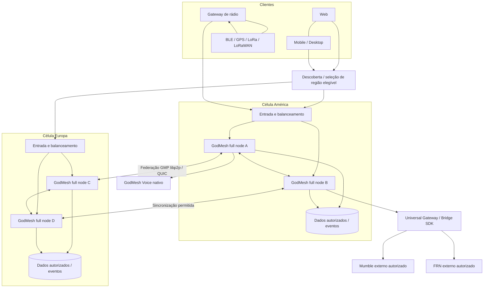

# Arquitetura de referência — GodMesh integral

> **DOCUMENTO NORMATIVO — revisão 3.0 (15/11/2026).** Em caso de divergência, este documento e as ADRs prevalecem sobre registros anteriores de brainstorming. **Estado:** arquitetura proposta, não validada em produção.

## Tese técnica
O GodMesh tem **protocolo de aplicação, identidade, roteador de capacidades e motor PTT nativos**, desenvolvidos em Rust. Reutiliza padrões de rede e bibliotecas comprovadas, não reinventa cifra/codec. Mumble e FRN são **bridges externas opcionalmente ativadas**, nunca dependências do serviço principal.

## Plataformas de entrega — ADR-055

Decisão explícita do usuário: servidor Rust distribuído em **contêiner Linux**; desktop **macOS universal Apple Silicon (arm64) e Intel (x86_64), com SwiftUI**, **Windows** e **Linux**; mobile **iOS com SwiftUI** e **Android**. O núcleo Rust e as integrações de plataforma permanecem separados.

A distribuição em contêiner não altera a diretriz de desenvolvimento: dependências como PostgreSQL e NATS no OrbStack, backend, frontend e apps executados localmente. Isso não comprova infraestrutura configurada. A imagem Linux base, arquiteturas do servidor, versões mínimas de SO, ferramentas de build e distribuição ainda precisam ser definidas.

Recomendação técnica pesquisada, ainda não aprovada como escolha específica nem validada no GodMesh: **WinUI 3** para Windows, **Qt 6 / Qt Quick / QML** para Linux e **Kotlin / Jetpack Compose** para Android. Ver fundamentos, alternativas e critérios de fechamento na [ADR-055](../06-planejamento/decisoes.md#adr-055--plataformas-de-entrega-e-seleção-de-interfaces).

## Topologia

## Cinco planos, com responsabilidade separada
| Plano | Próprio GodMesh | Meios técnicos |
|---|---|---|
| Identidade e governança | Trust, políticas, ingresso e revogação, catálogos assinados | OIDC/PKI, consenso somente para alterações que o exijam |
| Acesso e roteamento | API, localização de regiões, capacidade, sessão e autenticação | HTTP/3, HTTP/2, QUIC, WebSocket, IPv6/IPv4 |
| Domínio e eventos | Ativos, dispositivos, observações, mensagens, SOS, sync | Rust, Postgres/PostGIS, fila durável e logs de eventos |
| Mídia | Voz, canal, floor PTT, codec e distribuição | GodMesh Voice, Opus, WebRTC/RTP/QUIC quando apropriado |
| Interoperabilidade | Adaptadores e bridges isolados com políticas por rede | Mumble, FRN, ChirpStack, BLE, GPS/LTE, LoRa e futuros |

## Modelo operacional
- **Mesmo pacote funcional em cada servidor full node**, mas recursos físicos e dependências externas são observados antes de anunciar readiness.
- **Várias instâncias por região** compartilham carga; sessões de voz mantêm afinidade ao nó de mídia e admissão controlada.
- **Sem origem global única:** governança replicada com quórum restrito. Em partições, escritas críticas sem autoridade param; eventos locais permitidos continuam.
- **Espelhamento de software ≠ cópia mundial de dados privados:** replicação por tenant, classe e região conforme finalidade/autorização.
- **Bootstrap automático ≠ aprovação de desconhecidos:** chave persistente local, descoberta, atestação/convite e sincronização apenas após autorização.
- **Clientes não são full nodes:** app web/móvel contribui quando operacional, mas não é relay global persistente garantido.

## Transporte e evolução
Prioridade de IPv6 quando comprovadamente acessível, IPv4 alternativo, QUIC/TLS e transporte TCP seguro conforme política. `GMP` é independente do transporte e negocia versões/recursos. Protocolos futuros são adicionados por drivers/SDK testados, não suportados magicamente.

## Consistência e replicação
- Identidade, posse/ACL e alterações de governança: autoridade consistente por escopo, com fencing para líder/lease.
- Posições e telemetria: eventos imutáveis, idempotentes e eventual consistency.
- Mensagens/comandos/SOS: log persistente, estados de ACK por camada, replay, idempotência, TTL e escalonamento.
- Presença/health: informação efêmera com expiração; nunca base única de autorização.
- Fluxos mundiais: snapshots e eventos por escopo; não replicar bases SQL livremente entre continentes.

## Normalização universal de dados e identidade

O Universal Gateway é a coordenação lógica dos módulos de descoberta, capacidades, política e roteamento. O Bridge SDK define interfaces para bridges opcionais; o bloco conjunto no diagrama não impõe uma crate, serviço ou processo único. A UDNL conserva a responsabilidade pela normalização e projeção. Consulte as [fronteiras entre módulos](fronteiras-modulos.md); esta distinção não altera a implantação definida nas ADRs.

Todos os protocolos externos ingressam pela [UDNL](normalizacao-dados.md), que converte dados, identidades e eventos em contratos GMP com proveniência, nível de confiança e escopo de origem. A projeção de saída declara atributos que não podem ser transportados pelo destino. Áudio PTT é tratado no plano de mídia separado. Uma bridge não pode transformar nomes externos em identidades GodMesh verificadas sem prova.

## Interoperabilidade controlada
- **Mumble/FRN**: só por bridges explicitamente autorizadas, com política RX/TX, prevenção de loops, limites e consentimento; não misturar automaticamente rádio amador com tráfego empresarial.
- **ChirpStack/LoRaWAN**: dados curtos, telemetria, localização/SOS; uplink não prova GNSS, downlink enfileirado não prova recepção.
- **BLE/Smart Tags**: detecção consentida, proximidade e última localização observada; redes Apple/Google/Samsung exigem interfaces oficiais.
- **Rádios analógicos/digitais**: interfaces de áudio/PTT ou gateways próprios/autorizados; marca/protocolo não bastam para liberar transmissão.

## Regras de resiliência
A disponibilidade é por **serviço** e **rota elegível**, não por ping do servidor. Redirecionamento de HTTP não implica migração contínua de áudio. Nenhum caminho de emergência é garantido sem energia, cobertura, transporte e confirmação humana.

## Estado e governança da especificação
A arquitetura contempla o produto completo. A implementação é organizada por dependências técnicas e gates de qualidade; **nenhuma fase reduz o escopo final**. Ver [Roadmap integral](../06-planejamento/roadmap.md) e [Requisitos](../00-produto/requisitos.md).

## Transcrição multimodal e assistência SOS
Todos os canais nativos possuem chat/timeline com suporte à transcrição autorizada por política de canal. ASR fica em workers isolados e não faz parte do caminho crítico de mídia; identidade e proveniência passam pela UDNL. O serviço SOS aceita acionamento explícito via app/dispositivos compatíveis, prioriza filas reservadas, encaminha a destinatários autorizados e distingue confirmações técnicas de reconhecimento humano. Ver [Transcrição](transcricao-multimodal.md) e [SOS](../02-dominio/servico-sos.md).

## Guardian, CrowdFind e Resilient Connectivity
O smartphone GodMesh utiliza o DICE para sensores e caminhos permitidos, o [Guardian](../02-dominio/guardian-acompanhamento.md) para compartilhamento temporário e [CrowdFind](../03-integracoes/crowdfind-beacon.md) para observações opt-in via BLE. Um `Guardian Beacon` é um acessório lógico temporário na rede **própria** GodMesh; não é automaticamente membro do Apple Find My nem Google Find Hub. O [Resilient Connectivity](conectividade-contingencia-satelite.md) monitora mudanças de rede, inclusive evidências de transporte satelital quando expostas por API, e mantém prioridades de SOS/check-in/mensagens. **Ações indisponíveis por API são instruídas ao usuário, nunca fingidas como executadas.**

## Operação cotidiana, Wi-Fi colaborativo e interfaces móveis

A [operação normal do aplicativo](aplicativo-operacao-normal.md) é uma superfície do núcleo GodMesh: estados simultâneos de PTT, Guardian, SOS e conectividade, com dados locais e sincronização incremental. [Live Presence](live-presence.md) é projeção opcional para ActivityKit/Live Activities e Android Live Updates elegíveis; nenhum estado crítico é inferido apenas da apresentação no SO.

[AutoDiscover/AutoShare/AutoConnect](wifi-autodiscover-autoshare.md) operam por permissões e APIs nativas, **sem** ler senhas salvas ou publicar redes de terceiros. O [Router Agent](../03-integracoes/wifi-android-ios-roteadores.md) pode fornecer credenciais e auditoria para APs administrados. [Modelo e posição do AP](../02-dominio/wifi-modelo-dados.md) distinguem coordenadas precisas protegidas de projeções públicas: localização exata do AP só por consentimento explícito do administrador; posição de usuário em chat segue a política mínima de 50 km. [Access Registry](../02-dominio/wifi-registro-acessos.md) guarda evidências de acesso técnico, não navegação.
