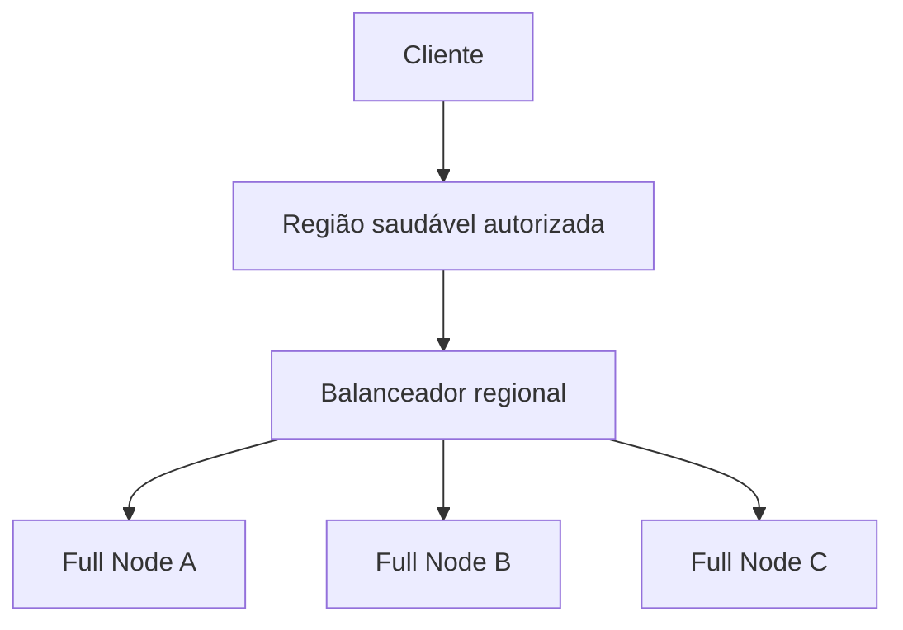

# Balanceamento, failover, autoscaling e controle de sobrecarga

## Dois níveis
1. **Global:** escolher região por política de dados, latência, saúde, proximidade e serviços necessários.
2. **Regional:** escolher full node elegível por capacidade efetiva, latência, filas e afinidade.

## Escolha de nós
Critérios obrigatórios antes da pontuação: versão e protocolo compatíveis; tenant autorizado; credenciais válidas; serviço healthy; capacidade reservada disponível; acesso a dados ou rota para obtê-los. Só então aplicar peso para RTT, carga, custo e afinidade.

Táticas: weighted least request / least connections, locality awareness, health checks, circuit breakers, outlier detection, consistent hashing por sessão/tenant, admission control, backpressure, quotas e prioridade SOS.

## Telemetria do balancer
`cpu`, `memory`, `network_egress`, `connection_count`, `active_ptt_rooms`, `audio_jitter`, `queue_depth`, `p95_latency`, `error_rate`, `db_pool_wait`, `replication_lag`, `relay_ratio`.

Os sinais acima usam a responsabilidade documental primária e interfaces do [catálogo C13 de observabilidade](../05-operacao/observabilidade.md), conforme o registro único por família na [matriz de rastreabilidade](../06-planejamento/matriz-rastreabilidade.md). O contrato transversal de freshness/readiness/admissão referencia `C13-SIG-020` (Brendan Gregg); cada sinal-fonte mantém o seu primário de domínio. Nenhum desses papéis atribui operação, on-call ou autoridade de roteamento.

Cada medida usada para selecionar ou excluir um nó precisa declarar fonte, unidade, janela, cobertura, idade e classe segura. Dado ausente, atrasado ou inválido não equivale a capacidade livre nem a saúde. Limiares, freshness, histerese e cooldown dependem de baseline e aprovação; não são valores implícitos neste catálogo.

Para cada produto e perfil de implantação, a elegibilidade deve ser verificada contra uma carga declarada nos regimes nominal, pico e degradado, não contra CPU isolada. Proposta de entrada do cenário: região/topologia autorizada, serviço/rota, população, taxa e distribuição de operações, concorrência (incluindo mídia), retenção, recurso reservado e falha exercitada. O balanceador só compara nós depois dos critérios obrigatórios e não usa custo para rebaixar requisito de autorização, residência, readiness ou capacidade reservada.

## Readiness e efeito de admissão

O balanceador consome o contrato por serviço/rota em [readiness](../05-operacao/readiness.md). Processo vivo não autoriza tráfego. `ready` somente vale para o serviço e escopo cuja evidência esteja atual e válida. `degraded`, `unready` e `unknown` são distintos: cada rota declara se admite operações novas, preserva operações existentes, drena ou rejeita com motivo/retry explícito. Falha de uma bridge não altera readiness do serviço de voz nativa.

Antes de admitir, revalidar versão/protocolo, tenant/rota autorizados, credencial, dependências requeridas e capacidade reservável, conforme critérios existentes. Resultado de dependência sem evidência não é `ready`. Ações no tráfego devem ser registradas sem payload/identidade em labels; auditoria de mudança de admissão permanece separada. A matriz por serviço, dependências, semântica de sessões existentes e critérios de recuperação requer aprovação dos owners; decisões de produto cabem ao usuário.

Para failover, região alternativa só pode receber tráfego se estiver autorizada para classe de dado/serviço, atender contrato e dispor de evidência atual. Estado `unknown` de autorização, fencing ou residência bloqueia o failover. Não mover sessões nativas ativas continuamente por variação de CPU, conforme regra já documentada. Limiares de capacidade, freshness, histerese e cooldown dependem de baseline e aprovação, não são valores implícitos neste catálogo.

## Evitar oscilação
Mínimo tempo de residência da sessão, histerese, cooldown do nó, amostragem móvel e introdução gradual de carga após retorno. Mídia **GodMesh Native** não deve migrar continuamente conforme carga da CPU. Falha do nó de mídia pode interromper chamadas ativas.

## Exclusividade de recursos
Bridge FRN e rádios físicos exigem controlador ativo único: lease renovável, fencing token monotonamente crescente, verificação no próprio conector. Evitar transmissões duplicadas.

## Escala
- **Vertical:** CPU, memória, rede, disco.
- **Horizontal intranó:** workers, instâncias Rust, pools de ingestão.
- **Horizontal inter-nós:** instalação/autorização de novo full node, sync, readiness, anúncio no registro.
- **Regional:** overflow entre regiões apenas se permitido e dentro de limite de latência/SLO.

### Cenários de seleção e capacidade (proposta)

| Regime | Evidência exigida antes de definir peso/limite | Decisão ainda necessária |
|---|---|---|
| Nominal por Personal/Teams/Node | Carga representativa aprovada para cada serviço e implantação; utilização, fila, pool wait, erros e p95/p99 com população/janela declaradas | Qual perfil de produto/topologia e população inicial constituem a referência? |
| Pico | Distribuição, concorrência, duração e mistura de operações acordadas; margem reservada para rotas essenciais e sinais de saturação por serviço | Qual pico é requisito de produto e qual margem/headroom deve permanecer disponível? |
| Degradado/failover | Perda de nó/dependência ou isolamento de região descritos; admissões, operações existentes, backlog e reconciliação separados; região alvo autorizada | Quais falhas devem ser toleradas, em qual escopo, e quais operações novas/existentes podem continuar? |

P95/p99 usados em roteamento precisam especificar se medem serviço, fila, rede ou experiência fim-a-fim, a população elegível, janela, amostra e cobertura. Proposta: não usar um quantil global para escolher região quando a classe de rota ou rede difere; publicar separadamente latência e capacidade de serviço e usar limites só após baseline e aprovação. Sem esses dados, o valor pode informar diagnóstico, mas não ser gate de admissão.

## Sobrecarga
Aplicar prioridade ao SOS, limitar streaming não essencial, atrasar tarefas de análise, reduzir anúncios, bloquear novas sessões antes de degradar sessões existentes. Se toda a capacidade global se esgotar, aplicar rejeição clara com retry/backoff, sem prometer ausência absoluta de saturação.

O limite operacional deve ser escolhido por serviço e por regime: aviso antes de consumir a reserva de capacidade; restrição de novas admissões não essenciais ao atingir o limite aprovado; preservação das operações já admitidas conforme contrato de domínio; rejeição explícita quando não houver capacidade segura. A ordem e os limites numéricos dependem de decisão do usuário/produto e dos owners de serviço; `unknown` não pode acionar overflow como se fosse capacidade livre.

## Testes
Carga sintética HTTP/WS, tráfego com sessões áudio reais, shutdown de nó, perda de uma região, partições assimétricas, retorno de servidor e introdução de um novo nó. Definir SLOs após baseline, não inventar capacidade em req/s.
