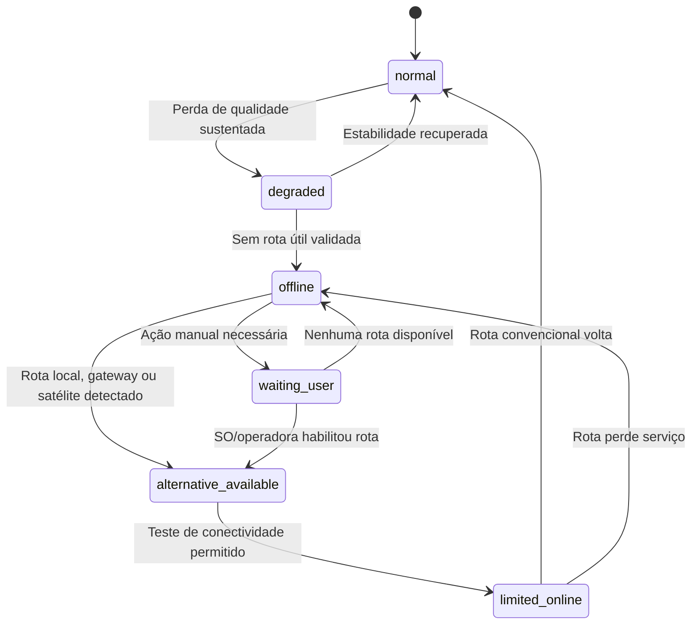

# GodMesh Resilient Connectivity — contingência móvel, satélite e autonomia

> **Versão documental 3.7.0 · ADR-045/046 · especificação proposta, não implementação.** Reúne monitoramento de sinal, mudança de rede, transportes alternativos e orientação manual. O GodMesh **não** consegue criar cobertura ou ativar uma assinatura satelital por conta própria.

## 1. Objetivo e princípios
1. Monitorar **o que APIs oficiais efetivamente revelam** sobre conectividade, operadora, sinal e estado da rota IP; nunca presumir acesso irrestrito ao modem.
2. Distinguir `radio_service_state` (registro celular), `network_path` (caminho IP), `reachability` (consegue comunicar com serviços GodMesh), `satellite_state` (disponibilidade declarada/observada) e `capability` (o que o serviço realmente suporta).
3. Preferir IPv6 quando viável; IPv4, conexão local e gateways são alternativas sem redução das garantias criptográficas.
4. Utilizar automaticamente **somente** interfaces e caminhos já disponibilizados/autorizados pelo sistema operacional, roteador, operadora ou usuário.
5. Se a operação requer configurações de sistema, plano de operadora, orientação do aparelho ou ação sobre outros aplicativos, **explicar o passo a passo ao usuário**; não tentar modificar as preferências sem autorização.
6. Em modo Guardian/SOS: preservar ações essenciais, mapas, localização, contatos e acesso às funções oficiais de emergência. Não orientar a desligar indiscriminadamente todos os aplicativos.

## 2. Classes de caminho
| Classe | Exemplos | Detecção | Limite |
|---|---|---|---|
| `terrestrial_cellular` | 4G/5G e dados móveis | Android: telefonia e `ConnectivityManager`; iOS: `NWPath` e parte das informações do CoreTelephony | Nem sempre possível obter operadora, RSSI, tecnologia ou motivo da queda |
| `wifi_ip` | Wi-Fi comum, inclusive Starlink com terminal/roteador próprio | Interface Wi-Fi e testes de conectividade | **Wi-Fi Starlink é diferente de Direct-to-Cell**; o app não pode identificar provedor de internet com segurança só pelo SSID |
| `local_peer` | BLE, Wi-Fi Aware, LAN | APIs locais, permissões e discovery consentido | Não equivale a internet, descoberta pode ser limitada em background |
| `radio_gateway` | LoRa, LoRaWAN, rádios via gateway | Bridge/gateway autorizado | LoRaWAN convencional não oferece voz PTT de tempo real |
| `satellite_carrier` | Operadora com satélite direct-to-device | Android: `TRANSPORT_SATELLITE` em versões compatíveis, se declarado; iOS: detecção limitada via APIs públicas, observação pelo usuário/OS | Disponibilidade e tráfego de aplicativos dependem de operadora, aparelho, plano, região e política da rede |
| `satellite_terminal_wifi` | Terminal satelital externo com Wi-Fi | Wi-Fi/IP normal | Não pressupor que um terminal existe ou tenha energia |
| `unknown` | Indícios incompletos | Não inventar classificação | Solicitar confirmação manual quando apropriado |

## 3. Máquina de estados do gerenciador

- Critérios por janela temporal e histerese; não entrar em oscilação com RSSI variável.
- `no_service` não é sinônimo de `no_internet`: uma rede celular pode perder sinal e Wi-Fi continuar funcionando.
- Uma rota satelital pode atender **mensagens selecionadas**, mas não áudio PTT, anexos nem toda API. O app deve testar elegibilidade do **serviço** e mostrar `limited_online`.
- Falha de conexão não prova que existe satélite disponível. É proibido anunciar “Starlink ativado” a partir de simples perda de 4G.

## 4. Automação versus intervenção manual
| Operação | GodMesh faz | Usuário faz quando necessário |
|---|---|---|
| Monitorar qualidade da rota GodMesh | Sim, a partir de callbacks e probes leves autorizados | Conceder permissões opcionais |
| Observar troca de operadora/tecnologia | Quando a API revelar, com consentimento e sem rastreamento de terceiros | Conferir o indicador do sistema quando não houver API |
| Mudar o tráfego **do GodMesh** para rota IP elegível | Sim, onde o SO disponibilizar transporte e política permitir | Selecionar Wi-Fi/rede manualmente quando necessário |
| Ativar operadora/assinatura satelital | **Não**, via aplicativo de terceiros comum | Verificar compatibilidade, plano e opções da operadora/sistema |
| Abrir preferências de economia de energia | Android: encaminhamento para ajustes disponíveis; iOS: instruções apropriadas | Ativar/desativar modo de economia |
| Fechar outros aplicativos/alterar seus dados em background | **Não** como ação genérica | Interromper streaming/downloads/sincronizações opcionais, sem interromper navegação ou recursos essenciais |
| Limitar consumo **do próprio GodMesh** | Sim | Escolher perfil e autorizar compromissos de qualidade |
| Acionar SOS de terceiros/serviços públicos | Somente integrações oficiais homologadas | Utilizar funções oficiais de emergência do telefone quando necessário |

### Exemplos de mensagens de UI
- **Conexão limitada:** “A conexão móvel está instável. O GodMesh continuará tentando entregar suas mensagens e mostrará o último envio confirmado.”
- **Sem conectividade:** “Não há rota GodMesh disponível agora. As mensagens pendentes serão armazenadas com segurança neste aparelho.”
- **Satélite possivelmente disponível:** “Seu telefone ou operadora pode oferecer conexão satelital. Consulte o indicador e as opções oficiais do aparelho. O GodMesh ainda não confirmou que este serviço pode transmitir dados do aplicativo.”
- **Satélite em uso pelo SO:** “O sistema indica uma conexão de satélite. Somente funções compatíveis serão habilitadas; envio e recebimento podem sofrer atrasos.”
- **Economia de energia:** “Considere ativar o modo de economia de bateria e pausar downloads/streaming. Mantenha ativos o GodMesh, o mapa e os meios essenciais de comunicação.”
- **SOS:** “Pedido salvo neste aparelho. Ainda não há confirmação de entrega. Se houver uma função oficial de emergência disponível, utilize-a para buscar atendimento.”

A UI não deve exibir um comando “ativar Starlink agora” quando inexiste integração oficial e autorizada; mostrar `Abrir configurações` somente quando houver caminho suportado e `Como ativar manualmente` nos demais casos.

## 5. Política de transmissão por prioridade
| Classe | Exemplo | Política com link muito limitado |
|---|---|---|
| `emergency` | SOS explícito e confirmação de atendimento | Maior prioridade, payload mínimo, retries controlados, estados de entrega honestos |
| `safety` | Check-in Guardian e posição para contatos autorizados | Dados compactos, cadência reduzida e frescor explícito |
| `essential` | Mensagens curtas, controle do canal | Armazenamento e envio quando rede permitir |
| `interactive` | Voz PTT | Suspender/indicar indisponível se link não suportar qualidade necessária |
| `bulk` | Mídia, anexos, ASR remoto, telemetria frequente | Pausar automaticamente dentro do próprio GodMesh |

Um satélite pode permitir apenas mensagens SMS ou aplicativos previamente aprovados pela operadora. Nesses casos **não há obrigação de conseguir enviar GMP pela conexão**, mesmo que o telefone mostre sinal satelital.

## 6. Implementação Android/iOS
**Android:** `ConnectivityManager.NetworkCallback`, `NetworkCapabilities` (incluindo `TRANSPORT_SATELLITE` quando disponível), `TelephonyCallback.ServiceStateListener` e `SignalStrengthsListener` conforme permissão, plano/eSIM e versão. Não obter IMEI nem localização de célula sem necessidade. `ACTION_BATTERY_SAVER_SETTINGS` pode abrir a tela de ajustes, não habilita automaticamente a opção para o app. `SatelliteManager` tem APIs condicionadas a versão/permissões; não garantir acesso universal.

**iOS:** `NWPathMonitor` e controles de rede cara/restrita orientam o consumo do próprio app; `CoreTelephony` expõe informações celulares limitadas e variáveis. Não há API geral garantida para ativar conexão satelital ou detectar com certeza a marca Starlink. Apresentar ajuda manual baseada em aparelho/versão/operadora, conferida pelo usuário; em iPhones compatíveis, a conexão de operadora pode indicar `SAT` na barra de status.

**Núcleo Rust:** `connectivity-observer` recebe eventos de bindings Kotlin/Swift; `route-policy`, `link-budget`, `manual-action-advisor`, `offline-outbox` e `sync-reconciler` compartilham GMP e estados. O código Rust não contorna permissões da plataforma.

## 7. Privacidade e observabilidade
- Logs locais de alteração de operadora devem ser minimizados: sem IMSI, ICCID, números de telefone, IDs de torres ou históricos precisos de localização, salvo finalidade explícita e autorizada.
- Metadados de conectividade não entram no chat público; status de conectividade compartilhado com contatos Guardian somente por política.
- Acompanhamento Guardian e SOS mantêm a separação entre localização pública aproximada >= 50 km e posição precisa restrita aos contatos/atendentes autorizados.
- Indicadores: latência por transporte, custo/limite conhecido, taxa de tentativas, idade da última entrega confirmada, uso de energia pelo próprio app e erros de mudança de rota.
- Indicador `satellite_detected` terá `verification_method=platform_api|system_hint|user_report|unknown`, sem afirmar uma certeza superior à fonte.

## 8. Referências técnicas oficiais
- Android `NetworkCapabilities.TRANSPORT_SATELLITE`: https://developer.android.com/reference/android/net/NetworkCapabilities
- Android `TelephonyCallback`: https://developer.android.com/reference/android/telephony/TelephonyCallback
- Android `SatelliteManager`: https://developer.android.com/reference/android/telephony/satellite/SatelliteManager
- Android configurações de bateria: https://developer.android.com/reference/android/provider/Settings
- Apple `CTTelephonyNetworkInfo`: https://developer.apple.com/documentation/coretelephony/cttelephonynetworkinfo
- Apple conexão satelital de operadoras: https://support.apple.com/en-us/122339
- Apple `URLSessionConfiguration` para redes restritas: https://developer.apple.com/documentation/foundation/urlsessionconfiguration/allowsexpensivenetworkaccess
- Apple economia de energia: https://support.apple.com/guide/iphone/iphcab9aecd1/ios
- Exemplo de serviço de operadora com satélite: https://www.t-mobile.com/coverage/satellite-phone-service

## Documentos relacionados
- [GodMesh DICE](cliente-mobile-sensores-conectividade.md)
- [GodMesh Guardian](../02-dominio/guardian-acompanhamento.md)
- [SOS](../02-dominio/servico-sos.md)
- [Contrato de eventos](../07-contratos/conectividade-contingencia.md)
- [Testes móveis](../05-operacao/testes-mobile-guardian.md)
