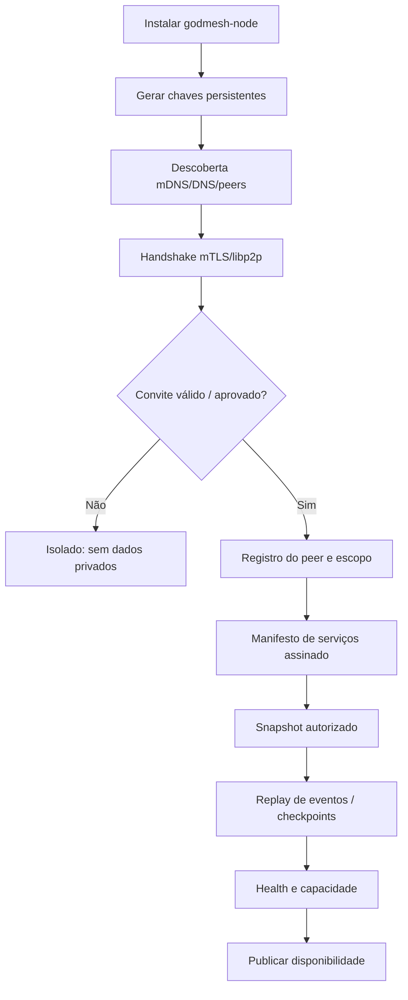

# Protocolo de descoberta, ingresso e autoativação (`mesh-join`)

## Definição de autoativação
A instalação gera identidade e serviços locais automaticamente. **Participação na federação requer autorização** por convite de curta validade, atestação ou credencial pré-provisionada. Não aceitar nós anônimos como réplicas de dados privados.

## Estados do nó
`initializing → discovering → awaiting_authorization → joining → synchronizing → ready` (estados transitórios `degraded`, `isolated`; terminal `revoked`).

## Registros necessários
`node_id`, `peer_id`, `public_key`, `cluster`, `region`, `tenant_scopes`, `trust_state`, `software_version`, `capabilities`, `endpoints`, `epoch`, `last_seen_at`, `join_attestation`.

## Fluxo mínimo
1. Instalação em Linux; criar diretório local, keystore com permissões restritas, identidade Ed25519.
2. Descobrir vizinhos locais, seeds públicos e relays; não confiar em informações de peers não autenticadas.
3. Negociar protocolo de federação e credenciais; validar convite e políticas de associação.
4. Receber `join_certificate` ou equivalente com escopos e validade; registrar revogações.
5. Baixar manifesto e configurações assinadas; subir stack e dependências.
6. Baixar snapshot consistente **escopado** com hash e checkpoint; aplicar eventos posteriores.
7. Passar readiness, anunciar capacidade e começar a receber novas sessões.

## Falhas e segurança
- Token de convite: curto, escopo mínimo, uso único quando viável, replay bloqueado.
- Revogação: invalidação de conexões, leases, rotação de segredos e políticas persistidas mesmo offline.
- Sem quórum: impedir alterações de governança; permitir apenas operações locais explicitamente previstas.
- Manifestos de atualização: assinaturas, versionamento, rollout gradual e rollback.
- Clocks dessincronizados e DNS malicioso: nunca depender só do horário ou DNS para autenticidade.

## Contratos de API propostos
`POST /v1/federation/join-requests`, `GET /v1/federation/manifests/current`, `POST /v1/federation/attest`, `GET /v1/federation/peers`, `POST /v1/federation/leave`.
