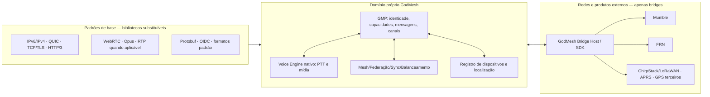

# Estratégia tecnológica nativa e evolução futura — GodMesh

> **Normativo — 3.1.0 (15/11/2026).** Define o que significa **protocolo próprio**, como incorporar padrões novos e onde termina a arquitetura GodMesh e começam redes externas. Esta é uma **decisão de projeto**, ainda não uma implementação concluída.

## Tese técnica e propriedade do produto

**GodMesh tem tecnologia própria na camada de aplicação e na orquestração, mas reutiliza protocolos abertos, implementações maduras e padrões criptográficos de mercado.** A inovação pertence ao *contrato semântico e operacional*: identidade, capacidade, autorização, descoberta de serviços, presença, roteamento, canais, sessões, PTT, sincronização, failover, federação, gestão de dispositivos e SDKs.

Não se pretende reinventar IPv4, IPv6, QUIC, HTTP, TLS, WebRTC, Opus, Protobuf, criptografia, codecs ou espectro de rádio. Esses padrões formam a base técnica evolutiva da plataforma.

**Independência operacional obrigatória:** contas GodMesh, dispositivos GodMesh, serviços nativos, canais, mensagens e voz PTT devem funcionar sem instâncias Mumble, FRN, ChirpStack, servidores APRS ou qualquer plataforma externa. As integrações com esses sistemas são **bridges/adaptadores de fronteira, opcionais, isolados e autorizados**.

## Três zonas de arquitetura



### Zona A — Domínio nativo obrigatório
- **GMP:** especificação pública e versionada de mensagens, identidade, canal, sessão, recursos, erros e autorização.
- **GodMesh Voice:** controla PTT e distribui mídia de forma nativa; não chama servidores Mumble/FRN para conversas entre clientes GodMesh.
- **GodMesh Federation:** nós independentes, descoberta e ingresso autorizados, sincronia seletiva, roteamento regional e operação offline.
- **GodMesh Universal Gateway:** perfis e capacidades, políticas, serviços, dispositivos, rotas e interoperabilidade.

### Zona B — Padrões e bibliotecas de infraestrutura
São dependências tecnológicas **substituíveis** sob interfaces próprias, não sistemas externos que governam a experiência do usuário. Exemplos:

| Capacidade de base | Política de adoção |
|---|---|
| IP | IPv6 preferencial com IPv4 funcional; ambos testados |
| Transporte P2P | QUIC/TLS 1.3 quando disponível; TCP seguro como fallback, relays conforme necessidade |
| Evolução QUIC | Negociar versões realmente implementadas, inclusive QUIC v2 **somente se** a biblioteca de produção suportar e passar nos testes; nunca declarar suporte por desejo |
| Web e API | HTTPS, HTTP/2 e HTTP/3; WebSocket para controle compatível; avaliar WebTransport por maturidade e suporte real |
| Voz web | WebRTC + Opus; não desenvolver codec ou criptografia própria |
| Mensageria binária | Protobuf/schema versionado, limites e validação de entrada |
| Segurança | TLS, PKI/identidades, OIDC; investigar MLS para E2EE em grupos, com análise de ameaças e compatibilidade |
| Infra Rust | Tokio/Axum, rust-libp2p quando apropriado; alternativas possíveis atrás de traits/contratos estáveis |

**Moderno não significa experimental por padrão:** padrões novos entram primeiro como candidatos, passam por avaliação de suporte, conformidade, segurança e custo, e só então tornam-se obrigatórios ou preferenciais.

### Zona C — Sistemas terceiros: bridges de fronteira
Mumble e FRN são os **primeiros alvos de interoperabilidade**. ChirpStack, LoRaWAN, redes LoRa, gateways BLE, APRS e serviços GPS entram por adaptadores específicos. São integrações opcionais, não partes fundacionais da tecnologia GodMesh.

- Cada bridge executa fora do plano crítico de comunicação nativa e possui credenciais, políticas e quotas independentes.
- Conexões com servidores externos demandam autorização e conformidade; descoberta **não** concede permissão de transmissão.
- Uma bridge pode mapear entidades externas para IDs GodMesh, mas **não** pode alterar unilateralmente identidade, autoridade de canal ou regras de permissão do núcleo.
- Falhas, indisponibilidade, licenciamento ou versões dos sistemas externos são isolados; roteamento nativo segue operacional.
- Transformação de mídia pode exigir decodificação no gateway e comprometer E2EE; isso deve ser explícito na UX e nas políticas.
- Bridges não formam ciclo de retransmissão automática: rastreamento de origem, TTL/hop limit, deduplicação e TX supervisionado.

## Protocolo GMP — evolução projetada

**Os nomes GMP abaixo designam semânticas de aplicação, não um transporte físico proprietário.** O wire format concreto será especificado antes do desenvolvimento com contratos Protobuf e testes de conformidade.

1. **Identificação e handshake:** validar peer e autorização, anunciar `protocol_versions`, `features`, `media_codecs`, `transport_options`, políticas e limites. Proteção contra downgrade é obrigatória.
2. **Negociação compatível:** escolher a versão mutuamente suportada e **mais segura**, com regras `required`/`optional` por recurso; ignorar campos opcionais desconhecidos sem rejeitar toda conexão.
3. **Separação dos planos:** controle, eventos, mídia e federação possuem semânticas distintas, canais e budgets de tráfego específicos.
4. **Agregação por capacidades:** uma feature nova só aparece ao cliente quando o suporte é implementado, verificado, autorizado e operacional.
5. **Contratos estáveis:** compatibilidade com pelo menos a versão anterior quando viável, depreciação anunciada, migrações de schema, rollout progressivo e rollback seguro.
6. **Negociação independente do transporte:** se QUIC não estiver disponível, uma sessão compatível pode usar TCP/TLS, HTTP ou um relay autenticado sem redefinir a semântica GMP; mídia usa caminhos adequados à latência.
7. **Trânsito privado:** nenhum nó deve publicar dados de localização, credenciais ou áudio em discovery/gossip público.

### Esboço de anúncio de recursos (ilustrativo)

```json
{
  "gmp": {"supported_versions": ["1.0"], "required_features": ["auth.v1"]},
  "features": ["ptt.floor.v1", "voice.opus.v1", "device.location.v1"],
  "transports": ["quic", "tcp-tls"],
  "ip_families": ["ipv6", "ipv4"],
  "extensions": [{"namespace": "org.godmesh.bridge", "version": "1"}]
}
```

É um exemplo de **manifesto semântico**: não corresponde à API concreta de bibliotecas e não prova suporte efetivo a nenhuma funcionalidade.

## Interface de extensibilidade

- **Transport Provider:** implementações de enlace com contratos de conexão autenticada, erro, QoS e observabilidade.
- **Media Provider:** codecs/transportes suportados, parâmetros negociados, auditoria e limites de jitter/latência.
- **Device Adapter:** identificação, capacidades declaradas/verificadas, comandos, telemetria e políticas.
- **Bridge Provider:** conversão de sistemas externos sob isolamento; TX negado por padrão até autorização explícita.
- **Runtime de extensão:** preferir processo isolado com RPC autenticado, limites e atualizações assinadas; não executar código externo arbitrário dentro do nó privilegiado.

## Garantias e testes exigidos

1. **Teste de independência:** com Mumble, FRN e ChirpStack desligados, dois clientes nativos trocam voz/mensagens e o servidor executa controle/localização.
2. **Teste de múltiplas versões:** cliente antigo e servidor novo negociam versão e recursos compatíveis, com rejeição segura de downgrade.
3. **Teste dual-stack:** rede IPv6-only, IPv4-only e dual-stack com fallback e mudanças de endereço.
4. **Teste de falha externa:** bridge travada, sem permissão ou desconectada não afeta a saúde dos serviços internos.
5. **Teste de extensão nova:** adicionar um protocolo por adaptador versionado, sem alterar as entidades e regras de domínio.
6. **Teste de segurança:** credenciais segregadas, autorização e auditoria, isolamento de processos, fuzzing dos parsers e anti-loop.
7. **Teste de rollout:** atualização assinada, versões mistas, rollback e rejeição explícita de features não suportadas.

## Padrões e referências de acompanhamento

- [QUIC RFC 9000](https://www.rfc-editor.org/rfc/rfc9000.html); [QUIC v2 RFC 9369](https://www.rfc-editor.org/rfc/rfc9369.html); [negociação QUIC RFC 9368](https://www.rfc-editor.org/rfc/rfc9368.html)
- [HTTP/3 RFC 9114](https://www.rfc-editor.org/rfc/rfc9114.html); [QUIC DATAGRAM RFC 9221](https://www.rfc-editor.org/rfc/rfc9221.html)
- [libp2p — negociação de protocolos](https://libp2p.io/docs/protocols/); [MLS RFC 9420](https://www.rfc-editor.org/rfc/rfc9420.html)

Ver também [Protocolo nativo](protocolo-nativo.md), [Transporte](transporte.md), [Bridges](../03-integracoes/bridges-voz.md) e [ADRs](../06-planejamento/decisoes.md).
