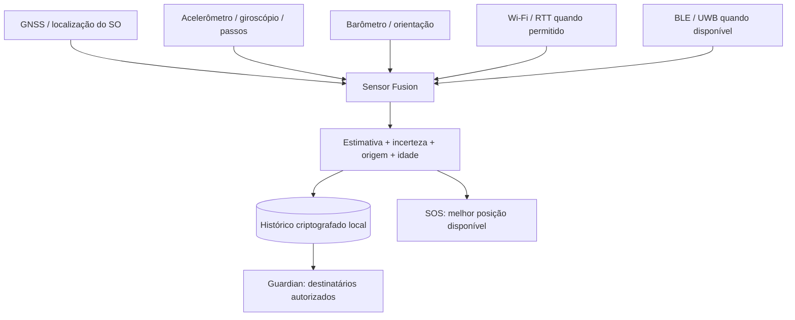

# GodMesh Guardian — localização e estimativa de trajetória

> **Especificação técnica proposta.** Não confundir cálculo de trajetória com localização de precisão garantida. Informar sempre fonte, confiança e idade da informação.

## Objetivo
Aumentar continuidade da rota de uma sessão Guardian usando fusão de sinais acessíveis no smartphone, com processamento preferencialmente no dispositivo e sincronização seletiva. GNSS é referência principal a céu aberto; Wi-Fi/BLE/IMU ajudam apenas quando presentes, autorizados e com qualidade suficiente.

## Pipeline

## Regras de qualidade
- Cada observação possui `observed_at`, `received_at`, `source`, `accuracy_m` ou distribuição de incerteza, `quality_flag` e nível de confiança.
- GNSS recente de boa qualidade geralmente precede posição derivada; dados antigos jamais são rotulados como localização atual.
- Pedestrian dead reckoning (PDR) e integração inercial apresentam **erro crescente com o tempo**; estimativas offline devem aumentar incerteza e exibir último ponto confirmado.
- RSSI de Wi-Fi/BLE indica sinal, não posição exata nem orientação; o “360°” é cobertura de descoberta ao redor, **não** mapa confiável do ângulo dos roteadores.
- Wi-Fi RTT, UWB e outras medições de distância dependem de aparelhos/APs e permissões compatíveis; não são universalmente disponíveis.
- Dados de APs ou beacons externos não serão publicados com BSSID, SSID, MAC ou coordenadas brutas para outros usuários. Só coletar dados necessários com consentimento e política de minimização.
- Rotas e geofences são processadas com tolerâncias e avisos; localização em atraso nunca é interpretada automaticamente como abandono, lesão ou SOS.

## Privacidade por destino
| Destino | Representação permitida |
|---|---|
| Chat/PTT comum | Região generalizada consentida com raio >= 50 km; nunca rota precisa |
| Contatos Guardian aceitos | Trajeto com precisão escolhida e expiração do acesso |
| Serviço SOS autorizado | Melhor posição e incerteza disponíveis, segregadas do chat |
| Bridges Mumble/FRN | Nenhuma localização precisa por padrão |
| Analítica global | Agregados estritamente necessários e políticas de retenção |

## Processamento e consumo
`adaptive_sampling` aumenta intervalo de captura quando imóvel/bateria baixa e reduz quando uma sessão ativa exige dados recentes, dentro das permissões do SO. Não pressupor varredura contínua em segundo plano. Definir orçamento de energia e limites de armazenamento offline.

## API conceitual
`POST /v1/guardian/sessions/{id}/observations` recebe lote autenticado, com `location_source`, `measured_at`, `accuracy_m`, `coordinate_ref`, `sensor_quality`. Coordenadas precisas são criptografadas/segregadas; a API geral de chat não aceita esse conteúdo.

## Dependências
- [DICE: matriz de capacidades](cliente-mobile-sensores-conectividade.md)
- [Compartilhamento temporário](../02-dominio/guardian-acompanhamento.md)
- [Política de localização](../04-seguranca/politica-localizacao.md)
- [Privacidade CrowdFind](../04-seguranca/privacidade-crowdfind.md)
