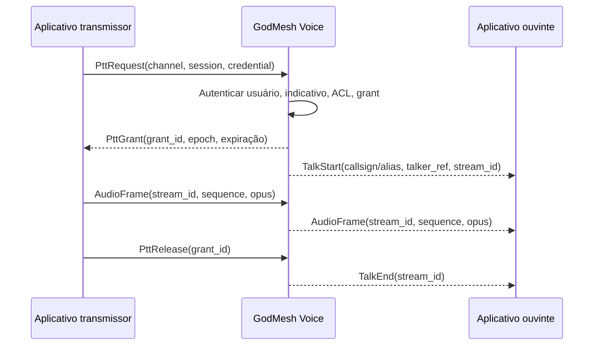

# GMP — Identificador pseudônimo em mensagens e PTT

> **Status:** especificação de arquitetura, sem implementação concluída. **ADR-036**. Data: 2026-11-15.  
> Complementa [GMI / GMC](../02-dominio/indicativos-digitais.md), [GMP](protocolo-nativo.md) e [Voice](midia-nativa.md).

## Decisão

**Identificar a pessoa uma vez na sinalização de uma sessão e transportar uma referência curta nos pacotes de áudio.** Nas mensagens persistentes, incluir o indicativo/alias público e a comprovação criptográfica necessária, sem colocar identificadores internos, nome civil ou e-mail no envelope compartilhado.



## Identificadores e responsabilidades

| Campo | Padrão | Finalidade |
|---|---|---|
| `callsign` | Código GMC público ou alias de contexto | Exibição de quem fala |
| `talker_ref` | Token de curta duração e autenticado | Associar sessão ao emissor |
| `stream_id` | ID compacto por fluxo, único no contexto de conexão/canal | Demultiplexação de pacotes |
| `channel_id` | UUID/identificador do canal | Autorização |
| `grant_id` + `epoch` | Concessão PTT e geração de controle | Impedir transmissão sem direito e líderes obsoletos |
| `sequence` | Inteiro crescente por fluxo | Reordenação/perda e anti-replay |
| `message_id` | UUID global | Idempotência de mensagens persistentes |

O indicativo estável **não** deve aparecer em todos os pacotes de mídia ou ser colocado diretamente em RTCP CNAME, SSRC, endereços de IP ou nomes de transporte. Em clientes WebRTC, RTP/RTCP usa SSRC como origem de fluxo; o GodMesh associa esse SSRC a `stream_id` e indicativo durante sinalização autenticada (RFC 8834). Caso necessário, extensões RTP negociadas seguem RFC 8285; não presumir que toda extensão RTP oculta metadados de todos os intermediários.

## Mensagem confiável (exemplo lógico)

```json
{
  "protocol": "gmp.message.v1",
  "message_id": "019a0000-0000-7000-8000-000000000001",
  "channel_id": "channel-example",
  "from_callsign": "GM-7K4P-9R2Q-X",
  "created_at": "2026-11-15T18:00:00Z",
  "content": {"type": "text", "value": "Ponto de encontro confirmado"},
  "auth": {"credential_ref": "cred-example", "proof": "<prova-verificavel>"}
}
```

O modelo real criptografa conteúdos quando a política requer, aplica integridade também aos campos externos relevantes e autentica a origem antes de distribuir. A assinatura ou MAC cobre conteúdo canônico, `message_id`, canal, emissor, destinatários/escopo, expiração e proteção contra replay, conforme o modelo de chaves escolhido.

## Voz PTT por QUIC (nativo)

- Plano de **controle confiável**: `TalkStart`, concessão, credencial/associação e `TalkEnd`, em QUIC stream protegido ou outro canal de sinalização autenticado.
- Plano de **mídia em tempo real**: `AudioFrame` com `stream_id` compacto, número de sequência, timestamp relativo e Opus em QUIC DATAGRAM (RFC 9221), quando negociado e suportado; sem retransmissão automática de áudio antigo.
- **Robustez**: o receptor armazena o mapeamento `stream_id → (talker_ref, callsign, channel)` temporariamente. Em perda de `TalkStart`, o servidor repete sinalização e o cliente pode solicitar `WhoIsSpeaking(stream_id)` de modo autenticado; não anunciar identidade inexistente.
- **PTT half-duplex**: a mídia é aceita apenas com grant vigente, epoch correto, ACL e stream associado.
- Quando WebRTC for usado: mapear `SSRC/track → stream_id` na sinalização segura. RTP header extension **não é obrigatória** e não deve carregar a identidade civil ou `gmi_id`.

## Envelope binário proposto (não definitivo)

```text
AudioFrame v1:
  protocol_version : varint
  frame_type       : varint
  stream_id        : varint
  sequence         : varint
  timestamp_delta  : varint
  flags            : varint
  opus_bytes       : bytes restante
```

A criptografia é provida pelo transporte ou pela camada de mídia apropriada; o protocolo aplicativo precisa vincular `stream_id` à sessão autenticada e rejeitar frames reusados, de origem inadequada ou de grants expirados. Tamanhos, MTU, prioridades, multiplexação e codec negotiation exigem testes.

## Redes e bridges externas

| Destino | Metadados GodMesh | Limitação |
|---|---|---|
| GodMesh nativo | GMC ou alias e referência curta | Suporte completo sob nossa especificação |
| WebRTC | Associar identidade por sinalização a SSRC/track | Não substituir SSRC por UUID ou indicativo permanente |
| Mumble Bridge | Associar indicativo a usuário/sessão da bridge | Protocolo externo decide o que é exibível; session ID muda na reconexão |
| FRN Bridge | Associar indicativo ao campo de usuário/indicativo permitido | FRN tem autenticação/identificação próprias; não há extensão arbitrária garantida |
| Rádio analógico FM | Sem metadados digitais de identidade por padrão | Não prometer identificação automática no aparelho sem canal de dados/equipamento compatível |
| Radioamador externo | Indicativo legal continua obrigatório quando aplicável | GMC não substitui identificação legal de estação |
| LoRaWAN | Mensagem de dados compacta, limitada por classe/região/payload | Não supor PTT de voz em tempo real |

Bridges devem possuir identificação `bridge_id`, vínculo autorizado, limites de hop e deduplicação; não podem inventar identidade verificada para participantes externos.

## Proposta de mensagens Protobuf (esboço)

```protobuf
syntax = "proto3";
package godmesh.gmp.media.v1;

message TalkStart {
  string channel_id = 1;
  string callsign = 2;
  uint32 stream_id = 3;
  bytes talker_ref = 4;
  bytes credential_proof = 5;
  string grant_id = 6;
  uint64 epoch = 7;
}

message TalkEnd {
  uint32 stream_id = 1;
  string grant_id = 2;
}

message MessageEnvelope {
  string message_id = 1;
  string channel_id = 2;
  string from_callsign = 3;
  bytes encrypted_or_plain_payload = 4;
  bytes authentication_proof = 5;
}
```

Especificação demonstrativa: para produção, usar tipos/IDs normalizados, versionamento, deadlines, saltos e regras formais de assinatura, expiração e esquemas.

## Testes obrigatórios

1. Transmissor real é exibido pelo GMC/alias mesmo após mudança de servidor; conta não expõe PII por padrão.
2. Indicativo falsificado, grant vencido, `stream_id` não vinculado e replays são rejeitados.
3. Perda e reordenação de pacotes não altera quem é exibido como transmissor.
4. Troca de canal invalida tokens antigos; retomada de sessão obtém novo `stream_id`/credenciais efêmeras.
5. WebRTC identifica por sinalização (SSRC/track) sem ID permanente em RTCP.
6. Bridge Mumble/FRN desabilitada não afeta PTT GodMesh; bridge de saída mostra apenas as identidades aceitas no sistema externo.
7. Canais com alias de contexto impedem exposição casual do GMC persistente e deixam explícita a política de responsabilização.

## Referências técnicas

- [RFC 9221 — QUIC DATAGRAM](https://www.rfc-editor.org/rfc/rfc9221.html)
- [RFC 8834 — RTP/WebRTC e identificação de fonte SSRC](https://www.rfc-editor.org/rfc/rfc8834.html)
- [RFC 8285 — RTP Header Extensions](https://www.rfc-editor.org/rfc/rfc8285.html)
- [Mumble — identidade temporária de sessão em áudio](https://github.com/mumble-voip/mumble/blob/master/docs/dev/network-protocol/voice_data.md)
- [FRN — formato e identificação de conta](https://freeradionetwork.eu/frnprotocol.htm)
