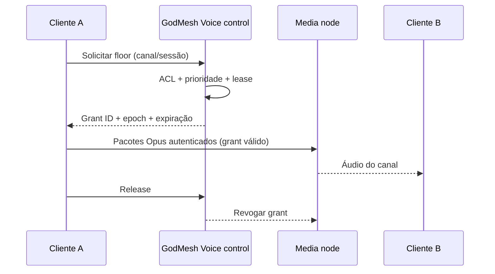

# GodMesh Voice — sistema nativo de voz, canais e PTT

> **Normativo:** Mumble e FRN não participam do caminho obrigatório GodMesh ↔ GodMesh. Especificação de engenharia, ainda não produto validado.

## Componentes
- `godmesh-voice-control`: autenticação de sessão, políticas de canal, prioridade e concessão do floor.
- `godmesh-media-edge`: ingestão/distribuição Opus, jitter buffer, controle de fluxo, métricas e moderação.
- `godmesh-media-router`: posicionamento e afinidade de sala, capacidade, reconexão e drenagem.
- `godmesh-bridge-host`: conecta bridges externas através de interface autenticada; isolamento de processo e autorização RX/TX.

## Transporte de mídia
O app web utiliza **WebRTC (Opus)** para compatibilidade de navegador. Aplicativos móveis/desktop podem usar WebRTC ou outro transporte nativo versionado que passe em testes de segurança, migração de rede e QoS. O plano de controle usa GMP. **Gossipsub/NATS não são o caminho de cada pacote de áudio.**

## Quem está falando: indicativo GMC
No início da transmissão, `TalkStart` vincula indicativo GMC (ou alias de canal), sessão, `stream_id` efêmero e grant autenticado. Frames de áudio enviam referência curta, sequência e codec, não dados pessoais nem UUID permanente. Em WebRTC, o mapeamento SSRC/track → indicativo ocorre por sinalização. Consulte [Transporte de identidade em mídia](identificacao-midia-mensagens.md).

## Fluxo PTT

## Invariantes
1. Em canal **half-duplex**, apenas um grant TX válido por domínio de arbitragem, com geração/epoch e expiração; o media edge também valida o grant.
2. Mudanças de autoridade exigem fencing; a perda de controle impede TX externo novo, não cria dois transmissores.
3. Controle PTT e voz podem degradar de maneira diferente; eventos e SOS não dependem do codec.
4. Canais têm políticas para público/privado, organização, operação profissional e amador, com isolamento e identidades verificadas.
5. `bridge_id`, `origin`, `hop_limit`, deduplicação e políticas de não-retorno evitam ciclos entre redes.
6. Mídia pode precisar de reconexão após falha da máquina; não prometer troca inaudível.
7. Áudio e gravação têm permissões específicas, consentimento quando exigido e retenção controlada.

## Planejamento de capacidade
Posicionamento de sala por latência, egress, perda/jitter, quantidade de clientes e CPU; sticky sessions enquanto sessão ativa. Números máximos de salas/usuários serão definidos por benchmark real, não por suposição.

## Criptografia
TLS/DTLS protege mídia em trânsito conforme transporte. Se uma bridge precisa transcodificar, normalmente acessará áudio legível; **não declarar E2EE preservada entre redes externas**. Avaliar E2EE real para canais nativos com requisitos e modelo de chaves próprios, antes de qualquer promessa de produto.

## APIs complementares
- `CreateChannel`, `JoinChannel`, `LeaveChannel`.
- `RequestFloor`, `ReleaseFloor`, `RevokeFloor` com `grant_id`, `epoch`, TTL e razão.
- `CreateMediaSession`/`ResumeMediaSession` com limites de reconexão.
- `BridgeAttach` somente por política de operador e auditoria.

## Aceitação
Dois clientes nativos estabelecem voz PTT via GodMesh sem Mumble/FRN; prioridades, expiração e failover são testados; bridges são desligáveis e não causam impacto no núcleo.

## Transcrição e chat por canal
O motor Voice expõe áudio permitido a um worker ASR separado, sempre por política de canal, sem transportar frames no barramento persistente. `TalkStart` fornece o autor GMC ou a origem de bridge escopada. Falha de transcrição não pode degradar o PTT. Ver [Transcrição multimodal](transcricao-multimodal.md).

## SOS e prioridade PTT
Um incidente pode criar canal auxiliar e solicitar prioridade de fala conforme ACL e regras de rádio; SOS estruturado independe de ASR. Ver [SOS](../02-dominio/servico-sos.md).

