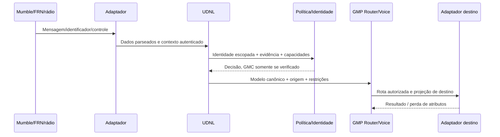

# GodMesh — Universal Data Normalization Layer (UDNL)

> **Status:** decisão arquitetural oficial, ainda não implementada. **ADR-037**. Data: 2026-11-15. Complementa [Arquitetura de referência](arquitetura-referencia.md), [Universal Gateway](../03-integracoes/gateway-universal.md), [GMP](protocolo-nativo.md), [GMC](../02-dominio/indicativos-digitais.md), [Identificação em mídia](identificacao-midia-mensagens.md) e [Eventos](../02-dominio/eventos.md).

## 1. Objetivo e limite

O GodMesh adota uma **camada nativa de normalização bidirecional** para integrar protocolos externos sem torná-los dependências do núcleo. A camada transforma observações, identidades de participantes, sinalização PTT, mensagens, localização, telemetria e capacidades em contratos canônicos e gera **projeções compatíveis** para redes de destino autorizadas.

**Princípio:** `Adaptador de origem -> validar -> normalizar -> autorizar -> rotear -> projetar -> adaptador de destino`.

Normalização é **semântica**, não significa transportar toda informação em JSON, converter sempre áudio em PCM, transformar usuários externos em contas GodMesh ou prometer equivalência entre redes. O GMP é o contrato nativo. Mumble, FRN, ChirpStack e outros são apenas bridges/adaptadores de borda opcionais.

## 2. Contratos canônicos e separação de planos

| Plano | Contrato | Responsabilidade |
|---|---|---|
| Identidade | `UniversalParticipant`, `IdentityEvidence`, `PrincipalBinding` | Representar identificador externo com escopo, procedência e garantia verificável |
| Serviço | `CapabilitySet`, `ServiceRoute`, `AccessDecision` | Preservar evidência contextual de capability, seleção de rota e decisão de autorização como resultados distintos |
| Eventos | `NormalizedEvent`, `SourceProvenance` | Mensagens, posições, SOS, estados, telemetria, auditoria |
| Voz/sinalização | `PttSession`, `TalkStart`, `TalkEnd`, `TalkerRef` | Floor control, quem está falando, mapeamento de sessão e bridge |
| Mídia | `MediaSession`, `AudioFrame`, `CodecProfile` | Quadros Opus/RTP/QUIC, temporização, jitter e transcodificação em processo isolado |
| Saída | `ExternalProjection`, `ProjectionReport` | Traduzir para protocolo de destino e registrar dados não representáveis |

Para uma origem externa, a UDNL valida e preserva sujeito, capability, contexto, evidência e horário observados conforme o perfil aplicável. Ela não promove uma declaração `supported` a `verified` ou `operational`, e não transforma disponibilidade em autorização. `CapabilitySet` relata evidência; `AccessDecision` decide permissão; `ServiceRoute` relata uma rota candidata ou selecionada. Uma rota elegível exige a capability requerida operacional e fresca, autorização explícita e os gates independentes de rota e recurso. A semântica proposta e a projeção cumulativa para `supported[]`, `verified[]` e `operational[]` estão detalhadas no [perfil de capacidade do Universal Gateway](../03-integracoes/gateway-universal.md#avaliação-de-capability-rota-e-readiness) e no GMP v1 §7.3; esses contratos continuam propostas, não evidência de implementação.

**Áudio em tempo real NÃO é entregue via barramento de eventos genérico.** Áudio é encaminhado pelo plano de mídia com buffers limitados, enquanto identidade/PTT e mensagens persistentes utilizam contratos próprios. Adaptadores podem encapsular metadados de mídia, mas não converter cada frame em evento persistente.

## 3. Identidade: namespace, original e confiança

Participantes externos são representados por **identificador composto e escopado**, não por um apelido global:

```text
source_ref = (network_kind, network_instance_id, native_user_id_or_session_id)
```

O significado e estabilidade de cada identificador devem ser informados pelo adaptador. `Mumble session` é efêmero; `Mumble user_id` existe quando cadastrado no servidor; FRN fornece nome/indicativo e identificadores definidos pelo serviço. O escopo do servidor é obrigatório. **Não mesclar pessoas automaticamente por nickname, número de rádio isolado, callsign aparente ou perfil semelhante.**

Modelo lógico:

```json
{
  "participant_ref": "external:example-participant-01",
  "network_kind": "mumble",
  "network_instance_id": "mumble:server-eu-01",
  "native_id": "registered-user:218",
  "native_session_id": "459",
  "display_label": "OperadorBravo",
  "godmesh_callsign": null,
  "identity_assurance": "external_authenticated",
  "identity_evidence": {
    "schema_version": 1,
    "evidence_id": "evidence-example-01",
    "subject_ref": "external:mumble-server-eu-01:user-218",
    "identity_assurance": "external_authenticated",
    "issuer_ref": "mumble:server-eu-01",
    "method": "upstream_authenticated_session",
    "scope": ["session:459"],
    "observed_at": "2026-11-15T18:00:00Z",
    "valid_until": "2026-11-15T18:30:00Z",
    "proof_ref": "proof-ref-example-01",
    "verification_state": "verified"
  }
}
```

Valores ilustrativos. **A bridge afirmar que a rede externa autenticou uma sessão não equivale a comprovação de identidade civil ou titularidade de conta GodMesh.** O grau de confiança é relativo à evidência realmente verificada. Os valores já ilustrados são detalhados no perfil documental proposto abaixo e ainda dependem de integração e aprovação do contrato de identidade GMP.

Somente uma associação de conta (`PrincipalBinding`) com prova de controle do vínculo, autorização e política de privacidade pode relacionar uma identidade externa a um `gmi_id`/`gmc_callsign`. O GMC não é atribuído automaticamente a participantes externos.

### Perfil documental proposto para evidência de identidade

O vocabulário abaixo é uma proposta de perfil UDNL v1 para fechar ADR-037. Ele não cria identidade nem autorização por si só, não substitui o contrato GMP de identidade e não está aprovado como wire format. Kim Cameron e Graydon Hoare devem integrar os nomes e os campos a `07-contratos/identidade-autorizacao.md` e `07-contratos/gmp-api-v1.md` antes da publicação de um schema interoperável.

A proposta mantém classes categóricas de evidência em vez de um único número de confiança: autenticação de sessão externa e observação de gateway não são comparáveis sem emissor e escopo. A alternativa de aceitar texto livre deixaria os consumidores sem decisão interoperável. A enum mantém os rótulos já presentes neste documento e inclui `upstream_reported`, usado no exemplo de evento. Qualquer wire consumer exige schema versionado; o exemplo anterior com `verified_by` e `verified_at` mapeia para `issuer_ref`, `proof_ref` e `observed_at`, sem migrar identidade silenciosamente.

`identity_assurance` mantém os nomes já usados nos exemplos. Os valores descrevem a origem e o tipo da afirmação; não são uma escala global de confiança e não podem ser comparados sem considerar emissor, método, escopo e validade.

| Valor proposto | Significado | Quem pode declarar | O que não demonstra |
|---|---|---|---|
| `self_asserted` | A pessoa ou dispositivo declarou um identificador sem prova externa validada. | Adaptador, com origem identificada como declaração não verificada. | Controle de conta ou identidade externa autenticada. |
| `gateway_observed` | O gateway observou um identificador ou sinal de origem e registrou o método de observação. | Adaptador responsável por essa observação. | Controle de uma conta, titularidade de indicativo ou identidade civil. |
| `upstream_reported` | O serviço de origem forneceu um identificador ou afirmação, sem evidência suficiente de que a sessão foi autenticada. | Adaptador, atribuindo a afirmação ao serviço upstream. | Autenticação de sessão ou vínculo GodMesh. |
| `external_authenticated` | O protocolo do serviço externo autenticou a sessão observada pelo adaptador. | Adaptador que validou a autenticação da sessão externa. | Identidade civil ou titularidade de conta GodMesh. |
| `godmesh_cryptographically_verified` | A autoridade de identidade GodMesh validou prova criptográfica e vínculo autorizado para o escopo declarado. | Serviço de identidade GodMesh, nunca uma afirmação livre do adaptador. | Identidade civil, salvo se outro processo autorizado a verificar isso emitir prova própria. |

O objeto lógico `IdentityEvidence` contém os campos abaixo. Os tipos são semânticos e não substituem os tipos wire que serão definidos pelo GMP.

| Campo | Tipo | Presença e regra |
|---|---|---|
| `schema_version` | inteiro positivo | Obrigatório. Valor ilustrativo `1` para este perfil proposto; não é versão wire GMP aprovada. |
| `evidence_id` | identificador opaco | Obrigatório e estável para a evidência. Não deve conter nome, indicativo ou segredo. |
| `subject_ref` | referência externa escopada | Obrigatório. Deve apontar a `source_ref`, nunca a um apelido global sem escopo. |
| `identity_assurance` | enum acima | Obrigatório. O adaptador relata apenas o nível sustentado pelo método e pela prova disponível. |
| `issuer_ref` | referência de emissor | Obrigatório. Identifica o serviço externo, gateway ou autoridade GodMesh que emitiu a prova. |
| `method` | enum ou identificador versionado | Obrigatório. Nomeia o método de verificação; segredo, token e material de autenticação não são valores válidos. |
| `scope` | conjunto de escopos | Obrigatório. Delimita tenant, serviço, conta ou sessão para a qual a prova vale. |
| `observed_at` | instante UTC | Obrigatório. Hora em que o adaptador observou ou verificou a prova. |
| `valid_until` | instante UTC ou nulo | Obrigatório para prova limitada a sessão ou com prazo emitido pelo upstream. Nulo só é permitido quando a fonte não informa expiração e o uso fica limitado à sessão observada; não sustenta binding persistente. |
| `proof_ref` | referência opaca ou hash autenticado | Opcional. Aponta evidência minimizada sob política de acesso; não transporta credenciais ou dados pessoais desnecessários. |
| `verification_state` | enum de ciclo de vida | Obrigatório: `reported`, `verified`, `rejected`, `expired` ou `revoked`. |

`reported` significa que a fonte informou a evidência. `verified` significa que o verificador confirmou integridade, emissor, método e escopo previstos. Não significa que a pessoa é quem diz ser. As transições permitidas são `reported → verified`, `reported → rejected`, `reported → expired`, `reported → revoked`, `verified → expired` e `verified → revoked`. `rejected`, `expired` e `revoked` são estados terminais para aquela evidência; correção ou nova autenticação cria um novo `evidence_id` e mantém a trilha anterior protegida. Evidência expirada ou revogada não pode sustentar novo binding.

`verification_state` descreve somente o ciclo de vida da evidência UDNL. Não substitui o estado de credencial `active`, `suspended` ou `revoked`, nem o resultado de validação `valid`, `expired`, `revoked`, `unknown`, `stale` ou `key_unknown` proposto pelo contrato de identidade/autorização. `IdentityEvidence` e `PrincipalBinding` são perfis UDNL ainda sujeitos à integração C09/C07; não alteram os tipos de principal, os grants ou as autoridades que esses contratos definem.

`PrincipalBinding` é uma associação separada. Contém `binding_id`, `subject_ref`, `gmi_id`, `gmc_callsign` opcional, `evidence_ids`, `scope`, `authorization_ref`, `created_at`, `valid_until` opcional e estado `pending`, `active`, `expired` ou `revoked`. Apenas a autoridade de identidade GodMesh pode ativar o binding após validar prova de controle do vínculo, autorização e política de privacidade. Um binding revogado nunca volta a `active`; um novo vínculo exige novo identificador e nova prova. Evidências de vários serviços não autorizam fusão automática de participantes.

As transições de binding são `pending → active`, `pending → expired`, `pending → revoked`, `active → expired` e `active → revoked`. Estado terminal exige novo `binding_id` para uma associação posterior. A autoridade precisa verificar que todas as evidências referenciadas continuam válidas e que cobrem `scope` antes de ativar o binding.

Erros documentais propostos: `IDENTITY_EVIDENCE_MALFORMED`, `IDENTITY_ISSUER_UNTRUSTED`, `IDENTITY_EVIDENCE_EXPIRED`, `IDENTITY_EVIDENCE_REVOKED`, `IDENTITY_SCOPE_MISMATCH`, `IDENTITY_ASSURANCE_INSUFFICIENT`, `PRINCIPAL_BINDING_PROOF_REQUIRED` e `PRINCIPAL_BINDING_REVOKED`. Graydon deve mapeá-los ao catálogo comum de erros GMP; não são códigos wire aprovados.

| Caso de conformidade | Resultado esperado |
|---|---|
| Um adaptador Mumble prova que a sessão está autenticada no servidor e relata `external_authenticated`. | O consumidor registra a sessão externa; não associa `gmi_id` nem afirma identidade civil. |
| Um gateway observa um indicativo de rádio sem prova criptográfica. | Registra `gateway_observed` e mantém a identidade como externa escopada. |
| Um adaptador declara `godmesh_cryptographically_verified` sem atestado da autoridade GodMesh. | Rejeita como `IDENTITY_ISSUER_UNTRUSTED` ou `IDENTITY_ASSURANCE_INSUFFICIENT`; não cria binding. |
| Uma evidência expira ou é revogada enquanto um binding depende dela. | O serviço reavalia o binding e impede seu uso no escopo afetado; nenhuma sessão antiga reativa a evidência. |
| Dois serviços externos apresentam o mesmo nickname. | Mantém duas referências distintas por `network_kind` e `network_instance_id`; não mescla pessoas. |

## 4. Envelope universal para eventos

Usar como **referência** o modelo CloudEvents 1.0 para `id`, `source`, `type`, `subject`, `time` e `dataschema`; adicionar atributos GMP de escopo, proveniência, proteção, idempotência e causalidade. CloudEvents não substitui o modelo criptográfico do GodMesh.

```json
{
  "specversion": "1.0",
  "id": "event-example-001",
  "source": "godmesh://bridge/frn-node-03",
  "type": "gmp.ptt.talker.started.v1",
  "subject": "channel/operations",
  "time": "2026-11-15T18:10:00Z",
  "dataschema": "https://schemas.example.invalid/gmp/ptt/talker-started/v1",
  "gmp": {
    "tenant_scope": "tenant-example",
    "origin_network": "frn",
    "origin_instance": "frn:server-03/network-example",
    "origin_event_key": "source-session-42/talk-51",
    "bridge_id": "bridge-frn-03",
    "trace_id": "trace-example",
    "observed_at": "2026-11-15T18:09:59Z",
    "ingested_at": "2026-11-15T18:10:00Z",
    "identity_assurance": "upstream_reported",
    "hop_count": 1,
    "visited_bridge_ids": ["bridge-frn-03"],
    "hop_limit": 2,
    "chain_continuity": "authenticated_internal"
  },
  "data": {
    "participant_ref": "external:frn-server03-client07",
    "display_label": "EstacaoDelta",
    "session_ref": "talk-51",
    "service": "voice.ptt"
  }
}
```

Campos são ilustrativos e **não definitivos**; `example.invalid` não é endpoint operacional. O valor `hop_limit: 2` também é ilustrativo, não uma configuração aprovada. Eventos reais terão envelope canônico assinado ou autenticado por mecanismos acordados, política de proteção contra replay e criptografia conforme o escopo. **Não colocar localização pessoal ou identificadores sensíveis em metadados amplamente replicados.**

O sistema mantém separadamente:
- `observed_at`: momento informado ou observado pela origem, com qualidade do relógio;
- `ingested_at`: momento da recepção na bridge;
- `normalized_at`: momento da normalização;
- `origin_event_key`: deduplicação quando a rede não fornece UUID;
- `source_provenance`: lista controlada de transformações, sem credenciais nem PII desnecessária.

O perfil documental de proveniência e prevenção de ciclos na seção 7 define como representar essa lista e mapear `hop_count`, `hop_limit` e TTL.

## 5. Normalização de origem para destino



### Exemplos de projeção

| Origem → destino | Apresentação possível | Limitação |
|---|---|---|
| GodMesh → GodMesh | GMC ou alias validado, sessão `stream_id` | Proteção nativa GMP completa |
| Mumble → GodMesh | Nome/ID do servidor Mumble e sessão; opcional GMC comprovado | `session` muda com reconexão; nome não é garantia global |
| FRN → GodMesh | Nome/indicativo e identificador que FRN realmente reportar | Sem prova automática de titularidade de conta GodMesh |
| GodMesh → Mumble | Nome da bridge ou cliente(s) virtuais individuais, se admitidos | Um único usuário de bridge não representa magicamente cada transmissor |
| GodMesh → FRN | Identificação aceitada pelo servidor FRN, quando autorizada | Campos/canais e política da rede podem impedir projeção individual |
| Rádio digital → GodMesh | Radio ID / indicativo / alias, conforme gateway e protocolo | Podem faltar autenticidade ou metadados fim a fim |
| Rádio analógico → GodMesh | Estação/gateway; usuário apenas com sinalização realmente detectada | Voz analógica comum não carrega identidade individual por padrão |
| GodMesh → rádio analógico | Áudio e PTT somente por gateway autorizado | Exibição de ID no rádio exige função física/protocolo apropriado |

**Contrato obrigatório de saída:** registrar `delivered_fields`, `dropped_fields`, `identity_display_mode`, `upstream_permission` e `loss_reason` para projetar a informação de modo honesto. Se o canal não comporta identidade individual, exibir **gateway/bridge**; não inventar ID do transmissor.

### Perfil documental proposto para `ProjectionReport`

Este perfil concretiza os campos já exigidos por ADR-037, mas ainda é uma proposta documental. O tipo wire e os códigos de erro pertencem ao contrato versionado da UDNL/GMP. Preservam-se os nomes já publicados nos exemplos; se algum consumidor serializar a forma anterior, a transição exige versão de schema e leitura compatível, não renomeação silenciosa.

A lista por campo foi escolhida em vez de um único rótulo agregado de perda, porque o destino pode suportar alguns atributos e rejeitar outros. O perfil preserva os cinco nomes já usados na regra atual. A estrutura detalhada é uma nova versão documental; qualquer consumidor serializado precisa negociar a versão e mapear seu relatório antigo sem inferir que ausência de campo significa sucesso.

| Campo | Tipo | Regra |
|---|---|---|
| `schema_version` | inteiro positivo | Obrigatório. Valor proposto `1` identifica este perfil, não uma versão GMP aprovada. |
| `projection_id` | identificador opaco | Obrigatório e estável para a tentativa lógica e suas reentregas. |
| `event_ref` | referência escopada ao evento canônico | Obrigatório quando a projeção parte de evento. Para fluxo de mídia, usar referência de sessão, sem criar um evento por frame. |
| `source` e `destination` | referências de rede/instância | Obrigatórias e escopadas. Não contêm credenciais nem endpoint descoberto sem autorização. |
| `policy_decision_ref` | referência opaca | Obrigatória. Aponta a decisão de acesso, não substitui sua revalidação em nova tentativa. |
| `outcome` | enum | Obrigatório: `projected`, `projected_partial`, `rejected` ou `failed`. |
| `destination_effect` | enum | Obrigatório: `not_started`, `confirmed_applied`, `confirmed_not_applied` ou `unknown`. Registra só evidência observada no destino. |
| `delivered_fields` | lista de `{path, treatment}` | Obrigatória, inclusive quando vazia. `treatment` é `preserved` ou `transformed`; cada `path` é um caminho do modelo canônico, não valor de dado sensível. |
| `dropped_fields` | lista de `{path, required_by_policy, reason}` | Obrigatória, inclusive quando vazia. `reason` é `unsupported`, `not_authorized`, `privacy_restricted`, `source_missing` ou `destination_rejected`. |
| `identity_display_mode` | enum | Obrigatório: `verified_gmc`, `external_scoped`, `gateway_or_bridge`, `none` ou `not_applicable`. Só `verified_gmc` aceita um GMC com binding válido. |
| `upstream_permission` | enum | Obrigatório: `allowed`, `denied` ou `unknown`. Descreve o que a rede upstream autorizou. Não equivale à decisão GodMesh. |
| `loss_reason` | enum ou nulo | Nulo quando não há perda. Caso contrário, resume a razão principal usando um código de `dropped_fields`; detalhes ficam por campo. |
| `created_at` | instante UTC | Obrigatório. Hora de geração do relatório. |

`projected` exige que todos os atributos exigidos pela política tenham sido entregues ou transformados. `projected_partial` só é válido se cada atributo omitido for opcional segundo a política e aparecer em `dropped_fields`. Se a política exige atributo que o destino não representa, o resultado é `rejected` antes do envio e `destination_effect=not_started`. `failed` significa que a tentativa não concluiu por falha operacional; `destination_effect` distingue efeito confirmado, ausência de efeito confirmado e resultado desconhecido. Um timeout depois do envio usa `unknown`, não sucesso nem falha sem efeito.

`upstream_permission=allowed` nunca autoriza uma rota GodMesh por si só. `rejected` registra que autorização, política, capacidade ou requisitos de projeção impediram o envio. `failed` não deve ser convertido em `rejected` nem em sucesso sem evidência. Reentrega da mesma tentativa reutiliza `projection_id`; uma nova decisão de política registra nova referência e tentativa relacionada.

Exemplo positivo, com perda apenas de campo opcional:

```json
{
  "schema_version": 1,
  "projection_id": "projection-example-01",
  "event_ref": "gmp-event-example-01",
  "source": {"network_kind": "godmesh", "network_instance_id": "region-example"},
  "destination": {"network_kind": "mumble", "network_instance_id": "server-example"},
  "policy_decision_ref": "decision-example-01",
  "outcome": "projected_partial",
  "destination_effect": "confirmed_applied",
  "delivered_fields": [{"path": "participant_ref", "treatment": "transformed"}],
  "dropped_fields": [{"path": "display_label", "required_by_policy": false, "reason": "unsupported"}],
  "identity_display_mode": "gateway_or_bridge",
  "upstream_permission": "allowed",
  "loss_reason": "unsupported",
  "created_at": "2026-11-15T18:10:00Z"
}
```

Exemplo negativo: se `participant_ref` for obrigatório para a rota e o destino não o aceitar, não enviar uma projeção parcial. Registrar `outcome: rejected`, `destination_effect: not_started`, incluir o campo em `dropped_fields` com `required_by_policy: true` e motivo `unsupported`; `delivered_fields` fica vazio. O exemplo não afirma que Mumble ou outra rede implementa esse formato.

Erros propostos para mapeamento no GMP: `PROJECTION_POLICY_REJECTED`, `PROJECTION_REQUIRED_FIELD_UNSUPPORTED`, `PROJECTION_DESTINATION_REJECTED`, `PROJECTION_AUTHORIZATION_UNKNOWN` e `PROJECTION_OUTCOME_UNKNOWN`. Não são códigos wire aprovados.

## 6. Compatibilidade e lossiness

A normalização de dados deve ser **loss-aware** (consciente de perdas). Distinções que não devem ser apagadas:

- Localização GNSS ≠ localização estimada por gateway BLE ≠ posição declarada pelo usuário.
- Mensagem aceita por fila ≠ recebida no dispositivo ≠ reconhecida por pessoa.
- Radio ID / indicativo declarado ≠ conta externa autenticada ≠ GMC verificado.
- Bridge conectada ≠ permissão de transmitir em RF ou em sala externa.
- Sessão PTT autorizada ≠ áudio efetivamente reproduzido pelo receptor.

Se a tecnologia de destino não suportar um atributo requerido pela política de serviço, **a rota deve ser recusada** em vez de descartar o atributo silenciosamente.

## 7. Segurança e operação

1. Nenhuma mensagem externa entra no núcleo como identidade `verified` apenas por nome ou formato.
2. Trust boundaries em cada adaptador: tamanhos máximos, timeout, versão, autenticação, isolamento de processo, limites de taxa, registros de auditoria e testes de parser.
3. Anti-loop e anti-duplicação: `bridge_id`, `origin_event_key`, `visited_bridge_ids`, TTL/hop count e dedupe idempotente, preservando privacidade entre redes.
4. Nunca publicar credenciais do sistema externo no envelope ou em logs; segredos por conexão guardados separadamente.
5. Aplicar autorização **antes** de encaminhar dados privados ou habilitar TX externo; regras específicas de radioamador e serviço externo prevalecem.
6. Ponte que decodifica/transcodifica áudio altera o limite de confiança da mídia e pode impossibilitar E2EE ponta a ponta no trecho ponteado.
7. A normalização deve registrar evidências observáveis de erro e correção, mas sem replicar metadados pessoais para todas as regiões.
8. Adicionar novas tecnologias por `Adapter SDK` versionado com contrato de capacidades, proveniência, identificação e projeção de saída.

### Perfil documental proposto para proveniência e prevenção de ciclos

Este perfil alinha os campos que já aparecem neste documento (`bridge_id`, `origin_event_key`, `visited_bridge_ids`, TTL e `hop_count`) aos campos de `bridges-voz.md` (`message_id` e `hop_limit`). É uma proposta documental a integrar ao envelope GMP e ao Bridge SDK; não é uma alteração aprovada do formato wire. Martin Kleppmann mantém o contrato de evento, Graydon Hoare o envelope GMP, Bruce Schneier a retenção e Radia Perlman as regras de voz. Não criar uma máquina de estados concorrente nesses contratos.

A proposta escolhe uma cadeia ordenada de bridges em vez de somente um contador de saltos: a cadeia identifica retorno à mesma bridge, enquanto a contagem por si só não o detecta. A compatibilidade requer versão GMP/Bridge SDK; leitores antigos podem mapear `message_id` para `origin_event_key` apenas quando a origem garante estabilidade. `hop_count` passa a ser derivado, e TTL continua sendo expiração temporal, sem substituir `hop_limit`.

| Campo proposto em `SourceProvenance` | Tipo | Regra |
|---|---|---|
| `root_network` | enum/identificador de rede | Obrigatório. Identifica a rede que originou o evento, não a bridge atual. |
| `root_instance_id` | identificador opaco escopado | Obrigatório quando a origem identifica uma instância. Não usar nome de usuário como chave de rede. |
| `origin_event_key` | identificador opaco escopado | Obrigatório para deduplicação estável quando a origem fornece chave estável. Escopo: tenant autorizado, rede, instância e chave. |
| `origin_key_quality` | enum | `upstream_stable` se a origem garante estabilidade; `adapter_assigned` se o adaptador gerou a chave uma vez e a persistiu antes de reentregar; `unavailable` se não há chave estável. |
| `visited_bridge_ids` | lista ordenada de identificadores de bridge | Lista bridges já atravessadas. O `bridge_id` da bridge atual é acrescentado uma única vez antes da saída. Identificadores são escopados e não contêm identidade pessoal. |
| `hop_count` | inteiro sem sinal | Derivado do comprimento de `visited_bridge_ids`; não pode ser fornecido com valor divergente. Conta uma transição de saída por bridge. |
| `hop_limit` | inteiro positivo, nulo apenas em contexto interno sem encaminhamento externo | Limite máximo configurado para a rota pelo serviço de política. Uma bridge não pode aumentá-lo. A rota externa é recusada quando falta limite. |
| `chain_continuity` | enum | `authenticated_internal` para cadeia autenticada entre componentes GodMesh; `external_unverified` para metadado recebido de rede externa sem prova; `unknown` quando a origem não preserva cadeia. |
| `observed_at`, `ingested_at`, `normalized_at` | instantes UTC opcionais conforme etapa | Preservar distinção entre hora reportada, recebida e normalizada. Ausência não deve ser preenchida com hora inventada da origem. |

`bridge_id` em cada elemento de `visited_bridge_ids` deve ser estável no escopo administrativo da bridge. `message_id` de uma bridge pode mapear para `origin_event_key` somente quando identifica o evento de origem de modo estável; caso contrário, registrar `origin_key_quality=unavailable` ou `adapter_assigned` conforme o caso. `TTL` temporal e `hop_limit` são controles diferentes: prazo usa expiração absoluta do comando/evento e limite de saltos usa contagem de bridges. Um não substitui o outro.

`chain_continuity=authenticated_internal` só se aplica depois que o consumidor validar a autenticidade e o escopo do envelope GMP. A forma de assinatura ou autenticação pertence ao contrato GMP; este perfil não cria chave, assinatura ou algoritmo criptográfico. Se essa validação não puder ser feita, o estado é `unknown` e a bridge não reexporta o evento para outra rede externa.

Antes de encaminhar para fora, a bridge verifica a integridade do envelope interno, validade da autorização e política da rota. Se o próprio `bridge_id` já aparecer na cadeia, recusa com `BRIDGE_LOOP_DETECTED`. Se acrescentar a bridge exceder `hop_limit`, recusa com `BRIDGE_HOP_LIMIT_EXCEEDED`. Se a rede externa não preservar metadados de proveniência, um evento recebido pode entrar no domínio nativo com `chain_continuity=unknown`, mas não pode ser encaminhado automaticamente a uma segunda rede externa. Essa restrição evita presumir que um sinal externo não percorreu outra bridge.

Deduplicação de origem externa compara a chave `(tenant_scope, root_network, root_instance_id, origin_event_key)` com a qualidade declarada e o hash do conteúdo. Mesmo identificador e mesmo hash retornam a operação já registrada e não iniciam uma nova projeção. Mesmo identificador com conteúdo diferente é conflito e é recusado. Quando a origem não tem chave estável, a chave local só impede repetição após persistência pelo adaptador; não promete deduplicação após reconexão da origem. Efeitos externos não idempotentes falham em modo fechado se o consumidor não puder consultar o registro de deduplicação ou estabelecer o resultado de uma tentativa anterior. Conforme eventos/sync §3.3, `event_id` identifica o evento canônico GodMesh e sua redelivery; `origin_event_key` identifica a origem externa escopada. Os campos não são aliases: uma ingestão pode conservar ambos, e o contrato de sync aplica sua identidade/hash ao Inbox durável.

O TTL de deduplicação, tamanho máximo da cadeia e valor de `hop_limit` dependem de classe de dado, política de retenção e rota. A política de retenção por classe pertence a `04-seguranca/retencao-revogacao.md`; o usuário ainda precisa escolher valores. Enquanto faltarem esses parâmetros obrigatórios, não declarar pronta uma rota que dependa deles. A UDNL não replica payload pessoal ou credenciais para tornar a cadeia auditável.

| Caso de conformidade | Resultado esperado |
|---|---|
| Evento GodMesh percorre bridge A e depois B, e a rota tenta voltar por A. | A segunda tentativa de saída por A vê A em `visited_bridge_ids` e é recusada com `BRIDGE_LOOP_DETECTED`. |
| A mesma origem entrega novamente a mesma chave e o mesmo hash. | O consumidor devolve o resultado previamente registrado sem repetir efeito externo. |
| A mesma chave chega com hash diferente. | Recusa como conflito; não sobrescreve o evento original. |
| Rede externa remove a cadeia de origem antes de devolver o evento. | Marca `chain_continuity=unknown`; aceita ingestão nativa conforme autorização, mas bloqueia encaminhamento externo encadeado automático. |
| Uma rota não tem `hop_limit` ou a contagem atingiria o limite. | Recusa a rota externa; não inventa um limite padrão nem reinicia a contagem. |
| Registro de deduplicação ou autoridade de retenção está indisponível antes de efeito externo não idempotente. | Não executa o efeito; mantém o estado definido pelo contrato comum de comando/evento. |

O conjunto anterior de propriedades passa a ter este mapeamento documental: `message_id` é um alias de ingresso para `origin_event_key` apenas se a origem garantir estabilidade; `visited_bridge_ids` é a cadeia normativa; `hop_count` é derivado; `hop_limit` é o limite configurado e monotônico; TTL é expiração temporal. A compatibilidade wire exige versão GMP/SDK explícita e negociação; sistemas que não suportem a cadeia não recebem eventos roteados por bridge em cadeia.

## 8. Organização Rust

```text
crates/
  godmesh-normalization/
    identity/       # ExternalPrincipal, Evidence, binding autorizado
    events/         # NormalizedEvent, validação e schema registry
    location/       # fontes de posição, qualidade e precisão
    capabilities/   # negociação e limitações reais
    ptt/            # TalkerRef, floor, associação à sessão
    projection/     # tradução de saída e ProjectionReport
    provenance/     # origem e cadeia de transformações
  godmesh-bridge-sdk/
  godmesh-protocol/  # GMP
  godmesh-voice/     # plano de mídia separado
```

**Contratos obrigatórios de adaptadores:** `discover_capabilities`, `parse_inbound`, `normalize`, `project_outbound`, `validate_identity_evidence`, `health`, `permissions` e `report_projection_loss`. Adaptadores de áudio possuem interface de mídia separada, fora do processo de normalização genérica.

## 9. Testes de aceitação

1. Mumble e FRN recebidos simultaneamente, com mesmo apelido, aparecem como participantes distintos.
2. Um GMC só aparece com comprovação criptográfica válida de vínculo; tentativa de falsificação é rejeitada.
3. Perda de `TalkStart` não atribui áudio a uma pessoa errada; dados de sessão são recuperados de modo autenticado.
4. Bridge única em Mumble não faz usuários GodMesh distintos parecerem falsamente usuários Mumble individuais.
5. Rádio analógico sem dados de identificação exibe estação/gateway, não suposto operador.
6. Posição BLE não é registrada como GNSS; SOS enfileirado não é mostrado como entregue.
7. Loops entre bridges são interrompidos e eventos duplicados são idempotentes.
8. Sessões PTT não passam pelo log de eventos para cada frame de áudio.
9. Desabilitar bridges externas não quebra voz e mensagens nativas entre dois clientes GodMesh.
10. Mudanças de esquema permitem negociação de versão; adaptadores incompatíveis falham de forma explícita.

## Referências

- [CloudEvents — especificação de eventos](https://github.com/cloudevents/spec/blob/main/cloudevents/spec.md)
- [W3C PROV-O — rastreabilidade/proveniência](https://www.w3.org/TR/prov-o/)
- [Mumble.proto — UserState](https://github.com/mumble-voip/mumble/blob/master/src/Mumble.proto)
- [FRN — protocolo publicado](https://freeradionetwork.eu/frnprotocol.htm)

## Projeções de localização com controle de privacidade (ADR-041)

A UDNL **não** pode normalizar a localização exata e enviá-la ao canal comum para a interface ocultar depois. Deve produzir contratos **diferentes** conforme destinatário e finalidade: `gmp.channel.location.coarse.v1` com região ampla/raio de incerteza mínimo 50 km, e `gmp.sos.location.precise.v1` com posição original e precisão da fonte, apenas sob escopo e proteção de incidente. Bridges e replicadores só recebem a projeção compatível com suas ACLs. Ver [Política de localização](../04-seguranca/politica-localizacao.md).
