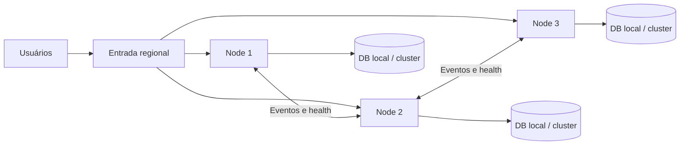

# Nós, clusters, regiões e espelhamento

## Papéis de instalação
| Papel | Funções | Observações |
|---|---|---|
| `full-node` | API, identidades locais verificáveis, registro, sync, mensagens, localização, GodMesh Voice nativo, adapters/bridges opcionais | Mesmo pacote em todo servidor; alguns conectores dependem de serviços externos |
| `control-voter` | Papel adicional de consenso no control plane | Pequeno conjunto, quórum ímpar, domínios de falha diferentes |
| `edge-node` | Serviços locais e fila offline | Pode manter subset autorizado e vir a operar em rede isolada |
| `gateway-agent` | Driver de hardware local / protocolo | Linux/Raspberry Pi ou aplicativo de borda |
| `client` | UI, cache local e sincronização quando ativo | Cliente web/móvel não é relay 24/7 garantido |

## Região
Cada região comporta **vários** `full-node` (N servidores), com balanceamento de entrada e peer mesh regional. Nós podem usar IPv6 diretamente ou IPv4/relay. Cada `full-node` executa os serviços, porém somente a instância eleita por recurso controla uma ponte de rádio ou gateway que exige exclusividade.

## O que é espelhado
1. **Software:** releases assinadas, migrações, manifestos, módulos e políticas de configuração.
2. **Serviços:** todos os módulos habilitados, com health por serviço (inclui dependências).
3. **Dados:** cópias completas **dentro do escopo autorizado** (`full-authorized`), ou cópias regionais/cache (`regional`, `edge-cache`). Para tenants que optarem por espelhamento integral em múltiplas regiões, exigir consentimento/base legal e políticas de residência de dados.

## Governança sem SPOF
O “servidor principal” vira um **líder temporário do control plane**. Nenhum nó é origem permanente indispensável. Um quorum Raft de 3 ou 5 votantes governa alterações sensíveis; disponibilidade durante partição depende da maioria. Operações locais com consistência eventual continuam em outros nós.

## Concessões exclusivas
Sessão de ponte FRN, controle de rádio físico e autoridade de escrita sensível utilizam lease + `epoch`/fencing token; a troca de nó não poderá produzir dois transmissores ativos em paralelo.

## Riscos e restrições
- Replicar todas as identidades e localizações globalmente não é aceitável como padrão de privacidade.
- Ativos em várias regiões exigem regras de propriedade, “home shard” ou resolução de conflitos.
- Failover de mídia normalmente interrompe sessão atual; não garantir seamless PTT.
- Sistemas externos (FRN, Mumble, ChirpStack) têm estado e políticas próprias, mas não são dependências do canal GodMesh Native.
