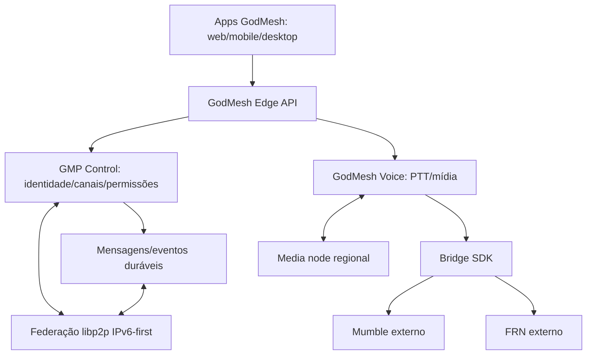
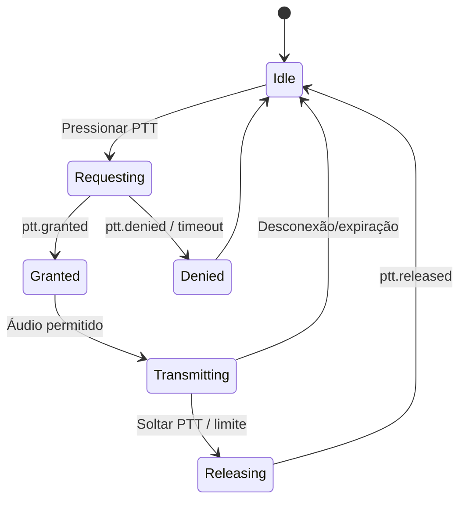

# GodMesh Native — protocolo e motor de comunicação próprios

> **Status:** decisão arquitetural aprovada como direção de produto, especificação inicial para implementação futura.  
> **Data:** 2026-11-15  
> **Referências:** ADR-021 e ADR-022 em `../06-planejamento/decisoes.md`.

## Intenção

**Definição normativa:** a tecnologia própria do GodMesh é a semântica do **GMP** e seus motores (Voice, roteamento, identidade, presença, sincronização, dispositivos). O GMP roda **sobre** IPv6/IPv4, QUIC, TLS, WebRTC, Opus, HTTP e outros padrões maduros, sem criar cifras, codecs ou transportes incompatíveis. Bibliotecas padrão podem integrar a infraestrutura nativa, mas **serviços de terceiros, como Mumble/FRN/ChirpStack, só são acessados por bridges externas opcionais**. Consulte [Estratégia tecnológica](estrategia-tecnologica.md).

GodMesh é o **sistema integral planejado** para identidade, canais, PTT, mensagens, localização, roteamento entre dispositivos, federação e sincronização. Mumble e Free Radio Network (FRN) passam a ser sistemas externos opcionais, conectados exclusivamente por bridges autorizadas.

**Propriedade intelectual própria:** protocolo de aplicação, contratos de eventos, motores de capacidades e rotas, arbítrio PTT, escalonamento de sessões, federação e SDKs.  
**Padrões existentes reutilizados:** IPv6/IPv4, QUIC/TLS 1.3, WebRTC, Opus, Protocol Buffers, libp2p; MLS avaliado para mensagens com E2EE. Não criar criptografia ou codec próprios.



## Padrões de transporte e limites

| Fluxo | Transporte padrão | Alternativa | Semântica |
|---|---|---|---|
| Servidor ↔ servidor | QUIC/TLS sobre IPv6 preferencial | IPv4; TCP seguro quando necessário | eventos, controle, recuperação |
| Aplicativo nativo ↔ edge | QUIC/TLS (a validar) | HTTPS/WebSocket | autenticação, controle e dados |
| Navegador ↔ API | HTTPS + WebSocket | WebTransport quando suportado | mensagens, telemetria e sinalização |
| Navegador ↔ mídia | WebRTC + Opus | gateway de mídia compatível | áudio em tempo real |
| Servidor ↔ servidor de mídia | caminho de mídia regional autenticado | relay autorizado | forwarding de áudio; **não** enviar áudio via gossip |
| Gateways de dispositivos | adaptadores específicos (MQTT, LoRaWAN etc.) | conforme dispositivo | dados e comandos compatíveis |

A seleção de caminhos deve preferir IPv6 com fallback automático IPv4, considerando disponibilidade de UDP, NAT, firewall e relays. Browsers não possuem acesso irrestrito a sockets QUIC/TCP.

## Indicativos e identificação de comunicação

A identidade interna é `gmi_id`; o identificador público nativo de quem fala/escreve é o **indicativo digital GMC**, sem dados civis. Cada transmissão tem `stream_id` efêmero e sinalização `TalkStart` autenticada que vincula a sessão ao indicativo. **Não repetir UUID/indicativo estável em cada frame de áudio.** O endereço `acct:` é opt-in para descoberta. Ver [Indicativos GMC](../02-dominio/indicativos-digitais.md) e [Transporte de identidade](identificacao-midia-mensagens.md).

## Identificação normativa das entidades
O GMP pode referenciar `gmi_id` (UUIDv7/URN padronizada) **somente em mensagens internas/autorizadas**, independente do servidor regional; mensagens e PTT destinados aos participantes usam por padrão o indicativo pseudônimo GMC ou alias de contexto. O endereço legível `acct:apelido@domínio` é um alias WebFinger **opcional**, não um token. OIDC usa `iss` + `sub` apenas para vincular a sessão à identidade GodMesh; a declaração de plataforma GodMesh requer verificação de autoridade federada. Consulte [GodMesh Global Identity](../02-dominio/identidade-global.md).

## Protocolos de aplicação propostos

A seleção de recurso exige **versão mutuamente suportada, feature negociada, identidade verificada e autorização**. Campos opcionais desconhecidos podem ser ignorados conforme o schema; recursos críticos desconhecidos provocam rejeição explícita. Modificar o transporte ou adicionar um conector não altera a semântica das entidades GodMesh.


Nomes de trabalho (não padrões existentes):

- `gmp.control.v1`: login/autorização, presença, canais, PTT grant/revoke, manifests e descoberta de capacidades.
- `gmp.event.v1`: mensagens, estados de dispositivos, localização e alertas com IDs globais e persistência.
- `gmp.federation.v1`: identidade de nós, anúncio de serviços, snapshots, cursores e reconciliação.
- `gmp.media.v1`: sinalização, identificação de sessão, prioridades e orientação de mídia; payload de voz utiliza Opus por caminhos adequados, evitando codec próprio.
- `gmp.bridge.v1`: nome lógico de uma interface interna para autorização de links, controle PTT e diagnóstico de bridges; não declara pacote wire separado. A proposta C07 transporta comandos de bridge pelos contratos `gmp.control.v1`/API e usa os perfis de proveniência da UDNL. Um package/wire próprio exige proposta e compatibilidade aprovadas, não se infere deste nome de trabalho.

Não enviar payloads de localização privados para tópicos globais abertos. A autorização deve ser verificada tanto na origem quanto no destino da rota.

### Envelope lógico de controle (ilustrativo)

```json
{
  "protocol": "gmp.control.v1",
  "message_id": "019a0000-0000-7000-8000-000000000001",
  "kind": "ptt.request",
  "tenant_id": "tenant-example",
  "channel_id": "channel-example",
  "session_id": "session-example",
  "source_device_id": "device-example",
  "issued_at": "2026-11-15T15:00:00Z"
}
```

É **envelope conceitual**, não esquema de produção. O contrato documental proposto para handshake, schemas, erros, limites, replay e o mapeamento da API está em [GMP / API v1](../07-contratos/gmp-api-v1.md). Ele não está aprovado como wire final, não foi compilado como `.proto`/OpenAPI e não comprova implementação.

Integração documental: [identidade/autorização](../07-contratos/identidade-autorizacao.md) define principal, scopes, prova e revogação; [eventos/sincronização](../07-contratos/eventos-sincronizacao.md) define `event_id`, `command_id`, `operation_id`, `attempt_id`, lifecycle/attempt/ACK e cursor; [autoridade de escrita](autoridade-escrita.md) propõe `authority_epoch`/fencing; [retenção/revogação](../04-seguranca/retencao-revogacao.md) exige política efetiva por classe/cópia; [UDNL](normalizacao-dados.md) define proveniência e projeção. São propostas não ratificadas; GMP/API mapeia sem duplicar suas autoridades.

**Limite de replay:** QUIC/TLS não substitui deduplicação da aplicação. O perfil proposto v1 não aceita dados de aplicação em 0-RTT; liberar operações replay-safe exige perfil explícito e validação posterior. Semântica de `message_id`, ID idempotente de operação, estado, cursor/replay, retenção e inbox pertence ao contrato único de eventos/sync, não a esta arquitetura. Até a ratificação desse contrato, não há garantia de execução exactly-once nem prazo de deduplicação aprovado.

## GodMesh Voice: máquina de estados PTT

PTT é concedido pelo **controlador de canal autorizado**; a simples recepção de áudio não concede o direito de transmiti-lo.



**Invariantes:**
1. No modo half-duplex existe no máximo um transmissor efetivamente autorizado por canal/domínio de coordenação por vez.
2. Um `grant` inclui `channel_id`, `session_id`, `grant_id`, `epoch`/fencing token, prazo de expiração e teto de duração; um grant antigo não vale após mudança de coordenação.
3. Sem coordenador/quórum autorizado, não conceder TX sobre RF externa; pode haver modo local explicitamente configurado, nunca transmissão duplicada.
4. Prioridades e emergência só em canais e integrações que permitam tal comportamento; a fila SOS tem ACKs verificáveis, mas nenhuma entrega é presumida.
5. Um canal de mídia tem afinidade regional. Failover pode encerrar e restabelecer a sessão; não prometer continuidade imperceptível.

## Roteamento de capacidades

A plataforma registra separadamente `capability_supported`, `capability_verified` e `capability_currently_operational`. Para cada rota, verificar:

`identidade/autorização ∧ capacidade TX/RX ∧ codec/protocolo compatível ∧ gateway disponível ∧ destino elegível ∧ política da rede externa`.

Exemplos: smartphone ↔ smartphone via GodMesh Voice; smartphone ↔ rádio FM através de bridge autorizado; smartphone → LoRaWAN somente dados curtos compatíveis; a arquitetura proposta não transporta áudio PTT convencional de baixa latência por LoRaWAN.

## Dados, sincronização e escalabilidade

- Nós de aplicação completos por região; não replicar automaticamente dados privados para todos os servidores mundiais.
- Eventos persistentes com `event_id`, `origin_node`, sequência e cursor; snapshot + sync incremental.
- O plano de mídia não usa NATS nem Gossipsub para transportar cada pacote de voz. A especificação funcional do Voice Engine está em [Mídia nativa](midia-nativa.md).
- `room placement` e `sticky sessions` para mídia; novas sessões balanceadas por capacidade e saúde.
- Controle global não deve ser necessário a cada fala ou localização; autoridades locais e leases definidos por escopo.
- Fila de mensagens: confirmação de persistência, encaminhamento, entrega a gateway e recebimento pelo dispositivo são estados diferentes.

## Segurança e privacidade

- TLS 1.3/QUIC e identidades persistentes para nós; autenticação e autorização também em nível de aplicação.
- Não criar cifras ou protocolos criptográficos próprios.
- Criptografia de ponta a ponta para mensagens privadas é requisito a avaliar usando padrões como MLS. **Bridges de áudio legadas não devem ser descritas como E2EE**: a transcodificação usual exige acesso a áudio legível no gateway. Informar os usuários e permitir opt-in explícito para bridging.
- Áudio não gravado por padrão. Vinculação de dispositivos por prova de posse/autorização, compartilhamento revogável e controles anti-rastreamento.
- Isolar integrações de rádio amador de canais corporativos/privados incompatíveis com suas normas. Não habilitar TX automaticamente em servidores externos.

## Critérios de interoperabilidade do GodMesh Native

1. Dois clientes nativos conseguem entrar em um canal **GodMesh próprio**, solicitar PTT e trocar áudio Opus sem depender de Mumble nem de FRN.
2. Dois nós Rust conseguem encaminhar sinais autorizados via IPv6 e usar IPv4 quando necessário.
3. Mensagens e localização são persistidas e sincronizadas após desconexão sem duplicação.
4. O motor de capacidades nega rotas impossíveis e explica a razão ao cliente.
5. Bridges Mumble/FRN são desligáveis sem prejudicar canais nativos.
6. O áudio não volta ao canal de origem através de ciclos entre bridges.
7. Testes de segurança e desempenho definem limites conhecidos antes de qualquer uso operacional crítico.

## Pontos pendentes

- Definir se o edge nativo usará WebRTC também para clientes móveis ou QUIC/datagrams próprios; comparar latência, estabilidade, suporte a rede e custo.
- Revisar e aprovar o perfil documental Protobuf/handshake e o artefato OpenAPI propostos em [GMP / API v1](../07-contratos/gmp-api-v1.md); gerar/validar os schemas formais, negociar compatibilidade e definir os limites publicados por perfil antes de declarar interoperabilidade.
- Implementar controle e orquestração próprios; avaliar bibliotecas maduras para o plano de mídia e documentar a separação entre propriedade do protocolo e reuso de componentes auditados.
- Integrar e ratificar a proposta de identidade/autorização por tenant, scopes, membership e revogação; definir ainda política de canal/grupo, priorização PTT, reconciliação e auditoria.
- Alinhar IDs, idempotência, ACKs, cursor/replay e estados de comando com o contrato transversal [Eventos e sincronização](../07-contratos/eventos-sincronizacao.md); não duplicar máquina de estados na camada GMP.
- Testar desempenho e interoperabilidade com clientes/servidores FRN e Mumble reais autorizados.

## Referências

- [QUIC — RFC 9000](https://www.rfc-editor.org/rfc/rfc9000)
- [Opus RTP — RFC 7587](https://www.rfc-editor.org/rfc/rfc7587)
- [MLS — RFC 9420](https://www.rfc-editor.org/rfc/rfc9420)
- [libp2p — conectividade browser](https://libp2p.io/docs/browser-connectivity/)
