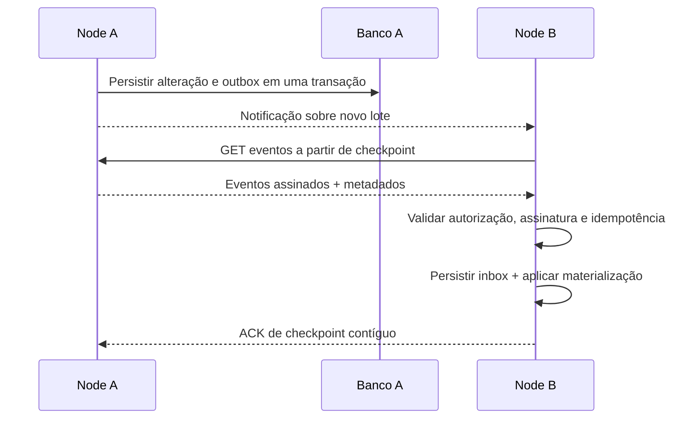

# Replicação, consistência e sincronização offline

## Objetivo
Servidores completos devem manter dados suficientes para atender usuários autorizados e poder ser promovidos a instâncias ativas. A sincronização deve operar após quedas e partições, sem exigir transações ACID globais para cada evento GPS.

## Classes de informação
| Dados | Consistência recomendada | Estratégia |
|---|---|---|
| Cadastro de organização/ownership/ACL | Forte por tenant/shard | Autoridade de escrita/quórum quando necessário |
| Posições GPS/telemetria | Eventual | Eventos append-only, timestamp de origem e recepção |
| Mensagens | Durabilidade + ordem por conversa | Outbox/inbox, ACK e cursores |
| Alertas SOS | Alta prioridade e auditoria | Log persistente, reentrega, escalonamento |
| Presença/health | Efêmera | Gossip com TTL, não fonte de verdade |
| Configurações/versões | Governança assinada | Control plane e rollouts |
| Sessões PTT | Tempo real | Estado regional, affinity; não replicar áudio bruto globalmente |

## Fluxo

## Snapshot + replay
- Snapshot consistente e assinado/hashing; declarar `tenant_scope`, stream, versão do schema e último cursor incluído.
- Transferência em partes com verificação de integridade; retomar download.
- Reaplicar eventos posteriores, confirmando a maior sequência contígua por origem.
- Testar perda, duplicação e reorder.

## Deleções e retenção
Eventos de exclusão/tombstones **devem ser replicados como comandos de domínio**, respeitando regras de retenção, porque um mirror de NATS JetStream não replica deleções da origem. Sujeito a políticas de privacidade e revogação. [NATS Source & Mirror](https://docs.nats.io/nats-concepts/jetstream/source_and_mirror).

## Tipos de conflito
- Posições: guardar observações originais; `latest` por ocorrido, qualidade da medição e idempotência, com política de atraso.
- Estado de dispositivo: atribuição por owner, versionamento otimista ou escrita controlada.
- Preferências simples: CRDT pode ser avaliado, mas não usado em controle de autorização crítico sem modelagem específica.
- Comandos: idempotency key, prazo, tentativa e status confirmados por etapa.

## Escopo de replicação
`full-authorized`, `regional`, `edge-cache`; `tenant_id`, `data_class`, `residency_policy` e `replication_acl` em todos os fluxos. Nenhum espelhamento global indiscriminado de posição privada.

## Autoridade de escrita e isolamento (normativo)
Para cada registro mutável sensível há uma autoridade por tenant/partição (`home_region` + `authority_epoch`), com requisições remotas roteadas à autoridade quando o quórum é necessário. Regiões offline não podem alterar posse, ACL ou revogações globais sem autoridade; podem registrar eventos locais permitidos. Replicação usa autorização antes do snapshot e de cada replay, e chaves/escopos devem ser reavaliados após revogação. Backups separados das réplicas.
