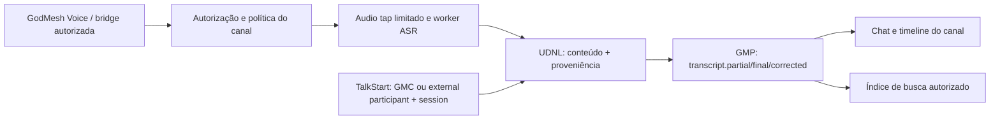

# GodMesh — Transcrição multimodal por canal (GodMesh Transcript)

> **Status:** especificação completa proposta; ainda não implementada. **ADR-038**. Data: 2026-11-15. Normativo em conjunto com [GodMesh Voice](midia-nativa.md), [GMP](protocolo-nativo.md), [Identificação PTT](identificacao-midia-mensagens.md), [UDNL](normalizacao-dados.md) e [SOS](../02-dominio/servico-sos.md).

## Finalidade e comportamento

Cada canal de áudio GodMesh terá um chat cronológico associado e **suporte à transcrição de falas autorizadas** (PTT, voz e áudio recebido por bridges). A política de transcrição do canal é explícita: canais podem exigir habilitação e aviso/consentimento antes de ativar captura, armazenamento, pesquisa ou tradução. **Nenhum áudio de uma rede externa pode ser transcrito, publicado ou retido contra as permissões do operador da rede ou das pessoas envolvidas.**

Uma transcrição é texto derivado, não é o áudio original nem prova incontestável de uma fala. O chat mostra `parcial`, `final`, `corrigido` ou `indisponível`; jamais fabrica uma frase quando há perda de áudio.

## Fluxo funcional



O plano de mídia continua separado do barramento de eventos: **não** publicar cada frame RTP/Opus na fila de mensagens. O serviço ASR recebe um fluxo de áudio autorizado por sessão ou por fala e publica *somente eventos textuais*. O fluxo de voz **não depende do ASR**: falha, sobrecarga ou desligamento da transcrição não interrompem comunicação nativa.

## Regra obrigatória: atividade de transmissão independente de ASR (ADR-040)

**Toda fala PTT identificável deve produzir uma entrada própria na timeline do canal, independentemente da disponibilidade de transcrição.** O motor de PTT emite `gmp.voice.talk.started.v1` ao conceder/iniciar transmissão e `gmp.voice.talk.ended.v1` ao encerrá-la. A timeline cria a entrada assim que houver evidência de início e a atualiza com duração e estado final; a transcrição é um enriquecimento opcional vinculado pelo mesmo `talk_session_id`. **Nunca esperar pelo serviço ASR para registrar a transmissão nem inventar texto em caso de falha.**

A entrada de timeline terá `channel_id`, `talk_session_id`, `speaker_ref` com origem/nível de confiança, `started_at`, `ended_at` opcional, `duration_ms` opcional, `source_network`, `gateway_ref` opcional, `audio_available` segundo política, `transcription_state`, `transcription_reason` opcional e `evidence_type` (`ptt_granted`, `rf_carrier_detected`, `speech_detected`, `bridge_reported`). Eventos são persistidos conforme a política de metadados do canal, com deduplicação e ordenação idempotente; canais efêmeros podem exibir a atividade sem histórico persistente conforme sua política explícita.

| Condição | Entrada visível na timeline |
|---|---|
| ASR finalizou | `GM-… falou · 4 s` e transcrição identificada como automática |
| ASR executando | `GM-… transmitiu · transcrição em processamento` |
| ASR com falha | `GM-… transmitiu · transcrição indisponível (falha no serviço)` |
| Sem consentimento/política desativada | `GM-… transmitiu · transcrição desativada neste canal` |
| Áudio inaudível | `GM-… transmitiu · não foi possível reconhecer a fala` |
| Bridge externa sem identidade individual | `Gateway FRN-03 · transmissão detectada · falante não identificado` |
| Rádio analógico apenas com portadora | `Estação/gateway X · atividade de rádio detectada`, **não** `usuário falou` |

O usuário vê a indicação `transcrição indisponível` com motivo adequado (`disabled_by_policy`, `consent_missing`, `processor_unavailable`, `processing_failed`, `audio_unintelligible`, `unsupported_source`, `e2ee_unavailable`). A interface não publica nomes reais nem atribui GMC a uma origem não verificada. O evento de transmissão é o registro primário; `gmp.transcript.final.v1` o enriquece sem substituir sua autoria. Em caso de queda de conexão, entradas incompletas são encerradas como `interrupted` por política de timeout, preservando incerteza sobre a duração final.

A atividade do canal (quem e quando transmitiu) também é metadado potencialmente sensível: ACL, minimização, transparência e retenção própria são obrigatórias, mesmo quando não ocorre captura ou armazenamento do áudio.

## Identificação correta do falante

- GodMesh nativo: associação do `TalkStart` autenticado ao `gmc_callsign`/alias e `talk_session_id`; frames usam `stream_id` temporário.
- Mumble/FRN: `network_kind`, `network_instance_id`, `native_session_id` e identificador reportado, com nível de confiança conforme [UDNL](normalizacao-dados.md). **Não** atribuir GMC a externos sem vínculo verificado.
- Ponte multipessoa ou rádio analógico sem ID individual: identificar somente `bridge_id/gateway` e indicar `speaker_unverified`; diarização pode sugerir separação de vozes, mas não prova identidade.
- Um participante poderá solicitar correção de transcrição segundo ACL e manter rastreabilidade de revisões.

## Política por canal e privacidade

`transcription_policy` deve conter: `mode` (disabled, opt_in, mandatory_with_notice), `retention_days`, `allow_audio_recording`, `allow_search`, `allow_translation`, `allowed_processors`, `external_network_consent` e `access_policy` com granularidade por tenant/canal. A exigência de consentimento e bases legais depende da jurisdição; para canais incompatíveis, não capturar áudio.

Canais E2EE só admitem transcrição via endpoint autorizado com acesso legítimo ao áudio claro (ex.: dispositivo local ou participante dedicado e consentido). Um servidor que transcreve áudio claro **não pode anunciar que a mídia permanece E2EE inacessível ao servidor**. Chaves e áudios brutos não são enviados globalmente pela mesh. Preferência por ASR self-hosted, com provedores externos só após autorização explícita.

## Pipeline ASR e tolerância à falha

1. Receber áudio após verificar política, autenticação e capacidade.
2. Separar por `talk_session_id`, usar PTT como limite de fala e VAD somente onde necessário.
3. Converter codec em PCM temporário **apenas no worker autorizado** e com buffer limitado.
4. Executar modelo ASR multilíngue, dicionário contextual de siglas/indicativos e idiomas configurados.
5. Publicar `transcript.partial` de melhor esforço e `transcript.final` com texto, idioma, estimativa de confiança/qualidade, `audio_start/end` e `source_provenance`.
6. Disponibilizar `transcript.corrected` como nova revisão; nunca sobrescrever silenciosamente uma transcrição final.
7. Se ASR falhar: estado `transcription.unavailable`, métricas e possibilidade de retentativa somente quando política autorizar gravação temporária.

Dimensionamento dos workers por GPU/CPU, idioma e latência; backpressure descarta atualizações **parciais** antes de comprometer a voz. Não declarar SLO numérico sem benchmark. A retenção de áudio e a retenção de texto são **independentes**.

## Contrato de evento normalizado

```json
{
  "type": "gmp.transcript.final.v1",
  "event_id": "event-example-01",
  "tenant_id": "tenant-example",
  "channel_id": "operations",
  "talk_session_id": "talk-example-14",
  "speaker": {
    "display_id": "GM-7K4P-9R2Q-X",
    "origin_network": "godmesh",
    "identity_assurance": "godmesh_cryptographically_verified"
  },
  "text": "Equipe, estou chegando ao ponto de encontro.",
  "language": "pt-BR",
  "start_ms": 0,
  "end_ms": 2800,
  "revision": 1,
  "transcript_status": "final",
  "audio_retained": false
}
```

IDs e números fictícios, contrato inicial sujeito a refinamento. Controles GMP de assinatura, versão, escopo e deduplicação seguem os demais envelopes. Texto parcial poderá ser substituído pela versão final na interface, preservando eventos conforme política de auditoria.

## Chat unificado e capacidades futuras

Mesmo `channel_id` para mensagens digitadas, mídia transcrita, avisos de serviço e eventos SOS autorizados. A ordenação considera horário de origem, ingestão e sequência, explicitando atrasos de rede. Tradução opcional é **derivada** e deve exibir idioma original, idioma de destino e indicação de tradução automática. Pesquisa apenas nos canais autorizados e após aplicar política de retenção.

Não permitir que reconhecimento automático de palavras isoladas gere SOS definitivo sem confirmação explícita do usuário ou política formal de operador; dados ASR podem conter erros. A transcrição pode auxiliar um atendente, mas **não substitui o evento SOS estruturado**.

## Indicadores e testes

- Taxa de falas transcritas, latência parcial/final, idioma, erros e perdas de frames.
- Associação correta de falante/GMC/bridge e marcação de origem não verificada.
- Falha de ASR não interrompe áudio; privacidade preservada em canais desativados/E2EE.
- Retenção de texto, áudio e busca aplicadas por ACL; logs sem conteúdo sensível.
- Reconnect e reordenação de eventos não duplicam entradas no chat.

## Referências

- [whisper.cpp: exemplos de streaming](https://github.com/ggml-org/whisper.cpp/blob/master/examples/stream/README.md)
- [OpenAI: transcrição realtime](https://developers.openai.com/api/docs/guides/realtime-transcription)

## Localização nas entradas do chat e do PTT (ADR-041)

Quando uma posição do participante for recebida e o compartilhamento do canal for permitido, a timeline pode mostrar apenas uma **região aproximada com incerteza mínima de 50 km de raio**, jamais coordenadas GPS reais. Isso vale para texto digitado, metadados da transmissão PTT, transcrição ASR, conteúdo de bridge e exportação. A publicação de localização é opt-in/autorizada e limitada por frequência para não permitir inferir trajetos detalhados. No SOS, o chat apenas mostra incidente e região aproximada, enquanto a **localização precisa** segue por canal restrito para responsáveis autorizados. Ver [Política](../04-seguranca/politica-localizacao.md).
