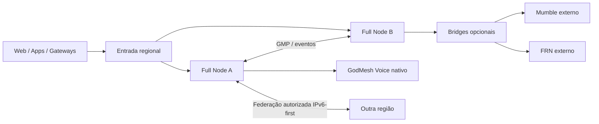

# Visão geral — resumo normativo

**Documento principal:** [Arquitetura de referência integral](arquitetura-referencia.md).

O GodMesh é uma **CDN de aplicação federada**, não uma CDN somente de arquivos: cada servidor full node hospeda API, motor GodMesh Native, localização, mensagens, gateway, autenticação e processamento, conforme health e recursos. Vários nós por região fazem balanceamento e cooperação. Não existe um origin único obrigatório para solicitações normais.

## Pilares
1. Tecnologia própria Rust (`GMP`, `Voice`, `Identity`, `Capability Router`, `Sync`).
2. Padrões interoperáveis existentes para transporte e codecs; IPv6 preferencial, IPv4 alternativo.
3. Espelhamento operacional completo, dados privados replicados apenas em escopos autorizados.
4. Serviços com métricas/readiness próprios, balanceamento e backpressure por região.
5. Conectores de dispositivos e redes externas **não determinam** a disponibilidade do núcleo.
6. Zero trust, autorização contínua, tratamento de localização sensível e regras RF.

O modelo de módulos/serviços está em [Serviços Rust](servicos.md), mídia em [GodMesh Voice](midia-nativa.md) e domínio em [Modelo de dados](../02-dominio/modelo-dados.md).
