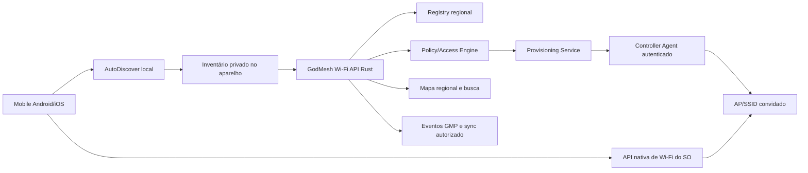

# GodMesh Wi-Fi AutoDiscover, AutoShare e AutoConnect — arquitetura normativa

> **Documento de engenharia:** GMWIFI-ARC-001 · **Versão:** 1.0 · **Data:** 2026-11-15 · **Estado:** arquitetura aprovada; implementação e homologação pendentes. Complementa a [arquitetura de referência](arquitetura-referencia.md). Não declara funções prontas.

## 1. Propósito e abrangência

O GodMesh constrói uma rede colaborativa de pontos de acesso Wi-Fi **voluntariamente compartilhados** entre contas pessoais e organizações. Usuários podem consultar um mapa de redes elegíveis, aproximar-se de um AP, solicitar conexão e, quando o sistema operacional e a infraestrutura autorizarem, reconectar automaticamente. O sistema distingue descoberta de sinal, cadastro privado, comprovação do direito de administrar e publicação autorizada.

A arquitetura preserva a tecnologia nativa GodMesh: GMP, identidade GMC/GMI, UDNL, federação, roteamento e políticas. Não depende de serviços externos proprietários de localização ou de voz. A ligação 802.11, credenciais e seleção final da rede permanecem sob o sistema operacional e/ou controlador autorizado do AP.

### 1.1 Preferências do produto

| Preferência | Configuração inicial | Condição obrigatória |
|---|---|---|
| `auto_discover` | Ligada | Permissão do aparelho e consentimento informado para funcionalidades de descoberta |
| `auto_share` | Ligada **como intenção** | **Não publica** até comprovar controle do AP e consentimento específico para compartilhamento |
| `auto_connect` | Ligada | Só redes elegíveis, credenciais/provisionamento válidos, autorização do SO e política de conectividade |

O consentimento não pode ser inferido a partir de o telefone já ter conectado a uma rede; redes salvas podem pertencer a terceiros. O GodMesh não acessa senhas guardadas por outro aplicativo/OS nem obtém listas completas de redes salvas em apps comuns.

### 1.2 Requisitos invariantes

1. `discovered_private` jamais aparece no mapa público, não libera acesso e não se replica indiscriminadamente.
2. Compartilhamento público exige administrador verificado, escopo, duração/opção de expiração e políticas de acesso.
3. Cada tentativa de conexão verifica autorização, revogação, elegibilidade local e estado do AP.
4. Credenciais domésticas principais **não** são compartilhadas por padrão: preferir guest SSID, WPA3-Enterprise/EAP-TLS, Passpoint, PPSK por dispositivo, ou mecanismo equivalente do roteador. Senha compartilhada é último recurso, com riscos explícitos e rotação.
5. A posição no **chat** continua generalizada com raio mínimo de 50 km; mapa de AP é produto distinto e respeita privacidade do proprietário (**localização exata apenas por opt-in específico**; área aproximada ou ocultação como padrão).
6. O GodMesh não promete conectar redes que não estejam no alcance nem obter lista completa de redes Wi-Fi no iOS.
7. O rádio/OS controla a associação; `suggested` não é `connected`; associação não comprova saída à internet.
8. Todos os eventos e identificadores de rede são escopados a tenant, assinados quando necessário e filtrados por autorização; não publicar BSSID bruto em endpoints públicos.
9. Nunca forçar migração Wi-Fi no meio de SOS/voz ou Guardian; continuidade depende da política e das rotas disponíveis.
10. Retirar compartilhamento bloqueia novos ingressos e inicia revogação no controlador, mas pode não desconectar imediatamente dispositivos com PSK já exposta.

## 2. Fronteiras dos subsistemas

| Componente | Linguagem/execução | Responsabilidade |
|---|---|---|
| `godmesh-wifi-core` | Rust, crate comum | Modelos, políticas, erros, estados, pontuação, contratos GMP |
| `godmesh-wifi-registry` | Rust/Axum + PostgreSQL/PostGIS | Redes, APs, consentimento e catálogo por região/tenant |
| `godmesh-wifi-access` | Rust | Grants, leases, autorização por conta/dispositivo e revogação |
| `godmesh-wifi-provisioner` | Rust | Solicitações de credenciais/certificados e integração com controladores/APs |
| `godmesh-wifi-map` | Rust + PostGIS | Busca geográfica e projeções públicas minimizadas |
| `godmesh-wifi-sync` | Rust + GMP/NATS | Sincronização por eventos autorizados, deduplicação e checkpoints |
| `godmesh-wifi-router-agent` | Rust/Linux em roteador/gateway autorizado | Prova de administração, estado do AP, provisionamento, isolamento e revogação |
| `godmesh-mobile-wifi` | Rust compartilhado + Kotlin/Swift | Observações, decisão de rota, provisão no SO, fila local e monitoramento |

Esses componentes podem integrar o mesmo processo `godmesh-node` no início, mas os limites lógicos de domínio e contratos são estáveis. Cada nó regional full-stack instala todos os módulos; apenas nós com autorização de AP e conectividade local exercem controle físico de rede.

## 3. AutoDiscover — descoberta e inventário

### 3.1 Fontes de informação

- Android: resultados de scans Wi-Fi liberados por `WifiManager`, rede atual via conectividade, e redes configuradas **pelo próprio GodMesh**, onde APIs permitem. O Android restringe scans em segundo plano e requer permissões.
- iOS: rede **atual** quando os critérios de `NEHotspotNetwork.fetchCurrent` são satisfeitos; redes anteriormente adicionadas pelo **próprio GodMesh**; eventos de conectividade. Não há API pública geral para enumerar APs próximos ou todas as senhas/redes salvas.
- Controladores/APs consentidos: inventário de SSIDs/rádios, topologia, telemetria, disponibilidade e opções de provisionamento. Essa é a fonte **mais confiável** de cobertura e estado operacional.
- Clientes móveis: telemetria de qualidade da conexão **somente mediante consentimento** e com limites de privacidade; uma observação de sinal não é prova de propriedade nem de acesso liberado.

### 3.2 Fluxo

`detected` → `local_private_inventory` → (opcional) `claim_requested` → `owner_verified` → `share_policy_active` → `published` → `eligible` → `provisioned` → `connected` → `validated`.

A etapa `detected` nunca ativa `published` por conta própria. Registros privados podem permanecer inteiramente no aparelho. Se sincronização do inventário privado estiver habilitada, a API usa escopo `wifi.inventory.private`, sem disponibilizá-lo a outros usuários.

### 3.3 Frequência de descoberta e economia de recursos

Descoberta baseada em eventos, resultados de scans do sistema e estado do app; sem varredura contínua. Coletar em foreground mediante comando do usuário; reduzir processamento em background, bateria baixa, dados medidos e SOS. `startScan` pode ser limitado pelo Android e resultados podem estar defasados. No iOS não tentar contornar limitações. Não declarar cobertura 360° nem direção do AP com RSSI convencional.

## 4. AutoShare — comprovação e publicação

### 4.1 Verificação de controle do AP

Método preferencial: pareamento explícito com `godmesh-wifi-router-agent` no roteador/gateway, vinculação por chave pública e confirmação administrativa no controlador. Outras opções: fluxo administrativo autenticado de roteadores homologados; convite assinado da organização responsável. SSID, BSSID, localização, conexão prévia, senha conhecida e proximidade **não** provam autoridade. Sem integração homologada ou prova suficiente, permitir apenas cadastro como *ponto de interesse privado*, sem compartilhamento automático de credenciais.

### 4.2 Modos de publicação

- `private`: visível apenas ao titular/administradores.
- `members`: visível e acessível aos membros de organização/grupo autorizado.
- `community`: elegível a contas GodMesh conforme regras do proprietário, restrições regionais e políticas antirrastreamento.
- `invite_only`: localização e acesso restritos a convidados.

O proprietário escolhe limites de horário, dispositivos simultâneos, quotas, duração de grants e bloqueios. O sistema não pode contornar restrições contratuais do ISP nem políticas legais do estabelecimento.

### 4.3 Automação de novos SSIDs

Após pareamento com controlador **explicitamente autorizado**, novos SSIDs *gerenciados por esse controlador* podem herdar uma política previamente aceita, limitada a SSIDs de convidados ou redes selecionadas. Alterações de categoria de segurança, redes pessoais e redes não atribuídas ao GodMesh requerem nova autorização. Não aplicar a regra a outras redes simplesmente observadas no celular.

## 5. AutoConnect — seleção de AP e execução

**Elegibilidade obrigatória:** `share.active` + conta/dispositivo autorizados + prazo válido + provisionamento possível + rede presente/possível + conformidade e política + consentimento de conexão no OS. A escolha do OS pode não acompanhar nossa preferência.

O `godmesh-wifi-route-planner` filtra candidatos por: autorização, categoria de segurança, política empresarial, qualidade comprovada, estado recente do AP, capacidade, custos, limites de dados, conexão ativa e confiabilidade. Em seguida calcula pontuação relativa para **sugerir** prioridade. Exemplo de pesos ajustáveis: qualidade 25%, estabilidade 20%, latência 20%, reputação verificada 15%, capacidade 10%, gasto de energia 10%. Não confundir pontuação com garantias.

Não transferir sessão PTT ativa por diferença pequena de RSSI: usar histerese, janela mínima e health checks; switches podem derrubar streams. Para SOS/Guardian, preservar conectividade existente e solicitar consentimento ou executar fallback do próprio app quando permitido.

### 5.1 Estados da conexão

`eligible` → `credential_requested` → `credential_ready` → `os_provisioning` → `os_approval_required`/`os_deciding` → `associating` → `associated` → `internet_verified` ou `local_only`/`captive_portal`/`failed` → `expired`/`revoked`.

**Importante:** confirmação do endpoint de provisionamento ≠ conexão Wi-Fi; associação ≠ internet; internet ≠ caminho saudável até GodMesh. Monitorar via capacidades da rede e teste autenticado de serviço, sem interceptar tráfego alheio.

## 6. Provisionamento — hierarquia preferida

1. **Passpoint / Hotspot 2.0 + EAP-TLS** com credenciais únicas por usuário/dispositivo e roaming de APs participantes, quando houver suporte real de AP/controlador/cliente.
2. **WPA2/WPA3-Enterprise + EAP-TLS / RADIUS** com credenciais individuais e revogáveis; CA e certificados sob controle seguro.
3. **PPSK/DPSK por cliente** oferecida por controlador compatível; revogação local por chave e isolamento de convidados.
4. **Wi-Fi Easy Connect (DPP)** quando dispositivos e hardware disponibilizarem APIs e modalidade adequada; é um mecanismo de provisionamento, não um serviço universal de autenticação revogável.
5. **SSID de convidados com PSK compartilhada**, apenas quando não houver alternativas, com segredo entregue a clientes autorizados, expiração/rotação, segmentação de rede e aviso sobre revogação imperfeita.

Nunca distribuir a senha principal de uma rede doméstica por padrão. O backend deve preferir referências a credenciais emitidas pelo controlador, não senhas permanentes em PostgreSQL. Se o cliente precisar receber um segredo, usar entrega autenticada, transporte criptografado, tempo limitado, armazenamento em Keystore/Keychain e mascaramento absoluto em logs e analytics. Credenciais pré-compartilhadas vazadas não podem ser revogadas individualmente sem suporte do roteador.

## 7. Mapa e localização

A localização de um AP é um atributo **publicado com consentimento do operador**, não automaticamente a posição de quem o detectou. A localização padrão do mapa usa região aproximada; para redes residenciais, não mostrar coordenadas exatas, BSSID/MAC, nome do dono nem histórico de detecções. Redes profissionais podem optar por ponto comercial preciso sob autorização explícita.

O mapa usa `wifi.map.public` com células geográficas ou geometria generalizada gerada pelo serviço, não `device.location.precise`. `GET /v1/wifi/map` retorna apenas redes elegíveis para o solicitante, posição generalizada, `last_verified_at`, classe de confiança e estado não sensível. O status `nearby_verified` só pode ser afirmado quando o cliente local comprovar visibilidade pelo sistema; no iOS exibir `alcance_nao_confirmado` em vez de inventar scan.

A política anterior continua: localização de pessoa em chat/PTT generalizada em área de raio ≥50 km; Guardian com autorização temporária; SOS com melhor posição disponível apenas aos responsáveis autenticados.

## 8. Sincronização distribuída

- A autoridade de escrita de `wifi_share`/`wifi_access_grant` pertence ao tenant responsável; eventos de mudança possuem ID, sequência, versão e assinatura.
- Réplicas regionais armazenam **somente dados autorizados**; catálogo geográfico público é projeção reduzida, não contém inventário privado/credenciais/BSSID.
- Eventos GMP via outbox transacional, NATS regional e federação escopada; `at-least-once` + idempotência e checkpoint para reconciliar desconexões.
- Revogação é evento prioritário; nós offline não emitem grants novos sem autorização atual. Aplicar limites máximos curtos de validade a credenciais/grants pré-distribuídos.
- Mapa: projeções eventual-consistent, com `last_verified_at` e TTL; nunca publicar `open_now`/`within_range` sem prova.
- Dados de varredura local não serão publicados como feeds de monitoramento de terceiros; coleta de telemetria colaborativa será opcional, minimizada e agregada.

## 9. Segurança, abuso e falhas

Casos relevantes: AP falso (*evil twin*), SSID duplicado, página cativa, rotação de MAC/BSSID, revogação de grants, perda de controladores, mudança de senha, usuários não autorizados, vazamento de localização de residência, retenção e coleta massiva de APs. Autenticar domínio de rede/provisionador com certificados e binding ao controlador. Não tratar SSID ou BSSID como identidade criptográfica. Isolar hóspedes da LAN particular; preferir rede guest com firewall e limites de banda.

Se uma etapa manual for exigida pelo Android ou iOS, orientar o usuário com texto claro e permitir retornar ao aplicativo; nunca afirmar que a conexão foi efetuada sem confirmação. Clientes devem conseguir permanecer no Wi-Fi anterior em caso de falha da nova configuração.

## 10. Contratos relacionados e aceitação

- [Modelo de dados e SQL](../02-dominio/wifi-modelo-dados.md)
- [REST, GMP, erros e exemplos](../07-contratos/wifi-autodiscover-autoshare-api.md)
- [Android, iOS e integração de controladores](../03-integracoes/wifi-android-ios-roteadores.md)
- [Segurança e privacidade](../04-seguranca/wifi-compartilhamento-privacidade.md)
- [Matriz de testes](../05-operacao/testes-wifi.md)

Aceita-se o desenho somente quando os testes comprovarem separação `private`/`published`, revogação e expiração, ausência de segredos em logs, funcionamento de permissões Android/iOS, limites de background, failover, proteção geográfica e coerência com políticas Guardian/SOS.

## 11. Referências oficiais (consulta de 15/11/2026)

- Android Wi-Fi Scanning: https://developer.android.com/develop/connectivity/wifi/wifi-scan
- Android Wi-Fi permissions: https://developer.android.com/develop/connectivity/wifi/wifi-permissions
- Android Wi-Fi suggestions: https://developer.android.com/develop/connectivity/wifi/wifi-suggest
- Android WifiManager depreciações: https://developer.android.com/reference/android/net/wifi/WifiManager
- Android Wi-Fi Easy Connect / DPP: https://source.android.com/docs/core/connect/wifi-easy-connect
- Apple Wi-Fi API overview: https://developer.apple.com/documentation/technotes/tn3111-ios-wifi-api-overview
- Apple NEHotspotConfigurationManager: https://developer.apple.com/documentation/networkextension/nehotspotconfigurationmanager
- Apple fetchCurrent: https://developer.apple.com/documentation/networkextension/nehotspotnetwork/fetchcurrent

## 11. Especificações complementares oficiais (2026-11-15)

- **Cadastro por AP físico:** registrar coordenadas precisas/qualidade quando disponíveis, evidência da medição, identidade interna de quem cadastrou/compartilhou e auditoria de cada mudança. A posição exata pode constar no mapa **somente após consentimento destacado do responsável legítimo pelo AP**.
- **Inventário não é oferta pública:** `auto_discover` ativado não concede direitos para compartilhar redes de terceiros; `auto_share` ativado depende de prova de administração e de publicação autorizada.
- **Registro de acesso:** coletar eventos atestados pelo controlador/servidor de autenticação e distingui-los de alegações de cliente; consumo/duração só quando mensurados. Ver [Access Registry](../02-dominio/wifi-registro-acessos.md).
- **Operação móvel:** Android permite sugestões de conexão, sem controle total da escolha; iOS exige aprovação para configurações via Hotspot Configuration. Ver [integrações](../03-integracoes/wifi-android-ios-roteadores.md).
- **Política de privacidade:** sem divulgar senhas, visitantes ou identificadores internos no mapa. Ver [segurança](../04-seguranca/wifi-compartilhamento-privacidade.md).
- **API/GMP:** [contratos](../07-contratos/wifi-autodiscover-autoshare-api.md); [testes](../05-operacao/testes-wifi.md).
