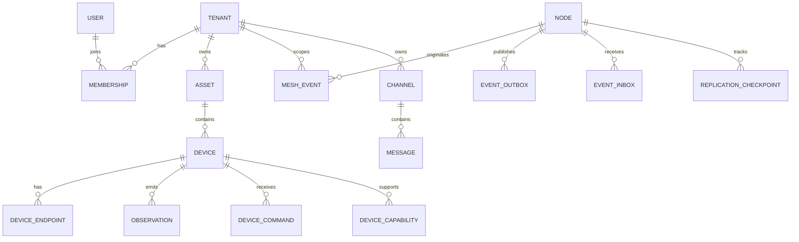

# Modelo de dados — domínio universal

> Identidades globais e aliases públicos: consulte [GodMesh Global Identity (GMI)](identidade-global.md).

## Conceitos
**Tenant** (pessoal/empresa) possui **ativos**; ativo possui **dispositivos**; dispositivo apresenta **endpoints** de rede; endpoints geram **observações**, comandos e eventos. O mesmo ativo pode ter BLE + GPS/LTE. Localização sempre contém origem e instante da observação.



## Tabelas centrais

| Entidade | Campos essenciais | Regras |
|---|---|---|
| `tenants` | id, kind, name, home_region, privacy_policy | Pessoal/empresarial |
| `users` | id (`gmi_id`), status, home_authority | Identidade GodMesh imutável; vínculos OIDC em tabela separada (`iss` + `sub`) |
| `identity_handles` | gmi_id, normalized_handle, domain, status | Alias `acct:` para descoberta via WebFinger, nunca prova de autenticação |
| `identity_auth_links` | gmi_id, provider_id, subject | Relaciona identidades OIDC externas sem tomar e-mail como chave |
| `memberships` | tenant_id, user_id, role, permissions | Row-level authorization |
| `assets` | id, tenant_id, name, category | Ativo lógico |
| `devices` | id, tenant_id, asset_id, manufacturer, model, status | `id` interno imutável |
| `device_endpoints` | id, device_id, protocol, external_id, gateway_id | Suporta múltiplos transportes |
| `device_capabilities` | device_id, capability, verified_at, confidence | Capability vs disponibilidade |
| `observations` | id, device_id, source, geometry, accuracy, occurred_at, received_at | Diferenciar GNSS/BLE/estimado |
| `device_commands` | id, device_id, command_type, state, expires_at | Estado + ACK por etapa |
| `channels` | id, tenant_id, kind, policy | Private/public/amateur autorizado |
| `messages` | id, channel_id, sender_id, payload, state | Dados escopados |
| `mesh_nodes` | id, peer_id, public_key, region, trust_state | Nó ≠ endereço IP |
| `mesh_events` | event_id, origin_node_id, tenant_scope, stream, authority_epoch?, origin_sequence, content_digest, payload, signature | Evento imutável; chave de sequência definida por perfil C10 proposto |
| `event_outbox` | event_id, origin_node_id, tenant_scope, stream, authority_epoch?, origin_sequence, content_digest, payload, publication_state, retention_policy_ref, created_at | Evento durável para publicação at-least-once |
| `event_inbox` | inbox_id, event_id, origin_node_id, tenant_scope, stream, authority_epoch?, origin_sequence, content_digest, validation_state, materialization_state, retention_policy_ref, received_at, validated_at?, materialized_at?, error_code? | Recebimento durável, deduplicação e recuperação |
| `replication_checkpoints` | authorized_scope_ref, origin_node_id, stream, authority_epoch?, last_contiguous_sequence, schema_profile, updated_at | Um prefixo contíguo por namespace; não é máximo escalar global |
| `service_manifests` | node_id, component, version, ready | Descoberta de serviços |
| `radio_services` | id, kind, operator_id, allowed_bridges, policy | Credenciais isoladas |
| `service_routes` | source/dest, capability, policy, status | Caminhos verificáveis |

## SQL inicial (ilustrativo, incompleto)
```sql
CREATE EXTENSION IF NOT EXISTS postgis;

CREATE TABLE tenants (
  id UUID PRIMARY KEY,
  kind TEXT NOT NULL CHECK (kind IN ('personal', 'business')),
  name TEXT NOT NULL,
  home_region TEXT NOT NULL
);
CREATE TABLE assets (
  id UUID PRIMARY KEY,
  tenant_id UUID NOT NULL REFERENCES tenants(id),
  name TEXT NOT NULL,
  category TEXT NOT NULL
);
CREATE TABLE devices (
  id UUID PRIMARY KEY,
  tenant_id UUID NOT NULL REFERENCES tenants(id),
  asset_id UUID REFERENCES assets(id),
  model_id TEXT,
  status TEXT NOT NULL DEFAULT 'registered'
);
CREATE TABLE observations (
  id UUID PRIMARY KEY,
  tenant_id UUID NOT NULL REFERENCES tenants(id),
  device_id UUID NOT NULL REFERENCES devices(id),
  source TEXT NOT NULL,
  position GEOGRAPHY(Point, 4326),
  accuracy_m DOUBLE PRECISION,
  occurred_at TIMESTAMPTZ NOT NULL,
  received_at TIMESTAMPTZ NOT NULL DEFAULT now()
);
CREATE INDEX observations_position_idx
  ON observations USING GIST(position);

CREATE TABLE mesh_nodes (
  id UUID PRIMARY KEY,
  peer_id TEXT NOT NULL UNIQUE,
  public_key BYTEA NOT NULL UNIQUE,
  region TEXT,
  trust_state TEXT NOT NULL
);
CREATE TABLE mesh_events (
  id UUID PRIMARY KEY,
  event_id UUID NOT NULL,
  tenant_id UUID NOT NULL REFERENCES tenants(id),
  tenant_scope TEXT NOT NULL,
  stream TEXT NOT NULL CHECK (stream <> ''),
  schema_profile TEXT NOT NULL,
  authority_epoch NUMERIC(20,0) CHECK (authority_epoch BETWEEN 0 AND 18446744073709551615),
  origin_node_id UUID NOT NULL REFERENCES mesh_nodes(id),
  origin_sequence BIGINT NOT NULL CHECK (origin_sequence > 0),
  content_digest BYTEA NOT NULL,
  event_type TEXT NOT NULL,
  payload BYTEA NOT NULL,
  signature BYTEA NOT NULL,
  occurred_at TIMESTAMPTZ NOT NULL
);
-- Proposta C10: epochs numéricos monotônicos por partição; NULL só se o perfil
-- declarar explicitamente que epoch não se aplica ao stream.
CREATE UNIQUE INDEX mesh_events_namespace_epoch_seq_uq
  ON mesh_events(origin_node_id, tenant_scope, stream, authority_epoch, origin_sequence)
  WHERE authority_epoch IS NOT NULL;
CREATE UNIQUE INDEX mesh_events_namespace_no_epoch_seq_uq
  ON mesh_events(origin_node_id, tenant_scope, stream, origin_sequence)
  WHERE authority_epoch IS NULL;
```

### Persistência, inbox/outbox e recuperação de eventos — perfil proposto

Esta seção alinha o modelo à recomendação de C10, sem ratificá-la como decisão aprovada. A autoridade de eventos/sync, os campos, cursores e casos de conformidade estão em [eventos e sincronização](../07-contratos/eventos-sincronizacao.md); o mapeamento de envelope/ACK/API está proposto em [GMP/API v1](../07-contratos/gmp-api-v1.md). Os contratos continuam sujeitos à aprovação, integração e compatibilidade. O SQL acima é ilustrativo, não é migração aplicada nem descrição de banco existente.

#### Chave de sequência e duplicatas

No perfil recomendado por C10, `origin_sequence` é inteiro positivo, crescente e contíguo dentro de `(origin_node_id, tenant_scope, stream, authority_epoch)`. `tenant_scope` representa o escopo canônico autorizado; seu mapeamento a `tenant_id` é explícito no perfil e não pode ser inferido de um cursor ou de um payload externo. `stream` separa sequências independentes. `authority_epoch` é o inteiro monotônico da autoridade por partição quando aplicável; ausência só é válida se o perfil do stream a declarar, e perfis com e sem epoch não podem ser misturados no mesmo namespace. `event_id` permanece a identidade lógica do evento e `content_digest` identifica o conteúdo canônico versionado: nenhum substitui os campos de escopo da chave de sequência. No SQL ilustrativo, `id` é identificador local da linha e não substitui `event_id`.

Quatro eventos do mesmo nó podem usar a sequência 12 sem colidir: `(N,T1,chat/room-7,4,12)`, `(N,T1,presence,4,12)`, `(N,T2,chat/room-7,4,12)` e `(N,T1,chat/room-7,5,12)`. Reentregar a primeira tupla com o mesmo `event_id` e digest é duplicata idempotente; a mesma tupla com `event_id` ou digest divergente é conflito, não sobrescrita, e deve ir a quarentena segundo o perfil. A restrição de unicidade detecta disputa pela tupla; a comparação de identidade/digest determina duplicata versus conflito.

Os dois índices parciais no exemplo representam os dois casos de perfil (`authority_epoch` presente ou explicitamente ausente), evitando que `NULL` enfraqueça a unicidade no PostgreSQL. A Inbox aplica a mesma unicidade namespaceada; ao detectar colisão, compara `event_id` e digest para decidir duplicata ou conflito. São formas ilustrativas, ainda não aprovadas como esquema ou migration. A alternativa de contador global por origem simplifica uma única chave, mas serializa streams e aumenta o escopo de bloqueio por lacuna; escolher essa alternativa exigiria mudar C10, checkpoints, snapshots, cursor/API e os exemplos. **Decisão pendente:** recomenda-se o namespace por stream/tenant/epoch conforme C10; usuário e responsáveis transversais ainda precisam aprovar a semântica, versão de perfil e compatibilidade.

#### Outbox e Inbox: atomicidade e ACK

- **Produtor:** a mutação de domínio, a alocação transacional da sequência no namespace e a inserção do evento na Outbox pertencem à mesma transação local. O mecanismo de alocação não está escolhido; deve preservar contiguidade no namespace ou deixar a lacuna explícita para reconciliação, e o índice único não substitui esse mecanismo. Publicação é at-least-once; retry mantém `event_id`, namespace, sequência e digest estáveis. Não declarar atomicidade quando a mutação e a Outbox estão em recursos transacionais diferentes.
- **Receptor:** validar autorização/escopo, assinatura, perfil, epoch e digest antes de admitir o evento. Persistir a Inbox com identidade, namespace, sequência, estados e referência à política de retenção eficaz. Mesma tupla + mesma identidade/digest é deduplicada; conflito não avança checkpoint.
- **Checkpoint/ACK:** por namespace, avançar somente até o maior prefixo contíguo duravelmente registrado como validado na Inbox. Uma lacuna mantém eventos posteriores pendentes. ACK confirma recebimento durável da Inbox, não entrega, materialização ou sucesso de projeção.
- **Materialização:** se Inbox, marcador de dedupe, projeção e checkpoint compartilham o mesmo recurso transacional, o commit deve ser atômico. Se não compartilham, Inbox é ledger durável e um projetor recuperável consome `pending`, aplica idempotentemente por versão de projeção/identidade de evento e marca o resultado; projeção não reconstruível ou sem idempotência comprovável fica bloqueada. Persistir Inbox sozinho não prova materialização pronta.

#### Checkpoints, cursores e snapshots

O modelo interno guarda vários checkpoints, cada um identificado por escopo autorizado, origem, stream, epoch (ou ausência declarada), última sequência contígua, perfil de schema e instante de atualização. O cursor de API é opaco, autenticado pelo servidor e vinculado ao vetor de checkpoints, filtros, principal/tenant, autorização vigente, perfil e retenção; não é um único `last_contiguous_seq` nem pode ser reutilizado em outro escopo/filtro. O manifest do snapshot inclui `snapshot_id`, escopo, origem, stream, epoch opcional declarado, `last_contiguous_sequence`, versão de schema, quantidade de partes, digest, prova de autoridade e política de retenção. Só snapshot completo e validado permite retomar replay depois do checkpoint; lacuna não é saltada. Ao trocar epoch, nunca comparar sequência nova como continuação implícita da anterior: exigir handoff autenticado que declare o último prefixo por stream; enquanto prova, wire e persistência desse handoff não estiverem definidos/aprovados, bloquear a retomada que dependa dele. Cursor expirado exige snapshot/rebootstrap ou falha fechada se a cópia necessária não existe, a retenção é ineficaz ou a autorização foi revogada.

#### Migração ilustrativa e compatibilidade

O esquema ilustrativo anterior tem somente `origin_node_id` e `origin_sequence` na unicidade. Essa chave equivale a sequência global por origem e não deve ser descrita como compatível com a recomendação C10 por stream. Uma futura migration versionada, ainda não escolhida nem executada, precisa:

1. acrescentar campos de escopo, stream, perfil e epoch, além de identidade/digest necessários; durante a expansão, manter escritores no perfil legado/global, pois a restrição antiga rejeita sequências iguais em streams distintos;
2. mapear cada linha histórica a partir do envelope/proveniência autoritativos — nunca adivinhar stream, tenant-scope ou epoch. Registros sem mapeamento íntegro ficam em quarentena ou bloqueiam a migração;
3. preparar uma janela de cutover com escrita pausada ou cercada; se necessário ao perfil novo, propor posição de projeção por namespace em ordem fundamentada e crosswalk versionado e autenticado, preservando o envelope histórico e sua assinatura/digest quando aplicáveis. Antes, identificar os campos assinados, a canonicalização e a autoridade da origem; registros sem prova ou mapeamento suficiente ficam bloqueados ou em quarentena. Uma alternativa com envelope derivado exige identidade, proveniência e provas próprias e decisão explícita. Não assumir que o número global existente já é contíguo em cada stream;
4. criar e validar unicidade de namespace para perfis com e sem epoch; comparar duplicatas pela identidade e digest, sem sobrescrever conflito;
5. trocar escritores/leitores por perfil versionado e retirar a unicidade global no cutover, antes de permitir sequência independente por stream. A compatibilidade de leitores/produtores legados, rollback e fencing deve estar definida para cada etapa;
6. migrar checkpoints escalares para vetor namespaceado. Cursores antigos sem escopo/vector compatível expiram e exigem snapshot/rebootstrap; nenhuma continuidade é presumida entre epochs. Plano de rollback e janela de compatibilidade dependem de volume, retenção, política de replay e capacidade de todos os nós, hoje não especificados.

Passos, backfill, índices e critérios acima são contrato documental ilustrativo, não código executado, plano operacional aprovado ou evidência de dados existentes. C07 ainda deve definir versionamento/mapeamento de cursor e compatibilidade wire; C06, handoff de epoch; C08, retenção efetiva das cópias e cursores; Alan integra as referências comuns. Falta decidir a chave final, o identificador canônico de `tenant_scope`, a política de backfill/rebootstrap e os critérios de rollback antes de considerar o perfil aprovado.

## Restrições que faltam na migração real
Chaves estrangeiras compostas para impedir referências cross-tenant; índices `(device_id, occurred_at DESC)`, particionamento de observações volumosas, retenção/TTL e GDPR/LGPD; RLS testado e verificado; envelope encryption e controle de acesso a mensagens/posições; a implementação e validação da fronteira transacional de outbox/inbox ainda faltam. A seção anterior define o contrato proposto, não confirma sua implementação.

## Origem e precisão da localização
`source=gnss`, `ble_gateway`, `network_estimate`, `manual` etc. Se uma tag BLE for detectada por gateway, a posição pertence à **observação do gateway** ou estimativa, não a uma suposta coordenada GNSS da tag. Guardar precisão/qualidade e atraso desde observação.

## Extensões obrigatórias do modelo integral
Adicionar em migrações versionadas: `device_profiles`, `device_interfaces`, `capability_verifications`, `gateway_bindings`, `bridge_instances`, `bridge_authorizations`, `voice_channels`, `ptt_grants`, `media_sessions`, `tenant_replication_policies`, `event_inbox`, `event_outbox`, `authority_epochs`, `privacy_consents`, `location_shares`, `retention_policies`, `node_service_health`. Para eventos, Inbox/Outbox e checkpoints devem persistir o namespace e a identidade definidos no perfil aprovado. Construir FKs compostas por `(tenant_id, id)` e RLS para impedir referências cross-tenant. Tratar sinais e permissões privadas com chaves apropriadas.
