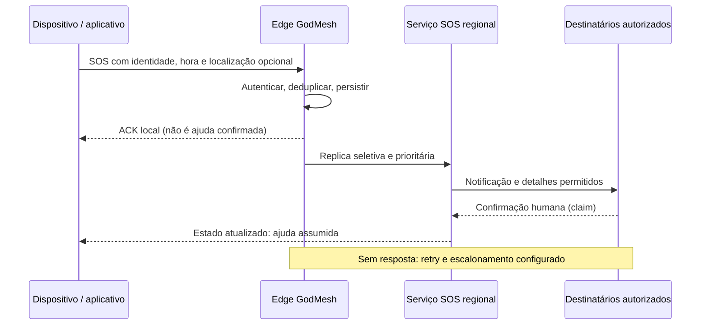

# GodMesh — Serviço federado de SOS e assistência

> **Status:** especificação de arquitetura avançada, **não operacional para emergências reais** até haver testes, procedimentos humanos, avaliações legais e acordos com destinatários. **ADR-039**. Alinhado à [Arquitetura de referência](../01-arquitetura/arquitetura-referencia.md), [UDNL](../01-arquitetura/normalizacao-dados.md) e [Eventos](eventos.md).

## 1. Finalidade e limites

SOS é um **evento de assistência estruturado**, independente da voz PTT e da transcrição, criado por uma ação explícita do usuário ou dispositivo autorizado. Pode informar o pedido de ajuda aos contatos e operadores selecionados, mesmo com redes parcialmente desconectadas. Nunca prometer entrega, despacho profissional ou substituição dos serviços públicos de emergência.

A interface deve oferecer, quando aplicável, ação explícita para usar o **discador de emergência nativo do aparelho**, sem afirmar que GodMesh conecta diretamente a autoridades. Integração com centrais públicas depende de convênio, testes e certificação aplicável. Não utilizar APIs de localização de emergência do sistema operacional como se fossem disponíveis a qualquer app.

## 2. Fontes de acionamento

- Aplicativo web/mobile/desktop: ação SOS clara, acessível e com prevenção de toques acidentais ajustável; ativação rápida também deve existir para situações urgentes.
- Dispositivo próprio: botão SOS autenticado, dispositivo GPS/LTE, LoRaWAN (uplink), ou LoRa mesh com firmware/gateway compatíveis.
- Rádio com gateway: evento SOS identificado **somente se o protocolo realmente transportar um sinal ou se houver mapeamento configurado**. Não deduzir usuário individual de áudio FM sem metadados.
- Mumble/FRN externos: apenas acionamento via comando explicitamente suportado, bridge autorizada e mapeamento de identidade com confiança; **não** anunciar SOS global automaticamente a partir de palavra transcrita ou de tráfego de terceiros.

## 3. Modelo e privacidade

Cada incidente possui `incident_id` global, `event_id` por atualização, `origin`, `gmc_callsign` ou referência externa escopada, `device_ref`, `created_at`, `observed_at`, `location` opcional (precisão, origem, frescor), `category` opcional, `priority`, `audience_policy`, `delivery_attempts`, `acknowledgements`, `timeline`, `status`, `test_mode` e `correlation_id`.

O GMC identifica publicamente o remetente dentro do canal autorizado, **não sua identidade civil**. Localização exata, dados pessoais e informações médicas (se existirem) ficam visíveis apenas a destinatários expressamente autorizados. Detalhes privados não são divulgados em tópicos globais P2P. Registrar revogações e auditoria de acesso.

## 4. Estados independentes e comprováveis

Não colapsar fases distintas em um único `delivered`:

| Dimensão | Estados possíveis | Significado |
|---|---|---|
| Registro | `created_local`, `accepted_by_node`, `replicated` | Evento persistido localmente, recebido por servidor, replicado |
| Transporte por destino | `queued`, `submitted`, `gateway_accepted`, `endpoint_confirmed`, `unconfirmed`, `failed`, `expired` | Melhor evidência por camada técnica; downlink enfileirado não é entrega |
| Atenção humana | `notified`, `viewed`, `claimed`, `response_in_progress`, `resolved` | Informação visível, recebida ou assumida por uma pessoa/grupo |
| Encerramento | `cancelled`, `resolved`, `expired`, `test_completed` | Desfecho auditado, sem apagar registros anteriores |

ACK do rádio, MQTT, websocket e push não equivalem à aceitação por um socorrista. Um atendimento só deve ser marcado como `claimed` por uma identidade humana autorizada. Se nenhum destinatário confirmar, apresentar essa condição de maneira destacada.

## 5. Encaminhamento e escalonamento



Regras por organização/canal: contatos definidos, equipe de plantão, zona geográfica, horário, nível de capacidade de cada transporte, sequência de reenvios, expiração, limites de carga e preferência por rota local. Circuit breakers e filas **reservadas** para SOS, com idempotência e retries. Uma entrega via LoRaWAN Classe A pode esperar próxima janela de recepção; nunca tratar downlink enfileirado como recebido.

**Falha de rede**: registrar localmente, mostrar último destino confirmado e tentar novamente quando houver rota; não prometer que P2P/radio/energia continuarão sempre disponíveis. O sistema não deve encerrar incidente automaticamente apenas porque o originador perdeu sinal.

## 6. Relação com canais de voz e transcrição

O incidente poderá abrir um `incident_channel` temporário com chat e PTT, criar marcador no canal original e permitir *floor priority* conforme ACL. **Não cortar automaticamente rádios externos nem ignorar regras de radioamador**. Após acionamento, texto digitado e fala transcrita podem compor histórico do atendimento com controles de acesso e retenção específicos. Transcrição ASR nunca é a única fonte do alerta, e decisões críticas precisam de confirmação humana.

## 7. Testes, abuso, auditoria e responsabilidade
### Integração com timeline quando não existe transcrição

O evento SOS estruturado cria marcador próprio no chat autorizado, sem depender de um resultado ASR. Quando o solicitante utiliza PTT, a timeline do canal/incident_channel registra a transmissão mesmo que a transcrição esteja indisponível; associa o `talk_session_id` ao `incident_id` sem assumir o conteúdo falado. Uma fala transcrita pode ser exibida como contexto adicional **somente se a política permitir**, nunca como único comprovante do pedido. Não ativar SOS automaticamente a partir de texto ASR incerto. Informar separadamente se o incidente foi somente registrado, se houve entrega técnica e se um responsável humano o assumiu.


- `test_mode=true` totalmente distinto de incidente real; simulações nunca enviam pedidos reais para terceiros.
- Antifraude: autenticação de origem, rate limiting adaptativo com cuidado para não bloquear emergência legítima, deduplicação, verificação de replay e logs de decisões.
- Cancelamento explícito com auditoria e notificação dos destinatários; pedidos atendidos não são apagados silenciosamente.
- Privacy by design, minimização, criptografia, prazo de retenção e exclusão conforme obrigação legal.
- Integrações de emergência pública só após contratos, validação legal, testes de ponta a ponta e rotinas operacionais.
- Testar perda de região, isolamento LAN, gateway offline, posições antigas, bateria baixa, falso positivo, rádio sem ID, latência, estados divergentes, migração de líder e sobrecarga.

## 8. Possível interoperabilidade CAP

O **Common Alerting Protocol (CAP) 1.2** é um padrão para publicação e troca de avisos de emergência e alertas públicos. O SOS pessoal/privado do GodMesh **não é automaticamente um alerta CAP nem uma solicitação validada de despacho a serviços públicos**. Criar um *CAP adapter* apenas quando houver um fluxo de alertas públicos autorizado e com perfil apropriado, sem publicação indevida de dados pessoais.

## 9. Contrato lógico de evento

```json
{
  "type": "gmp.sos.raised.v1",
  "incident_id": "incident-example-01",
  "event_id": "event-example-01",
  "origin": {"kind": "godmesh", "display_id": "GM-7K4P-9R2Q-X"},
  "device_ref": "device-example-03",
  "priority": "emergency",
  "location": {"lat": null, "lon": null, "source": "unavailable", "observed_at": null},
  "test_mode": false,
  "created_at": "2026-11-15T18:00:00Z",
  "visibility": "authorized_response_team"
}
```

Exemplo propositalmente sem localização. O envelope GMP completo adiciona escopo, assinatura, política de expiração e proteção contra repetição.

## Referências

- [OASIS CAP 1.2](https://docs.oasis-open.org/emergency/cap/v1.2/CAP-v1.2.html)
- [ChirpStack classes LoRaWAN](https://www.chirpstack.io/docs/chirpstack/features/device-classes.html)
- [Android Emergency Location Service](https://www.android.com/safety/emergency-help/emergency-location-service/how-it-works/)

## 10. Localização precisa exclusiva do SOS (ADR-041)

O SOS tem exceção **controlada** à regra de localização aproximada do chat: obtém do `Location Vault` a observação de localização mais precisa efetivamente disponível, incluindo latitude, longitude, `accuracy_m`, `source` e `observed_at`. Se a posição for antiga ou imprecisa, sinalizar; não inventar precisão. A localização precisa é entregue **somente a destinatários responsáveis previamente autorizados por incidente** com `incident.location.precise.read`, em canal protegido, com auditoria, expiração e retenção específicas.

O marcador de incidente na timeline comum pode anunciar o SOS e uma região de **raio mínimo 50 km**, mas **nunca** coloca posição exata em chat, PTT, transcrição, push geral, bridge Mumble/FRN ou gossip. A participação no canal de voz não concede acesso a localização precisa. Ver [Política de localização](../04-seguranca/politica-localizacao.md) e [Contrato GMP](../07-contratos/localizacao-privacidade.md).

## Conectividade satelital e recomendações manuais
O SOS usa a melhor rota **comprovadamente disponível**: rede IP convencional, caminho local, gateway ou serviço satelital de operadora quando o sistema o oferecer e quando o GodMesh for elegível para trafegar dados. A ausência de sinal celular não significa automaticamente que satélite está disponível. A confirmação de conectividade satelital **não** equivale à entrega do SOS nem à confirmação humana de socorro. Se a conexão satelital exigir ação manual, o aplicativo orienta conforme modelo/operadora, sem ativá-la diretamente. Oferecer acesso às funções **oficiais** de emergência do aparelho quando aplicáveis; priorizar sobrevivência da bateria e mensagens curtas do próprio GodMesh sem desativar funções essenciais.

Ver [Contingência e satélite](../01-arquitetura/conectividade-contingencia-satelite.md) e [Testes móveis](../05-operacao/testes-mobile-guardian.md).
