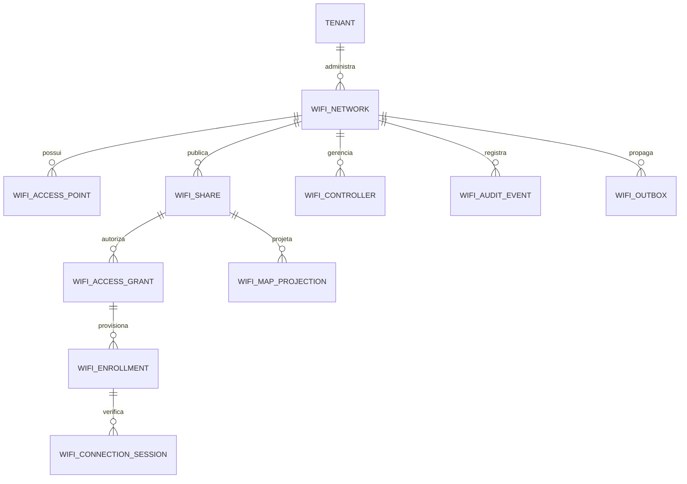

# GodMesh Wi-Fi — modelo de domínio e banco PostgreSQL/PostGIS

> **GMWIFI-DATA-001 · v1.0 · 2026-11-15.** Contrato lógico e DDL de referência, sujeito a migrations, testes e revisão de segurança. Consulte a [arquitetura](../01-arquitetura/wifi-autodiscover-autoshare.md).

## 1. Modelo de domínio



Entidades existentes em GodMesh `tenants`, `users`, `devices`, `nodes` continuam fontes canônicas; este módulo acrescenta somente entidades Wi-Fi. `GMI` não aparece publicamente. O mapa não expõe identidades pessoais nem BSSIDs.

| Entidade | Escopo | Observações |
|---|---|---|
| `wifi_networks` | Privado/administrador | Rede lógica controlada; SSID não é identificador único |
| `wifi_access_points` | Administração | APs físicos associados; BSSID opcional e protegido |
| `wifi_controllers` | Administração | Agente de roteador pareado; identidade e heartbeat |
| `wifi_shares` | Organização/usuários elegíveis | Política de divulgação e validade |
| `wifi_access_grants` | Individual/grupo | Direito de acesso, TTL, limite de dispositivos, revogação |
| `wifi_enrollments` | Confidencial | Fluxo de credencial, referências externas e estados |
| `wifi_connection_sessions` | Privado do solicitante | Progresso e diagnóstico; não confundir com autenticação AP |
| `wifi_map_projections` | Leitura autorizada | Projeção `coarse`, `hidden` ou **exata por opt-in**; TTL e elegibilidade |
| `wifi_audit_events` | Administrador | Mudanças e consentimentos; evidência de acesso detalhada em `wifi_access_session_evidence` |
| `wifi_outbox` | Interno | Eventos assinados/deduplicados e publicação por escopo |
| Inventário de sinais móveis | **Local no aparelho** | Armazenamento criptografado, retenção curta; só sync se opt-in |

## 2. DDL de referência

```sql
CREATE EXTENSION IF NOT EXISTS postgis;
CREATE EXTENSION IF NOT EXISTS pgcrypto;

-- Tabelas tenants/users/devices pertencem ao domínio GodMesh.
CREATE TABLE wifi_networks (
  id UUID PRIMARY KEY,
  tenant_id UUID NOT NULL REFERENCES tenants(id),
  display_name TEXT NOT NULL,
  ssid TEXT NOT NULL,
  security_mode TEXT NOT NULL CHECK (security_mode IN
    ('wpa2_psk','wpa3_sae','wpa2_enterprise','wpa3_enterprise','passpoint','owe','open')),
  state TEXT NOT NULL CHECK (state IN
    ('private','claim_pending','verified','disabled')) DEFAULT 'private',
  guest_network BOOLEAN NOT NULL DEFAULT FALSE,
  owner_verified_at TIMESTAMPTZ,
  owner_evidence_ref TEXT,
  created_at TIMESTAMPTZ NOT NULL DEFAULT now(),
  updated_at TIMESTAMPTZ NOT NULL DEFAULT now(),
  version BIGINT NOT NULL DEFAULT 1,
  UNIQUE (id, tenant_id)
);

CREATE TABLE wifi_controllers (
  id UUID PRIMARY KEY,
  tenant_id UUID NOT NULL REFERENCES tenants(id),
  network_id UUID NOT NULL,
  public_key BYTEA NOT NULL,
  driver_kind TEXT NOT NULL,
  state TEXT NOT NULL CHECK (state IN ('pending','active','suspended','revoked')),
  last_seen_at TIMESTAMPTZ,
  capabilities JSONB NOT NULL DEFAULT '{}'::jsonb,
  UNIQUE(network_id, id),
  FOREIGN KEY(network_id, tenant_id) REFERENCES wifi_networks(id, tenant_id)
);

CREATE TABLE wifi_access_points (
  id UUID PRIMARY KEY,
  tenant_id UUID NOT NULL REFERENCES tenants(id),
  network_id UUID NOT NULL,
  controller_id UUID REFERENCES wifi_controllers(id),
  bssid_ciphertext BYTEA, -- opcional; protegido sob chave/escopo do tenant
  radio_band TEXT CHECK (radio_band IN ('2.4ghz','5ghz','6ghz','unknown')),
  last_seen_at TIMESTAMPTZ,
  status TEXT NOT NULL DEFAULT 'unverified' CHECK
    (status IN ('unverified','online','offline','retired')),
  FOREIGN KEY(network_id, tenant_id) REFERENCES wifi_networks(id, tenant_id)
);

CREATE TABLE wifi_shares (
  id UUID PRIMARY KEY,
  tenant_id UUID NOT NULL REFERENCES tenants(id),
  network_id UUID NOT NULL,
  visibility TEXT NOT NULL CHECK (visibility IN
    ('private','members','invite_only','community')),
  state TEXT NOT NULL DEFAULT 'draft' CHECK (state IN
    ('draft','active','paused','revoked','expired')),
  access_method TEXT NOT NULL CHECK (access_method IN
    ('eap_tls','passpoint','ppsk','dpp','guest_psk','manual')),
  max_clients INTEGER CHECK (max_clients > 0),
  valid_from TIMESTAMPTZ,
  valid_until TIMESTAMPTZ,
  consent_version TEXT NOT NULL,
  consented_at TIMESTAMPTZ NOT NULL,
  created_by UUID NOT NULL REFERENCES users(id),
  policy JSONB NOT NULL DEFAULT '{}'::jsonb,
  updated_at TIMESTAMPTZ NOT NULL DEFAULT now(),
  version BIGINT NOT NULL DEFAULT 1,
  FOREIGN KEY(network_id, tenant_id) REFERENCES wifi_networks(id, tenant_id),
  CHECK (valid_until IS NULL OR valid_from IS NULL OR valid_until > valid_from)
);

CREATE TABLE wifi_access_grants (
  id UUID PRIMARY KEY,
  share_id UUID NOT NULL REFERENCES wifi_shares(id),
  grantee_user_id UUID REFERENCES users(id),
  grantee_device_id UUID REFERENCES devices(id),
  state TEXT NOT NULL DEFAULT 'active' CHECK (state IN
    ('active','revoked','expired')),
  valid_until TIMESTAMPTZ NOT NULL,
  created_at TIMESTAMPTZ NOT NULL DEFAULT now(),
  revoked_at TIMESTAMPTZ,
  policy_version BIGINT NOT NULL,
  CHECK (grantee_user_id IS NOT NULL OR grantee_device_id IS NOT NULL)
);

CREATE TABLE wifi_enrollments (
  id UUID PRIMARY KEY,
  grant_id UUID NOT NULL REFERENCES wifi_access_grants(id),
  method TEXT NOT NULL CHECK (method IN
    ('eap_tls','passpoint','ppsk','dpp','guest_psk','manual')),
  state TEXT NOT NULL CHECK (state IN
    ('requested','issuing','ready','delivered','failed','revoked','expired')),
  secret_ref TEXT, -- referência ao vault/controlador, jamais segredo em texto
  expires_at TIMESTAMPTZ NOT NULL,
  created_at TIMESTAMPTZ NOT NULL DEFAULT now(),
  idempotency_key TEXT NOT NULL,
  UNIQUE(grant_id,idempotency_key)
);

CREATE TABLE wifi_connection_sessions (
  id UUID PRIMARY KEY,
  grant_id UUID NOT NULL REFERENCES wifi_access_grants(id),
  enrollment_id UUID REFERENCES wifi_enrollments(id),
  client_device_id UUID REFERENCES devices(id),
  status TEXT NOT NULL CHECK(status IN
    ('requested','os_pending','permission_required','associating',
     'associated','internet_verified','local_only','captive_portal',
     'failed','disconnected')),
  client_reported_at TIMESTAMPTZ,
  server_observed_at TIMESTAMPTZ NOT NULL DEFAULT now(),
  failure_code TEXT
);

CREATE TABLE wifi_map_projections (
  share_id UUID PRIMARY KEY REFERENCES wifi_shares(id),
  tenant_id UUID NOT NULL REFERENCES tenants(id),
  display_point GEOGRAPHY(Point,4326),
  uncertainty_radius_m INTEGER NOT NULL CHECK (uncertainty_radius_m >= 0),
  position_kind TEXT NOT NULL CHECK
    (position_kind IN ('coarse_area','exact_opt_in','none')),
  last_verified_at TIMESTAMPTZ,
  valid_until TIMESTAMPTZ NOT NULL
);
CREATE INDEX wifi_map_geography_idx
  ON wifi_map_projections USING GIST(display_point);

CREATE TABLE wifi_audit_events (
  id UUID PRIMARY KEY,
  tenant_id UUID NOT NULL REFERENCES tenants(id),
  network_id UUID NOT NULL REFERENCES wifi_networks(id),
  actor_id UUID REFERENCES users(id),
  event_type TEXT NOT NULL,
  happened_at TIMESTAMPTZ NOT NULL DEFAULT now(),
  metadata_redacted JSONB NOT NULL DEFAULT '{}'::jsonb
);

CREATE TABLE wifi_outbox (
  event_id UUID PRIMARY KEY,
  tenant_id UUID NOT NULL REFERENCES tenants(id),
  stream TEXT NOT NULL,
  event_type TEXT NOT NULL,
  payload JSONB NOT NULL,
  inserted_at TIMESTAMPTZ NOT NULL DEFAULT now(),
  published_at TIMESTAMPTZ
);
```

**Notas de implementação:** IDs UUIDv7 gerados no Rust; exigências entre tenants adicionais devem ser aplicadas por FKs compostas e/ou validação transacional; políticas RLS por tenant em todas as tabelas; restrição exclusiva em controlador/grants de função conforme a política; limpeza automática de tokens e histórico de conexão. Não se deve executar esse DDL diretamente em produção sem migração, revisão de índices, plano de backup e testes de concorrência.

## 3. Inventário local

Estrutura criptografada no cliente (SQLite/SQLCipher ou solução equivalente): `local_wifi_observations(observation_id, ssid_hash, encrypted_ssid, bssid_hash_rotating, rssi_dbm, band, observed_at, expires_at, source, permission_state)`.

A retenção curta e a pseudonimização impedem que o catálogo central se transforme em serviço de rastreamento de redes de terceiros. Nunca derivar posição de residência sem consentimento de publicação. `rssi_dbm` não é distância nem direção; não é comprovante de alcance do AP na localização atual após expiração do registro.

## 4. Política de dados e replicação

| Conjunto | Regional | Federação | Mapa público |
|---|---|---|---|
| Inventário privado | Preferencialmente só dispositivo | Não | Não |
| Identificação de controladores | Tenant | Peers autorizados | Não |
| Redes/partilhas autorizadas | Sim | Projeção autorizada | Dados minimizados |
| Credentials/secret refs | Vault/região titular | Não | Não |
| Grants | Região de autoridade | Apenas réplica autorizada; TTL/versão | Não |
| Sessões de conexão | Região/usuário | Não por padrão | Não |
| Posição de AP | Privada em origem | Projeção autorizada | Opt-in + generalizada |
| Auditoria | Região de autoridade | Só auditoria autorizada | Não |

Revogação deve produzir `wifi.share.revoked`/`wifi.grant.revoked` com versão crescente; um nó offline não pode emitir novas autorizações usando estado desatualizado. Para PSK compartilhada, marcar revogação como `pending_ap_enforcement` até haver confirmação do controlador.

## 5. Regras de consistência

- Escritas: autoridade do tenant e controle de versão otimista.
- Outbox na mesma transação que a mudança de compartilhamento/grant.
- Eventos at-least-once; deduplicação por `event_id` e versão por `share_id`/`grant_id`.
- Cada leitura do mapa aplica escopo e TTL do registro.
- Não retroalimentar dados de scans privados como novos pontos públicos.
- Exclusão de usuário, término de consentimento e desativação do proprietário propagam tombstones e bloqueiam grants futuros.

## 6. Integrações

[Arquitetura](../01-arquitetura/wifi-autodiscover-autoshare.md) · [API/GMP](../07-contratos/wifi-autodiscover-autoshare-api.md) · [Segurança](../04-seguranca/wifi-compartilhamento-privacidade.md) · [Testes](../05-operacao/testes-wifi.md)


## 7. Correção normativa — AP físico, coordenada exata e proveniência (2026-11-15)

O ponto de acesso **físico** é a entidade geográfica. Um SSID pode existir em muitos APs; BSSID sozinho não constitui prova de propriedade. Após comprovar administração, GodMesh guarda uma coordenada exata **quando disponível**, sem fabricar precisão, juntamente com o método de obtenção, seu responsável e o histórico de consentimento. A publicação exata é **opt-in distinto** do compartilhamento de internet.

Extensão de esquema a aplicar em migração versionada (nomes ilustrativos; revisão final de FKs/RLS pendente):

```sql
ALTER TABLE wifi_access_points
  ADD COLUMN IF NOT EXISTS location_exact GEOGRAPHY(Point,4326),
  ADD COLUMN IF NOT EXISTS location_accuracy_m DOUBLE PRECISION
    CHECK (location_accuracy_m IS NULL OR location_accuracy_m >= 0),
  ADD COLUMN IF NOT EXISTS location_source TEXT,
  ADD COLUMN IF NOT EXISTS location_observed_at TIMESTAMPTZ,
  ADD COLUMN IF NOT EXISTS location_verified_at TIMESTAMPTZ,
  ADD COLUMN IF NOT EXISTS registered_by UUID REFERENCES users(id),
  ADD COLUMN IF NOT EXISTS shared_by UUID REFERENCES users(id),
  ADD COLUMN IF NOT EXISTS registered_at TIMESTAMPTZ NOT NULL DEFAULT now();

ALTER TABLE wifi_map_projections
  ADD COLUMN IF NOT EXISTS exact_location_consent_at TIMESTAMPTZ,
  ADD COLUMN IF NOT EXISTS exact_location_consent_version TEXT,
  ADD COLUMN IF NOT EXISTS location_source TEXT,
  ADD COLUMN IF NOT EXISTS location_accuracy_m DOUBLE PRECISION;
```

**Atenção:** em bancos já migrados, a constraint de `position_kind` anterior precisa ser substituída numa migração explícita para aceitar `exact_opt_in` e rejeitar publicações sem consentimento; `ALTER TABLE ... ADD COLUMN` sozinho não altera CHECK existentes. O armazenamento de coordenada exata é privado e a consulta pública recebe uma projeção controlada por ACL. Cada mudança gera evento de auditoria e versão para invalidação de cache/replicação.

## 8. Registro detalhado de acessos (2026-11-15)

Adicionar o esquema e os contratos de [GodMesh Wi-Fi Access Registry](wifi-registro-acessos.md): confirmação por controlador, sessão de acesso, contadores quando medidos, duração, forma de encerramento, consentimento e retenção. **Não** tratar solicitação do app como sessão de AP autenticada e **não** coletar histórico de URLs ou conteúdo de navegação.

## 9. Governança de dados no mapa

- `position_kind=coarse_area`: área geral autorizada; não divulgar localização exata.
- `position_kind=exact_opt_in`: apenas AP administrado, comprovado e com consentimento específico para publicar ponto real.
- `position_kind=none`: não publicar AP no mapa.
- A regra de localização pessoal aproximada de 50 km no chat **não se aplica automaticamente ao AP cadastrado**; são entidades e autorizações diferentes.

[Política Wi-Fi](../04-seguranca/wifi-compartilhamento-privacidade.md) · [Contratos API](../07-contratos/wifi-autodiscover-autoshare-api.md) · [Testes](../05-operacao/testes-wifi.md).
