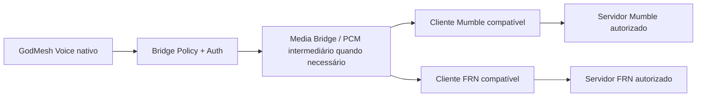

# GodMesh Voice Bridge SDK — Mumble e FRN

> **Status:** design inicial; nenhum conector de áudio validado neste documento. **Data:** 2026-11-15.

## Diretriz

**Limite arquitetural invariável:** FRN e Mumble são redes externas; suas implementações, servidores, contas e protocolos jamais constituem o núcleo GodMesh ou um pré-requisito para voz PTT nativa. Toda interoperabilidade atravessa um Bridge Host isolado e com política explícita. O SDK de bridge converte serviços externos em capacidades GodMesh, mas não delega a eles identidade, autorização global ou autoridade de canal. Consulte [Estratégia tecnológica](../01-arquitetura/estrategia-tecnologica.md).

**GodMesh Native é a fonte de verdade de identidade, usuários, canais, sessões e regras de roteamento.** Mumble e FRN são redes externas facultativas, acessadas por interfaces de bridge. Desativar a bridge não poderá interromper as comunicações GodMesh↔GodMesh.

## Contrato interno de bridge

Cada plugin implementa, conceitualmente:

| Operação | Descrição |
|---|---|
| `discover()` | Consultar capacidades/servidores compatíveis conhecidos, sem varreduras invasivas |
| `authorize()` | Validar credenciais, permissões de rede externa e política GodMesh |
| `connect()` | Criar sessão externa autorizada e reportar capacidade efetiva |
| `list_channels()` | Listar canais acessíveis segundo as regras do serviço |
| `subscribe_rx()` | Receber áudio/eventos no canal permitido |
| `request_tx()` | Solicitar transmissão somente quando explicitamente autorizada |
| `send_audio()` | Enviar áudio no codec aceito, sujeito a concessão PTT e limites |
| `release_tx()` | Encerrar transmissão e registrar estado |
| `health()` | Latência, reconexões, jitter, ocupação, autorização e estado |
| `disconnect()` | Fechamento seguro, liberação de leases e limpeza |

Protobuf/gRPC ou interface IPC autenticada são candidatos para separar bridge de terceiros do processo principal. Preferir isolamento de processos, limites de CPU/memória, timeouts e credenciais específicas por integração.

## Bridge Mumble

- Cliente com implementação compatível com **protocolo de áudio Mumble**; a interface Ice é para **administração**, não transporte de mídia.
- Controlar canais/ACLs pelo componente administrativo opcional, restrito a localhost/rede administrativa com segredo e firewall.
- Mapear identidades e canais explicitamente. Nunca inferir que um usuário GodMesh possui autorização no Mumble.
- Opus pode facilitar interoperabilidade, mas há distinções de encapsulamento, sessão e criptografia; testar o protocolo real.

## Bridge FRN

- Cliente compatível com o handshake e PTT do protocolo FRN publicado, versão documentada `2014000`.
- Ao receber permissão de transmissão da rede FRN, mapear concessões para a política do canal GodMesh; exigir autorização do operador para qualquer bridge externa.
- A documentação FRN descreve envio de comandos de controle e blocos de voz de 325 bytes; o formato de áudio exige implementação e testes específicos.
- Começar em **modo recepção**, em ambiente de teste autorizado, e habilitar transmissão somente depois de validação de políticas/controle.

## Segurança e prevenção de loops

**Toda ponte deve cumprir:**

1. Link desabilitado por padrão; aprovação explícita de usuário habilitado e operador do sistema externo.
2. `origin_network`, `bridge_id`, `channel_id`, `message_id`, `hop_limit` e cache de deduplicação nos metadados internos; não confiar em metadados inexistentes na rede externa.
3. Política de **não-retorno**: áudio originado em FRN não deve retornar à mesma rede FRN via Mumble ou outra bridge.
4. No máximo um processo bridge TX ativo por endpoint externo segundo lease com fencing token; expirado o lease, TX é recusado.
5. Temporizador máximo de PTT; locks de half-duplex, backoff de reconexão e proteção contra loops de áudio.
6. Auditoria de consentimento, operador, rede/canal de origem, duração e falhas sem gravação de conteúdo por padrão.
7. Separação explícita `internet-only`, `amateur-radio` e `professional-radio`, com políticas próprias de elegibilidade e transmissão.
8. A bridge normalmente **termina a criptografia de transporte e manipula áudio claro** para recodificar: não declarar E2EE ponta a ponta entre GodMesh e redes externas.

## Exemplos de política de roteamento

| Rota | Padrão | Habilitar quando |
|---|---|---|
| GodMesh ↔ GodMesh | permitida | contas/canais autorizados |
| GodMesh → Mumble | negada | link cadastrado + permissão nos dois ambientes |
| Mumble → GodMesh | negada | idem, observada política de privacidade |
| GodMesh → FRN | negada | operadores autorizam bridge e transmissão em rádio, quando aplicável |
| FRN → GodMesh | negada | recepção/ponte autorizadas; filtros anti-loop |
| Rede amadora ↔ canal corporativo | negada | não habilitar automaticamente; analisar restrições regulatórias |

## Testes obrigatórios

- Bridge desconectada não afeta canal nativo.
- Revogação de operador interrompe TX mesmo com mídia em andamento.
- Dois nós tentam tomar a bridge simultaneamente: somente um pode transmitir.
- FRN/Mumble ficam fora do ar: falha isolada com reconexão progressiva.
- Bridge A→B→A não causa retransmissão recursiva.
- Áudio adaptado possui latência/jitter medidos, sem afirmar qualidade antes de testes.

## Fontes técnicas

- [Protocolo Mumble](https://github.com/mumble-voip/mumble/blob/master/docs/dev/network-protocol/overview.md)
- [Configuração Ice do Mumble](https://www.mumble.info/documentation/administration/config-file/)
- [Protocolo FRN](https://freeradionetwork.eu/frnprotocol.htm)
