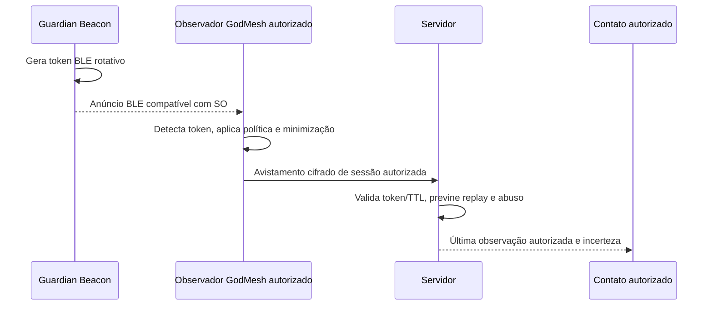

# GodMesh CrowdFind e Guardian Beacon — rede de localização colaborativa própria

> **ADR-043/044 · arquitetura proposta.** Usamos tecnologias abertas e APIs oficiais nos aparelhos. **Não** significa participar das redes proprietárias Apple Find My/Google Find Hub nem transformá-los em acessórios certificados.

## Objetivo
Quando o usuário ativar voluntariamente o Guardian, o telefone poderá oferecer **presença detectável temporária** (`beacon`) e/ou ajudar a retransmitir **observações de proximidade consentidas** de dispositivos próximos (`observer`). O cadastro, identidade, rede de detecção e backend pertencem ao GodMesh.

## Papel do smartphone
| Papel | Entrada | Saída | Condição |
|---|---|---|---|
| Guardian Beacon | Usuário ativa sessão e opt-in específico | Anúncio BLE temporário sem GMC nem coordenadas | Publicidade BLE disponível e SO permite |
| Observer | Detecção de um beacon GodMesh consentido | Relato cifrado de presença/posição estimada | Opt-in do detector, escopo e política antiabuso |
| Tracker principal | GNSS + sensores permitidos | Posição direta do aparelho com incerteza | Autorização Guardian/SOS |
| Relay IP | Mensagem recebida pela rede local | Encaminhamento quando conectado e permitido | Conectividade, bateria, políticas e credenciais |

Um **avistamento por BLE não é uma coordenada do telefone anunciado**. A localização inferida usa localização/qualidade e horário do detector, e deve ser rotulada como `proximity_sighting`, com incerteza frequentemente maior que GNSS.

## Fluxo

## Identidade e privacidade
- Anúncio BLE **não** divulga GMC, GMI, telefone, nome, coordenadas nem identificador permanente.
- Tokens rotativos vinculados a uma sessão, com tempo de vida curto e política anti-replay; proteção criptográfica padronizada e revisão especializada antes de produção.
- Somente o titular e contatos com concessões válidas consultam a localização conforme escopo; observadores não ganham direito de rastrear a pessoa detectada.
- O beacon desliga com `completed`, `expired`, `revoked` ou pausa solicitada; considerar limitações de confirmação no SO e exibir estado honesto.
- Proteções contra abuso: consentimento independente para emitir e observar; alertas contra rastreamento indesejado para tags físicas futuras; rate limiting, registros de acesso, exclusão/retention e revogação.
- **Nenhuma busca de “qualquer aparelho”**: detecção apenas de anúncios GodMesh reconhecíveis por recursos permitidos. Não utilizar BSSID/MAC como identidade permanente.

## Android e iOS
- Android: BLE advertise e scan acessíveis com permissões, hardware e limites de foreground/background. O scanner não garante disponibilidade contínua.
- iOS: CoreBluetooth pode anunciar/escutar serviços compatíveis, mas conteúdo e descoberta sofrem restrições consideráveis em segundo plano; anúncios iOS↔Android não são equivalentes aos de uma AirTag. Avaliar testes por versão/modelo, sem promessas universais.
- Funções de rede proprietária da Apple e Google não podem ser utilizadas por uma aplicação independente apenas copiando formato BLE. Integrações oficiais para acessórios dependem de acordos e certificações; a rede GodMesh é própria.
- UWB exige hardware/entitlements e interação suportada; não fornece por si só rastreamento mundial.

## Interoperabilidade e estado
`beacon_capability=ready|background_limited|disabled|unsupported|permission_required` e `crowdfind_observation=valid|stale|uncertain|rejected`. O motor de capacidades anuncia o que foi **testado em tempo de execução**, não o que o marketing do aparelho promete.

## Relações
- [Privacidade e antirrastreamento](../04-seguranca/privacidade-crowdfind.md)
- [Contrato Guardian/CrowdFind](../07-contratos/guardian-crowdfind.md)
- [Localização e trajetória](../01-arquitetura/guardian-localizacao-trajetoria.md)
- [Testes móveis](../05-operacao/testes-mobile-guardian.md)

## Referências
- Apple Core Bluetooth background: https://developer.apple.com/library/archive/documentation/NetworkingInternetWeb/Conceptual/CoreBluetooth_concepts/CoreBluetoothBackgroundProcessingForIOSApps/PerformingTasksWhileYourAppIsInTheBackground.html
- Android BLE advertise: https://developer.android.com/develop/connectivity/bluetooth/ble/ble-overview
- Apple Find My Network Accessory Program: https://developer.apple.com/find-my/
- Google Find Hub accessory program: https://developers.google.com/nearby/fast-pair/overview
