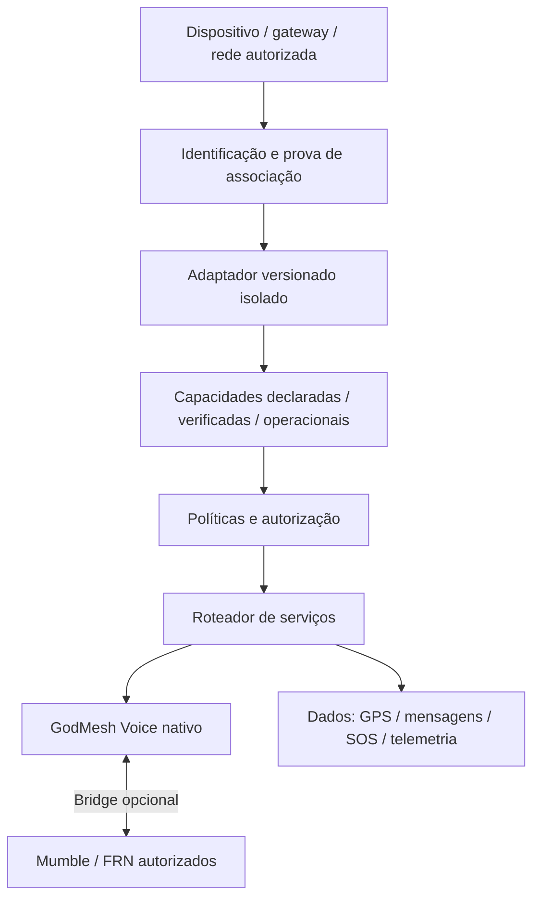

# GodMesh Universal Gateway — convergência de tecnologias

## Missão
Integrar dispositivos e serviços heterogêneos ao **GodMesh Native**, pela identidade e pelo motor de capacidades, sem presumir que todo dispositivo suporta todos os serviços.



## Camada de normalização obrigatória

Toda bridge/adaptador cruza a **[UDNL — Universal Data Normalization Layer](../01-arquitetura/normalizacao-dados.md)**: valida dados e identidade no contexto da rede de origem, preserva proveniência, transforma em eventos GMP e projeta para redes de destino de modo explícito e consciente de perdas. Não deduzir um GMC da coincidência de nomes ou números externos. O fluxo de áudio em tempo real permanece no plano de mídia.

Todas as integrações usam os perfis comuns `SourceProvenance` e `ProjectionReport` da UDNL. Um adaptador pode declarar suas limitações, mas não redefinir nomes, contagem de saltos, regra de deduplicação, semântica de identidade ou resultado de projeção. Se uma rede não preserva metadados de origem, a continuidade é desconhecida e o encaminhamento externo encadeado automático fica bloqueado.

## Etapas de habilitação
1. Detecção não invasiva via emparelhamento autorizado, BLE/USB/LAN ou cadastro por conta/credencial.
2. Prova de propriedade/gestão e registro das interfaces.
3. Seleção de perfil de dispositivo/firmware versionado.
4. Verificação operacional de cada capacidade e dependência de gateway.
5. Avaliação de ACL, licença RF, política de rede externa e consentimento de localização.
6. Busca de rota em grafo com função, direção, codec, latência, custo e validade.
7. Habilitação dinâmica no app e diagnóstico claro de indisponibilidade.

## Serviços e contratos
- `godmesh-device-discovery` e `godmesh-device-profiles`: perfis e interfaces.
- `godmesh-capabilities`: avalia evidência por capability, sujeito e contexto (`supported`, `verified`, `operational`); autorização e readiness são gates separados.
- `godmesh-service-router`: grafo de conectividade e rota elegível.
- `godmesh-bridge-sdk`: interface versionada para protocolos externos, com health/credenciais/quotas.
- `godmesh-media-edge`: áudio e floor/PTT nativo; conversão opcional em bridge.

### Avaliação de capability, rota e readiness

Esta é uma proposta de alinhamento entre `fronteiras-modulos.md` §3.2, `gmp-api-v1.md` §7.3 e a máquina de decisão de `02-dominio/capacidades.md`. Não altera esses documentos proprietários nem aprova wire ou implantação.

Uma avaliação descreve `subject_ref`, `capability_id`, `context_ref`, `state`, `evidence_ref` e `observed_at`, conforme a proposta C05. O estado é o nível mais alto sustentado para aquela capability, sujeito e contexto: `supported` é declaração de perfil; `verified` exige evidência atribuível validada; `operational` exige observação de disponibilidade atual da capability e das dependências incluídas naquele contexto. Mudança de sujeito, perfil, destino, dependência ou evidência invalida ou reduz a avaliação. Uma capability declarada não se torna verificada apenas por constar no perfil.

O GMP v1 §7.3 agora propõe listas cumulativas: `operational[] ⊆ verified[] ⊆ supported[]`. A lista `supported[]` pode conter declarações sem evidência; `verified[]` contém somente itens também listados em `supported[]`; `operational[]` contém somente itens também listados nos dois conjuntos anteriores. Consumidores podem derivar o nível mais alto presente. Eles não inferem nível a partir da ausência nas três listas. Essa equivalência entre enum de avaliação e coleções da API continua proposta, não wire aprovada.

`operational` significa disponibilidade observada da capability e de suas dependências específicas no contexto. Não significa autenticação, autorização, rota elegível, saúde global de um recurso ou readiness do serviço. O consumidor avalia `AccessDecision`, rota disponível, saúde dos recursos requeridos e demais condições de política separadamente. A rota só fica elegível quando a capability obrigatória está operacional e fresca, a autorização permite a ação e os gates de rota e recurso também passam. O gate `READY` não é sinônimo de `operational`.

O documento [de capacidades](../02-dominio/capacidades.md) separa a disponibilidade contextual observada da capability das decisões de autorização, elegibilidade da rota e readiness do serviço. Essa separação é coerente com a distinção acima; a projeção cumulativa C07 permanece proposta, e sua integração com os contratos e a política de evidência/frescor ainda precisa ser conciliada. A existência de texto alinhado não ratifica o wire nem define prazos de validade.

Sem método de observação e janela de frescor configurados para origem, capability e contexto, uma resposta não sustenta `operational` para uma nova rota nem anúncio de readiness. Nenhum TTL, threshold, SLO ou disponibilidade foi escolhido. A validade expirada remove a capability de `operational[]`; isso não remove a declaração `supported[]` nem prova revogação. A expiração de autorização é tratada pelo motor de políticas.

| Caso de conformidade documental | Resultado proposto |
|---|---|
| Perfil declara `voice.tx`, sem evidência atribuível. | Pode constar em `supported[]`; não consta em `verified[]` ou `operational[]`, e não habilita uma rota. |
| Evidência valida `voice.tx`, mas não há observação atual de disponibilidade. | Consta em `supported[]` e `verified[]`; não consta em `operational[]`. |
| `voice.tx` está operacional no contexto, mas `AccessDecision` nega TX. | Capability permanece operacional; a rota é inelegível e nenhum TX é habilitado. |
| Capability está operacional, mas a rota ou recurso requerido está indisponível. | A rota não está elegível; `operational` não equivale a `READY`. |
| `operational[]` contém item ausente de `verified[]` ou `supported[]`. | Consumidor rejeita resposta como violação de schema segundo C07. |
| Evidência perdeu frescor, mas o perfil ainda declara suporte. | Remove o item de `operational[]`; conserva `supported[]` e, se a prova continuar válida, `verified[]`. |

## Pipelines
- **Dados:** terminal LoRaWAN → gateway → ChirpStack/MQTT → adapter → evento normalizado → política → PostGIS / mensageria → cliente autorizado.
- **Áudio nativo:** cliente GodMesh → GMP control → GodMesh Media → cliente GodMesh.
- **Áudio com bridge:** GodMesh Media ↔ processo de bridge autorizado ↔ cliente FRN/Mumble compatível ↔ rede externa.
- **Tag BLE:** detecção consentida → gateway localizado → posição aproximada (não GNSS de uma tag sem GPS).

## Não objetivos
- Não habilitar voz em LoRaWAN Classe A pela mera presença de gateway.
- Não presumir integração a redes proprietárias Apple/Google/Samsung sem API/convênio autorizado.
- Não anunciar TX externo só porque um servidor rádio foi descoberto.
- Não prometer E2EE inalterada se houver transcodificação na bridge.

## Isolamento
Adaptadores com privilégios mínimos, IPC autenticado, segredo isolado por conexão, auditoria, rate limiting, fila de comandos com TTL, policy engine e prevenção de ciclos.

### Perfil documental proposto para comandos de bridge

Este perfil concretiza o requisito de fila com TTL e estende o contrato de comando comum. É uma proposta documental, não um schema GMP nem uma implantação aprovada. O perfil aplica-se a comandos que atravessam adaptadores e podem causar efeitos externos. O estado canônico continua pertencendo a `07-contratos/eventos-sincronizacao.md` (Martin Kleppmann) e ao contrato GMP de `07-contratos/gmp-api-v1.md` (Graydon Hoare). A fila de bridge não cria estados ou IDs paralelos.

O perfil usa os identificadores distintos do contrato comum de eventos e sincronização: `command_id` identifica o ciclo de vida lógico, `operation_id` identifica a operação idempotente e `attempt_id` identifica cada tentativa de entrega. Uma reentrega do mesmo efeito conserva `command_id` e `operation_id` e registra novo `attempt_id`. O contrato GMP mapeia `Idempotency-Key` para `operation_id`. A bridge não cria um identificador alternativo.

O replay segue a chave e a política de idade de `operation_id` no contrato comum de eventos e sincronização. Para comando de bridge, `expires_at` é obrigatório e limita o início de qualquer novo efeito; `created_at` é atribuído pelo serviço dono do comando e não substitui `operation_id` nem prova horário confiável. Uma chave conhecida com o mesmo namespace e `request_fingerprint` retorna a operação existente. Uma chave conhecida com fingerprint diferente é conflito. Uma chave desconhecida fora de `max_key_age`, além de `max_future_skew`, ou sem política eficaz é recusada. A janela de expiração é `[created_at, expires_at)`, condicionada ao relógio confiável e aos parâmetros de frescor definidos por operação. `max_key_age`, `max_future_skew` e `idempotency_record_retention` permanecem sem valores aprovados. Sem política eficaz e retenção compatível com redelivery, a rota não fica pronta.

| Campo de validação do comando | Tipo semântico | Obrigação |
|---|---|---|
| `command_id` | identificador estável de ciclo de vida | Obrigatório e imutável durante todas as tentativas da mesma operação lógica; definido por eventos/sync. |
| `operation_id` | UUIDv7 proposto para idempotência | Obrigatório em comando mutável. Seu namespace é `(tenant_id, principal_ref, operation_kind, resource_ref, operation_id)`; autenticação e autorização permanecem separadas. |
| `attempt_id` | identificador opaco | Obrigatório por tentativa de entrega e distinto em cada redelivery; não cria nova operação lógica. |
| `tenant_id` | identificador de tenant | Obrigatório. Derivado do principal/contexto autenticado; valor recebido não concede acesso. |
| `resource_ref` | referência tipada e escopada | Obrigatório para comando que age sobre endpoint ou recurso; inclui o alvo na verificação idempotente definida por eventos/sync. |
| `target_bridge_id` | referência registrada de bridge | Obrigatório. Deve corresponder ao adaptador ativo e autorizado para o escopo. |
| `target_endpoint_id` | referência opaca de endpoint | Obrigatório e pertencente à instância/tenant autorizados. Não pode ser substituído por resultado de descoberta sem nova decisão. |
| `operation_kind` e `command_schema_version` | enum/string namespaced e versão | Obrigatórios. O adaptador deve declarar suporte à operação e à versão antes de enfileirar. |
| `payload` | objeto do schema do comando | Obrigatório quando a operação requer parâmetros. O digest cobre sua forma canônica. Não incluir senha, token ou segredo; referenciar credencial isolada por conexão. |
| `request_fingerprint` | digest da requisição canônica e versionada | Obrigatório conforme eventos/sync. Inclui todos os campos que alteram o efeito, incluindo operação, recurso, alvo, prazo e payload. Canonicalização e algoritmo pertencem a C07; a bridge não escolhe outro digest. |
| `created_at`, `expires_at` | instantes UTC | `created_at` é definido pelo serviço dono; `expires_at` é obrigatório para comando de bridge. Deve ser posterior a `created_at` e respeitar limites eficazes ainda não escolhidos. |
| `policy_ref` | referência versionada à política de retenção | Obrigatória para persistir comando, outbox e deduplicação. Resolve para classe e cópia C08; ausente ou não efetiva bloqueia persistência e replay conforme C10. |
| `principal_ref` | referência interna autenticada | Obrigatório para identificar quem solicitou a operação. Não aceita identidade externa sem prova suficiente e binding ativo. |
| `authorization_ref` | referência opaca à decisão | Obrigatório como trilha. A referência não substitui a verificação atual de autorização no consumidor. |
| `authority_epoch` | inteiro monotônico por tenant/partição, quando aplicável | Obrigatório para mutação sensível sujeita à autoridade de escrita; o consumidor confirma epoch e prova atuais. O epoch de autoridade de dados e o fencing de lease de bridge são controles distintos. [Replicação](../01-arquitetura/replicacao.md) registra o baseline de autoridade; [autoridade de escrita](../01-arquitetura/autoridade-escrita.md) distingue esse baseline dos mecanismos ainda propostos. A conciliação dos mecanismos e deste contrato permanece pendente. |
| `bridge_lease_ref` e `fencing_token` | referências de lease e token monotônico | Obrigatórios para TX e operações que exigem exclusividade do endpoint. Devem ser válidos para o endpoint e titular ativo imediatamente antes do efeito. |
| `ordering_mode` | enum proposta | `per_target_serial` para comandos externos mutáveis; `independent` somente para operações declaradas comutativas e seguras fora de ordem pelo contrato do adaptador. |
| `dispatch_scope_ref`, `dispatch_sequence` | referência opaca + `uint64` positivo | Proposta para comando `per_target_serial`. O dispatcher atribui ambos uma vez por `command_id` lógico. `dispatch_scope_ref` vincula bridge, alvo e geração local de dispatch; `dispatch_sequence` cresce dentro desse escopo. Em redelivery, preserve ambos e crie novo `attempt_id`. Ambos ficam fora de `request_fingerprint`. Operações independentes sem requisito de ordem omitem os dois. Não são `origin_sequence`, cursor ou checkpoint de eventos/sync. |

`dispatch_epoch` nomeia a geração local de ordenação do dispatcher/alvo, mas não é um campo wire separado nesta proposta. Essa geração é vinculada ao `dispatch_scope_ref` opaco. Ela não é `authority_epoch`, que representa autoridade de escrita C06. Uma operação pode exigir ambos: o consumidor valida a autoridade da mutação e, separadamente, a geração/posição da ordem local.

### Ciclo de vida local de dispatch

O serviço que ordena os comandos mantém um registro durável por escopo local. O registro liga uma geração a uma bridge e a um alvo autorizados, guarda a próxima posição alocável e identifica o estado de recuperação. `dispatch_scope_ref` referencia essa geração; seu formato continua opaco. Esse registro é local ao dispatcher, não um novo campo wire. O serviço persiste a geração e a posição junto com o comando/outbox antes de aceitar o comando como enfileirado. Uma alocação confirmada nunca é desfeita por reinício.

O dispatcher cria uma geração para um novo escopo bridge/alvo ou quando precisa retirar o escopo anterior. Ele publica a nova referência somente depois de persistir o registro e atualizar a validação de escopo nos consumidores locais. Essa validação local não prova que um destino externo rejeitará uma chamada antiga. A rotação não reinicia nem reutiliza posições no escopo antigo. A mesma referência e sequência continuam válidas para redelivery do mesmo `command_id`; a tentativa recebe novo `attempt_id`. Se o dispatcher não puder provar que o novo escopo está persistido e ativo, ele não envia comandos.

O checkpoint local registra a maior sequência contígua cujo resultado está conhecido, além das posições pendentes e dos `command_id`/`operation_id` associados. Ele avança somente após recuperar cada lacuna e resolver o resultado da posição anterior. O checkpoint não é um cursor de eventos/sync e não substitui o registro de idempotência do destino. A retenção desses registros precisa cobrir o período em que a política aceita redelivery ou consulta; enquanto C08 não definir a retenção efetiva, o perfil não pode declarar recuperação durável pronta.

| Falha ou recuperação | Critério documental proposto |
|---|---|
| Crash antes da persistência atômica do comando, escopo e posição | O serviço não confirma `queued` nem envia o comando. Uma repetição pode alocar a posição somente depois de consultar o registro idempotente e provar que a transação anterior não foi confirmada. |
| Crash depois do commit e antes do envio | A recuperação reenvia o mesmo `command_id`, `operation_id`, `dispatch_scope_ref` e `dispatch_sequence`, com novo `attempt_id`; não aloca nova posição. |
| Crash depois do envio e antes de registrar o resultado | Marca a tentativa como `outcome_unknown`. Consulta o recibo ou estado remoto usando a mesma identidade lógica. Sem resposta conclusiva ou deduplicação remota, bloqueia novo efeito; não promete exactly-once. |
| Restore de snapshot anterior ao último registro conhecido | Isola o dispatcher restaurado e não aceita seu escopo como atual. Consulta uma fonte durável mais recente e reconcilia comandos e efeitos remotos. Se não puder provar o maior número já usado nem resolver efeitos desconhecidos, mantém a rota bloqueada; não reinicia a sequência a partir do snapshot. |
| Perda do registro local ou da chave de recuperação | Marca o escopo como indisponível. Só cria outra geração após reconciliar os comandos aceitos e impedir efeitos duplicados. Caso contrário, bloqueia o alvo para novos comandos. |
| Expiração do comando | Não inicia nem renova o efeito. Preserva o recibo e o registro de idempotência pelo prazo efetivo da política; uma consulta pode informar o resultado já conhecido, mas não reabrir o comando expirado. |
| Serviço de recuperação, registro de idempotência ou destino indisponível | Mantém o comando pendente ou `outcome_unknown`, sem avançar o checkpoint nem contornar a lacuna. Retry, quando permitido pelo prazo e política, usa os mesmos IDs e posição. |
| Rotação solicitada com comandos pendentes ou resultado desconhecido | Não ativa a nova geração para o alvo até reconciliar cada efeito anterior ou demonstrar que a política do adaptador impede duplicação. Se não houver essa evidência, a rotação permanece bloqueada. |

O perfil proposto mapeia `DISPATCH_SEQUENCE_GAP` para recuperação da posição ausente sem efeito posterior; `DISPATCH_SEQUENCE_CONFLICT` para falha fechada sem retry automático; `DISPATCH_SCOPE_STALE` para quarentena do escopo e reconciliação antes de rotear em nova geração; e `outcome_unknown` para consulta do mesmo comando, sem nova posição ou efeito. `DEADLINE_EXCEEDED` encerra tentativas de efeito após `expires_at`. `UNAVAILABLE` permite apenas consulta ou retry da mesma identidade lógica enquanto prazo, autorização, retenção e deduplicação continuarem válidos. Esses nomes permanecem candidatos wire sujeitos a C07; C10 precisa incorporar o lifecycle local e Martin revisar a semântica de recuperação. Nenhum mapeamento autoriza repetir um efeito externo incerto.

Critérios de aceite documental: nenhuma falha reinicia ou reutiliza posição dentro de um `dispatch_scope_ref`; redelivery conserva a posição e cria novo `attempt_id`; uma lacuna não libera posições posteriores; restore antigo não volta a ser escritor; resultado remoto desconhecido impede efeito novo até reconciliação; expiração impede novo efeito; indisponibilidade da recuperação mantém a rota bloqueada; e rotação não ativa enquanto houver comandos anteriores sem resultado resolvido. Estes critérios descrevem comportamento pretendido, não comprovam implementação ou garantia exactly-once.

O registro de comando e sua entrada de fila devem ser persistidos de forma atômica pelo serviço que os possui. O produtor verifica schema, tenant, principal, ACL, capacidade, destino registrado, autorização vigente, TTL e que a versão do adaptador aceita o comando. Se qualquer verificação falhar, não cria um comando executável. Persistir `queued` significa apenas que a plataforma guardou o pedido, não que a bridge ou o dispositivo o aceitou.

Antes de cada efeito, o consumidor da bridge verifica o envelope GMP autenticado, `command_id`, `operation_id`, `attempt_id`, `request_fingerprint`, tenant e endpoint, schema e capacidade, `expires_at` por relógio confiável, autorização e revogação atuais, `authority_epoch` quando aplicável e lease/fencing válidos para TX. Se não puder confirmar expiração, autorização, autoridade ou registro idempotente, não executa o efeito. Uma decisão guardada pelo produtor não autoriza execução após revogação.

| Condição no consumidor | Ação obrigatória | Erro proposto para mapeamento GMP |
|---|---|---|
| Mesmo namespace, `operation_id` e fingerprint; operação já conhecida | Retornar ciclo de vida e resultado registrados, depois de revalidar autorização; não repetir o efeito. | Mesmo recibo/estado C10; sem erro novo. |
| Mesmo `operation_id` no namespace, fingerprint divergente | Recusar sem alterar o registro ou o efeito anterior. | `IDEMPOTENCY_CONFLICT` de C10/C07. |
| `expires_at` passou | Não iniciar efeito nem renovar o prazo por retry; manter `expired` conforme C10 ou consultar o ciclo de vida existente. | `DEADLINE_EXCEEDED` conforme C07. |
| Autorização foi revogada ou deixou de cobrir o endpoint/operação | Não executar; estado da tentativa/ciclo de vida segue C10, sem inventar transição. | `PERMISSION_DENIED` conforme C07/C09. |
| Epoch menor que o committed | Recusar como autoridade obsoleta. | `authority_epoch_stale` conceitual de C06, mapeamento GMP por C07. |
| Autoridade inacessível ou estado de autoridade incerto | Consultar autoridade; sem confirmação, não executar. | `authority_unavailable` conceitual de C06, mapeamento GMP por C07. |
| Lease ou fencing token de TX não corresponde ao titular atual | Recusar o TX, mesmo se a autorização do usuário ainda for válida. | `CONFLICT` ou erro final de lease a definir por C07. |
| Chega `dispatch_sequence=n+1` antes de `n` no mesmo escopo | Persistir/observar como pendente; não executar o comando posterior, avançar watermark local nem declarar dispatch concluído. Solicitar recuperação/reentrega de `n`. Depois de resolver a lacuna, revalidar autorização, prazo, `authority_epoch` quando aplicável, lease/fencing e deduplicação antes de qualquer efeito. | `DISPATCH_SEQUENCE_GAP`, nome candidato C07 §6; recuperação sem efeito posterior. |
| Mesma posição já registrada com identidade ou fingerprint divergente, ou posição antiga sem correspondência idempotente | Preservar o registro anterior; falhar fechado e não repetir efeito. | `DISPATCH_SEQUENCE_CONFLICT`, nome candidato C07 §6; sem retry automático. |
| `dispatch_scope_ref` aponta para geração, alvo ou bridge que não está vigente | Falhar fechado; não migrar a posição antiga para novo escopo. Só criar novo escopo/posição após consultar o resultado anterior, evitar duplicação e revalidar autorização. | `DISPATCH_SCOPE_STALE`, nome candidato C07 §6; renovar roteamento/escopo com autorização atual. |
| Fingerprint, assinatura ou versão não valida | Recusar sem encaminhar dados ao adaptador. | `SCHEMA_VIOLATION`, `UNAUTHENTICATED` ou `UNSUPPORTED_VERSION` conforme causa e C07. |
| Não é possível consultar o registro de deduplicação | Não repetir operação externa não idempotente. | `UNAVAILABLE` conforme C07, com retry somente da mesma operação dentro do prazo. |
| A conexão falha após envio e o destino não informa se aplicou o efeito | Registrar `DeliveryAttempt.state=outcome_unknown`; consultar recibo/estado antes de decidir novo efeito. | `DEADLINE_EXCEEDED` ou `UNAVAILABLE` conforme C07; o estado C10 não é erro concorrente. |

`DISPATCH_SEQUENCE_GAP`, `DISPATCH_SEQUENCE_CONFLICT` e `DISPATCH_SCOPE_STALE` são nomes candidatos no GMP §6, não erros wire ratificados. C10 propõe suas semânticas para recuperação sem efeito posterior, conflito sem retry automático e escopo obsoleto sem migração silenciosa; C07/C15 ainda precisam confirmar o mapeamento e a política de retry. Esses erros não se confundem com `SEQUENCE_GAP` de eventos/sync, `authority_epoch_stale` ou `authority_unavailable` da autoridade de escrita. A geração local `dispatch_epoch` não substitui `authority_epoch`; quando ambos forem aplicáveis, o consumidor verifica cada domínio separadamente.

A política de retenção do registro de deduplicação deve cobrir a validade, redelivery e replay aceitos para a classe do comando, usando a referência e as classes de cópia de C08/C10. Esses prazos ainda não estão escolhidos; sem política eficaz, a prontidão de comandos externos não pode ser declarada.

Comandos serializados por alvo executam um por vez. A proposta `per_target_serial` privilegia segurança dos efeitos externos sobre paralelismo. `dispatch_sequence` é local ao escopo bridge/alvo/geração de dispatch e não reaproveita a sequência de eventos C10, que ordena eventos por origem, tenant, stream e `authority_epoch`. Uma lacuna retém comandos posteriores sem efeito e exige recuperar a posição ausente. Após a recuperação, o consumidor consulta estado anterior e revalida autorização, prazo, autoridade de escrita quando aplicável, lease/fencing e deduplicação. Não avança watermark nem pula posição. Operações independentes só podem reordenar se o perfil versionado do adaptador as declarar comutativas e seguras fora de ordem. C07 §4.5/§5.1/§6 e C10 §4.1.2 ainda são propostas documentais; os códigos de dispatch continuam candidatos, sem ratificação wire ou validação de implementação.

Se uma revogação chegar enquanto um efeito já está em curso, o consumidor interrompe o TX ou pede cancelamento ao adaptador quando a interface suportar isso. Só declara `cancelled` quando o adaptador confirmar a interrupção. Sem confirmação, registra o último estado canônico conhecido e o resultado como não confirmado; não afirma que uma transmissão foi interrompida. Protocolos externos podem não validar o fencing token nem oferecer cancelamento. Nesses casos o GodMesh pode impedir novas chamadas locais após perder o lease, mas não deve alegar que revogou uma operação já aceita pelo destino. Se a política exigir essa garantia, a operação permanece inelegível até que o protocolo ou a interface autorizada a sustente.

Exemplo positivo, apenas ilustrativo:

```json
{
  "command_id": "command-example-42",
  "operation_id": "019a8cf1-1234-7abc-8def-123456789abc",
  "attempt_id": "attempt-example-01",
  "tenant_id": "tenant-example",
  "resource_ref": "endpoint-example",
  "target_bridge_id": "bridge-frn-example",
  "target_endpoint_id": "endpoint-example",
  "operation_kind": "radio.ptt.transmit",
  "command_schema_version": "1",
  "payload": {"grant_ref": "grant-example"},
  "request_fingerprint": "fingerprint-defined-by-gmp",
  "created_at": "2026-11-15T18:10:00Z",
  "expires_at": "2026-11-15T18:10:30Z",
  "principal_ref": "gmi:principal-example",
  "authorization_ref": "decision-example",
  "authority_epoch": 7,
  "bridge_lease_ref": "lease-example",
  "fencing_token": 12,
  "ordering_mode": "per_target_serial",
  "dispatch_scope_ref": "endpoint-bridge-epoch-example",
  "dispatch_sequence": 8
}
```

Os números, IDs, TTL e timestamp acima são dados fictícios. Não indicam duração aprovada, contador real, execução ou suporte de FRN. O consumidor só executa se os valores coincidirem com autoridade, autorização, lease e registro de deduplicação atuais.

Exemplo negativo: o mesmo `operation_id` no mesmo namespace chega com `request_fingerprint` diferente ou após expiração. A bridge não reinterpreta a chave como novo pedido, não transmite e retorna o erro comum de conflito ou o estado `expired`. Outro negativo: a fila contém uma ordem de TX, mas o lease mudou. O consumidor recusa a ordem antiga, ainda que ela tenha passado pela autorização na origem.

## Casos de conformidade documental

Estes casos definem o que contratos e futuras verificações precisam demonstrar. Não são testes executados nem resultados de implementação.

| Caso | Resultado exigido |
|---|---|
| Produtor recebe o mesmo `Idempotency-Key` no mesmo namespace e com mesmo fingerprint. | Reutiliza `operation_id` e `command_id`; não cria um segundo efeito. |
| Consumidor recebe nova tentativa com mesmo `command_id`, `operation_id` e fingerprint. | Registra novo `attempt_id`, devolve estado C10 existente e não chama de novo operação não idempotente. |
| `operation_id` conhecido chega com fingerprint diferente no mesmo namespace. | Recusa como `IDEMPOTENCY_CONFLICT` e preserva o fingerprint registrado. |
| `operation_id` desconhecido está fora de `max_key_age` ou além de `max_future_skew`. | Recusa conforme C10, sem executar ou reutilizar como nova operação. |
| Retry chega depois do prazo ou com autorização revogada. | Não executa, mesmo se foi autorizado e enfileirado antes. |
| Epoch de escrita avançou ou lease foi transferido. | Token antigo não executa no endpoint. |
| Comando 9 chega antes do 8 em fluxo serial. | Não aplica 9 fora de ordem; aguarda 8 ou a resolução terminal comum da lacuna. |
| Comandos explicitamente independentes chegam reordenados. | Só executa fora de ordem se o perfil versionado do adaptador os marcou como comutativos e reordenáveis. |
| Destino fecha após receber comando, sem confirmação de efeito. | Não repete automaticamente e não apresenta `completed` ou confirmação de dispositivo. |
| Registro de replay não está disponível para efeito externo não idempotente. | Falha em modo fechado. |

## Dependências de integração

- `07-contratos/eventos-sincronizacao.md` define os IDs e estados lógicos propostos. A sequência de eventos não é a sequência de dispatch da bridge.
- `07-contratos/gmp-api-v1.md` propõe envelope e mapeamento de `Idempotency-Key`; fingerprint wire e erro específico de dispatch ainda dependem de integração C07.
- `01-arquitetura/autoridade-escrita.md` propõe autoridade por escopo, `authority_epoch` e transferência. `replicacao.md` já usa home region e epoch como regra normativa; Alan deve resolver o status antes de aprovação cruzada.
- `07-contratos/identidade-autorizacao.md` propõe sujeito, autorização e revogação; o consumidor revalida o estado e o grant atuais.
- `04-seguranca/retencao-revogacao.md` propõe política por cópia e revogação. Prazo de retenção/tombstone continua sem decisão e bloqueia readiness da operação persistente.
- ADR-028 continua a exigir exclusividade e fencing para TX de bridge. Este perfil não altera a ADR nem declara a regra implementada.
