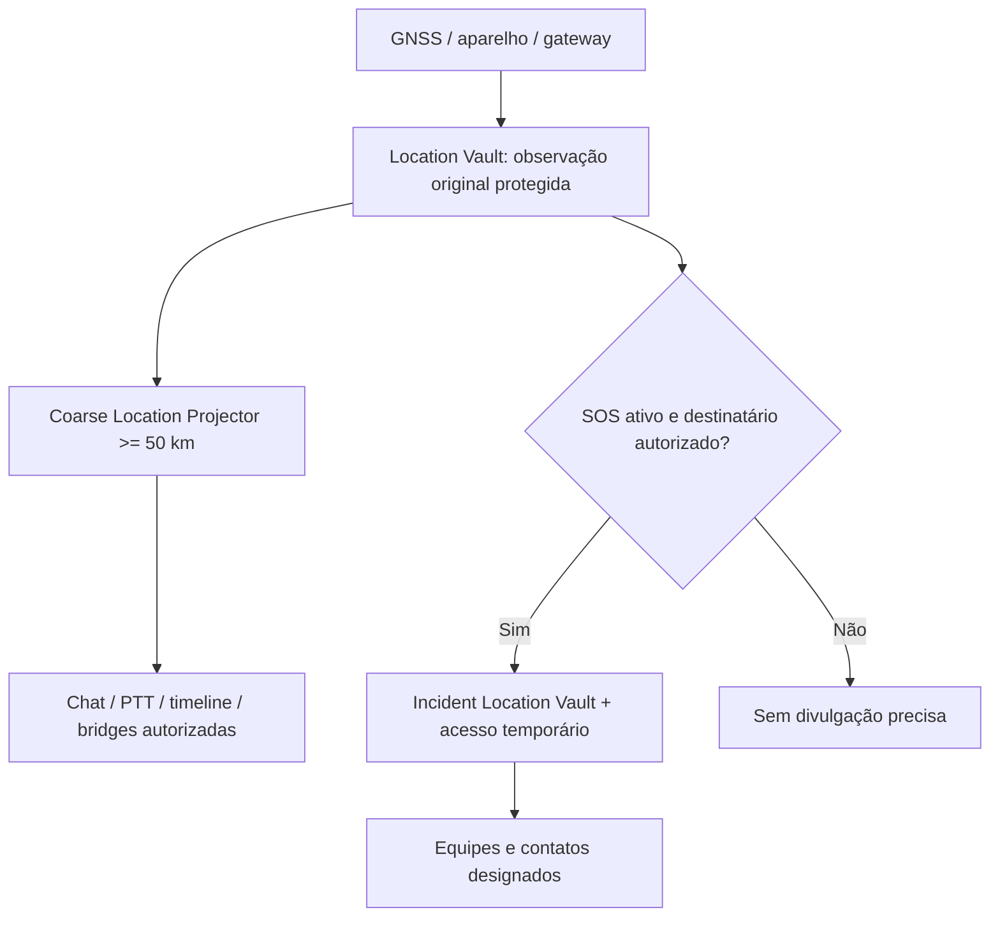

# GodMesh — Política de localização: chat aproximado e SOS preciso

> **Status:** diretriz arquitetural normativa proposta — **ADR-041**. Data: 2026-11-15. Complementa [Segurança](seguranca.md), [SOS](../02-dominio/servico-sos.md), [Chat/transcrição](../01-arquitetura/transcricao-multimodal.md), [UDNL](../01-arquitetura/normalizacao-dados.md) e [Contratos](../07-contratos/localizacao-privacidade.md). Não implica funcionalidade implementada.

## 1. Regra irrevogável de separação entre chat e SOS

- **Chat, canais PTT, timeline, mensagens e bridges externas:** apenas localização **aproximada**, quando o compartilhamento for permitido; representar por **área ou região com incerteza espacial mínima de 50 km de raio**. Nunca enviar latitude/longitude GPS original, endereço, coordenadas de alta resolução, accuracy real de GNSS, geohash de alta resolução ou outros metadados que reconstruam o ponto exato.
- **SOS acionado explicitamente:** enviar a **posição mais precisa e recente efetivamente disponível** (GNSS, localização do sistema operacional ou outra fonte), sem degradação artificial, **exclusivamente** a contatos/equipes autenticados designados para atender o incidente e autorizados a consultar localização precisa. Conservar `accuracy_m`, `observed_at`, `source` e `freshness`; não fabricar precisão que o dispositivo não fornece.
- O marcador de SOS na timeline normal informa estado e, se a política permitir, uma localização *coarse*. **Nunca** inclui a localização precisa do SOS. Um canal de atendimento separado também requer permissão específica para mostrar o ponto exato; participação no canal **não** concede automaticamente esse direito.
- Links externos, exportações, notificações push, resultados de pesquisa, analytics, logs, eventos de federação, transcrições e bridges devem aplicar a mesma política de acesso. **Não inferir que a omissão na UI protege dados já enviados pela API.**

## 2. Gerar a localização aproximada

1. Receber posição bruta apenas em componente protegido (`Location Vault`) com autenticação e política de retenção mínima.
2. Comprovar autorização para compartilhar localização com o canal; caso contrário, **não publicar nenhuma posição**.
3. Converter a posição para **região ampla pré-definida**, estável por um intervalo configurado, usando grade geográfica de baixa resolução ou área administrativa suficientemente ampla. Validar que o **alcance divulgado não é menor que a zona nominal de 50 km de raio** e que o ponto verdadeiro pertence à região; ampliar a região se necessário.
4. Publicar **rótulo de região e geometria generalizada** com `precision_class=coarse_50km_plus`; não publicar ponto lat/lon do usuário, centro como marcador preciso ou dados GPS de alta resolução. Se a UI exigir centro visual, exibir explicitamente a **região sombreada**, não um pin pontual.
5. Evitar inferência por repetição: limitar cadência, manter regiões estáveis por janelas de tempo, impedir combinação de múltiplas versões de áreas ligeiramente deslocadas e não divulgar mudança exata de fronteira/horário de cruzamento.
6. Não transformar o raio de 50 km em promessa de anonimato. Identificadores persistentes, voz, padrões de deslocamento, fotos e informações fornecidas pelo próprio usuário podem permitir identificação. Aplicar privacidade por padrão, finalidade e minimização.

### Termos de precisão

`coarse_50km_plus` significa **localização comunicada com incerteza intencional de pelo menos 50 km em escala radial**, não `accuracy_m=50000` medido pelo GPS. `accuracy_m` é a precisão *estimada pela fonte* e só aparece na observação protegida e no SOS autorizado. Uma área de raio 50 km é a **menor** área nominal permitida para o chat, não uma garantia matemática de não identificação.

## 3. Caminhos de dados separados

**Nunca utilizar um único evento contendo as coordenadas exatas e confiar que cada cliente as ocultará.** Modelar eventos e permissões distintos: `gmp.channel.location.coarse.v1` versus `gmp.sos.location.precise.v1`.

## 4. Privacidade e segurança no SOS

- Acionamento explícito e verificável (ou botão SOS do dispositivo previamente autorizado). A política de emergência predefine quem poderá receber a posição precisa; avisar o usuário sobre esses destinatários.
- Proteção com criptografia em trânsito e repouso, autorização por incidente (`incident.location.precise.read`), princípio do menor privilégio, acesso temporário, trilha de auditoria e política de retenção limitada.
- Sempre informar **qual fonte** produziu a posição e **há quanto tempo**. Se não houver GNSS, exibir `location_unavailable` ou uma posição menos precisa honestamente rotulada; o SOS não inventará coordenadas.
- Atualizações durante incidente seguem canal restrito e proteção equivalentes; a localização exata **não entra na timeline pública** por engano ao retransmitir ou transcrever.
- Bridges Mumble/FRN, redes de radioamador, LoRaWAN, mensagens comuns e tópicos de descoberta não recebem posição precisa do incidente por padrão. Somente integração formal e destinatário autorizado podem acessá-la.
- SOS não é promessa de despacho ou substituição de serviços públicos de emergência; informar status de entrega técnica e confirmação humana separadamente.
- Depois do encerramento: expirar concessões de acesso e observar retenção mínima/obrigações legais. Cancelamento ou expiração não eliminam automaticamente registros que precisem existir por obrigação de auditoria legitimada.

## 5. Critérios de aceitação e testes

- Verificar via API, WebSocket, timeline, pesquisa, exportação, FRN, Mumble e replicação que **nenhuma** mensagem comum contém coordenadas brutas nem dados suficientes para reconstruí-las.
- Testar várias observações sucessivas (inclusive perto de fronteiras de região): a combinação de publicações não deve revelar trajetória de alta resolução; adotar limites de cadência e estabilidade.
- Um usuário normal no canal não pode consultar `incident.location.precise`; somente respondedor autorizado recebe posição precisa e metadados de qualidade.
- Tentar acesso cross-tenant, replay, URL compartilhada, logs, notificações e exportações; negar vazamentos.
- Sem GPS ou com GPS desatualizado: apresentar precisão e frescor reais e estado de indisponibilidade, não coordenadas fabricadas.
- Durante particionamento de rede, preservar criptografia e autorização; não permitir downgrade para canal geral como estratégia de entrega de SOS.
