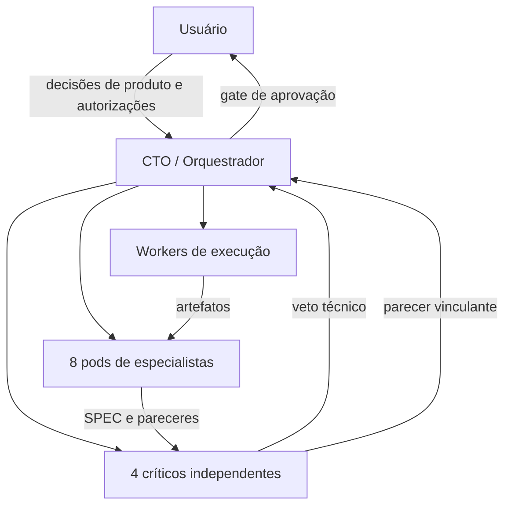
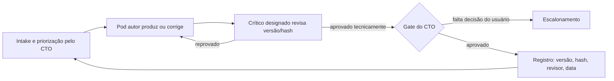

# GodMesh — equipe de engenharia e orquestração

> **Documento de organização, não normativo de produto.** Estado: vigente em 17/11/2026. Define papéis, fronteiras, fluxo de trabalho e gates de revisão. Não aprova arquitetura, SPEC, implementação ou resultado de teste. Precedência permanece em [Arquitetura de referência](../01-arquitetura/arquitetura-referencia.md), [Decisões](../06-planejamento/decisoes.md) e [Pendências](../06-planejamento/pendencias.md).

## 1. Autoridade

- **CTO / Orquestrador**: centraliza prioridade, atribuição, conflito entre pareceres e gate de aprovação. Não decide produto.
- **Usuário**: único que autoriza escopo, decisões bloqueadoras de produto/política, implementação, publicação, infraestrutura e integrações reais.
- **Especialistas**: donos técnicos documentais por domínio. Respondem por conteúdo e evidência, não pela aprovação.
- **Críticos**: revisão independente com poder de veto técnico. Nunca assinam o artefato que revisam.
- **Workers**: execução delimitada (autoria, integração, matriz, harness de evidências, e futuramente implementação/testes).

Regra dura: **autor ≠ revisor ≠ aprovador**. Aprovação exige versão identificada (hash), parecer favorável de crítico designado e registro do CTO.

## 2. Estado real do projeto (evidência, não intenção)

| Fato | Evidência |
|---|---|
| Documentação v3.8.0, revisão 15/11/2026 | `docs/README.md`, `docs/CHANGELOG.md` |
| Nenhum código, nenhum commit no repositório | `git log` sem commits; árvore apenas documental |
| 60 requisitos (43 RF + 17 RNF) | `docs/00-produto/requisitos.md` |
| 21 SPECs em `DRAFT/OPEN`, nenhuma aprovada | cabeçalhos de `docs/08-specs/SPEC-001..021` |
| Cobertura requisito→SPEC registrada como "A conciliar" em 60/60 | `SPECS.md`, tabela de catálogo |
| 8 programas de engenharia (A–H) com gates de validação | `docs/06-planejamento/roadmap.md` |
| 5 decisões bloqueadoras abertas | `docs/06-planejamento/pendencias.md` |
| Autorização: desenvolvimento contínuo até 100%, **com gate** de planejamento concluído + todas as SPECs aprovadas antes de implementar | `docs/06-planejamento/pendencias.md`, seção de autorização posterior |

Consequência operacional: a frente atual é **fechar planejamento, resolver decisões bloqueadoras e levar as 21 SPECs de DRAFT/OPEN a aprovadas**. Implementação só começa depois do gate.

## 3. Organograma

## 4. Especialistas — pods por domínio

Cada pod tem **um dono** (autor documental das SPECs do domínio) e colaboradores de interface. A divisão preserva a autoria já registrada em `SPECS.md`; mudar dono exige registro explícito.

| Pod | Domínio | Dono | Colaboradores | SPECs | Interfaces principais |
|---|---|---|---|---|---|
| P1 | Núcleo, protocolo GMP e federação | Martin Fowler | Leslie Lamport, Vint Cerf | 001, 003 | P3, P4, P7, P8 |
| P2 | Identidade, autorização e segurança | Kim Cameron | Bruce Schneier, Richard Bejtlich | 002, 020 | P1, P3, P7 |
| P3 | Dados, eventos, geoespacial e recuperação | Martin Kleppmann | Michael Stonebraker, Paul Ramsey, Bruce Momjian | 004, 005, 011, 021 | P1, P2, P8 |
| P4 | Voz PTT, mídia e transcrição | Radia Perlman | Daniel Povey | 007, 008 | P1, P6, P7 |
| P5 | Emergência, produto e jornadas | Nancy Leveson | Margaret Hamilton | 006, 012 | P4, P7, P8 |
| P6 | Integrações, UDNL, bridges e dispositivos | Gregor Hohpe | Jouni Malinen, Jack Ganssle | 009, 010, 017 | P2, P4, P7 |
| P7 | Clientes, offline, FFI e experiência multiplataforma | Lea Verou | Alex Crichton, Chet Haase, Donny Wals | 013, 014, 015, 016 | P1, P2, P4, P5 |
| P8 | Operação, SRE, capacidade e implantação | Brendan Gregg | Grady Booch | 018, 019 | P1, P3, P6 |

**Mandato do pod:** manter o domínio coerente com ADRs; fechar OPENs estruturais; declarar dependências e decisões bloqueadoras; entregar aceite observável por requisito coberto.

**Proibido ao pod:** aprovar a própria SPEC, alterar SPEC de outro pod, decidir política de produto, promover número proposto a medição, executar implementação ou teste antes do gate.

## 5. Críticos — revisão independente com veto

| Crítico | Mandato | Veta quando |
|---|---|---|
| C1 Cobertura e rastreabilidade | Verificar ligação requisito → SPEC → aceite → caso planejado; detectar requisito órfão e cobertura alegada sem texto | Existe RF/RNF sem SPEC, ou "A conciliar" apresentado como coberto |
| C2 Fronteiras, padrões e contratos | Revisar interfaces entre pods, versionamento, compatibilidade N/N-1, vocabulário e acoplamento | Contrato ambíguo, incompatível ou abstração sem necessidade demonstrada |
| C3 Testabilidade e evidência | Verificar aceite observável, casos positivos/negativos/borda/recuperação, honestidade de `NOT_EXECUTED` | Critério não verificável, teste inexistente tratado como cobertura ou resultado inventado |
| C4 Adversarial e abuso | Contestar premissas com contraexemplos; ameaça, abuso, rastreamento indevido, impersonação, falha em partição | Alegação sem evidência, garantia não demonstrável (entrega, SOS, anonimato) ou ameaça material sem tratamento |

Veto é registrado com: achado, documento/seção, contraexemplo, critério de fechamento e severidade. Só o CTO levanta veto, com justificativa escrita e registro da divergência preservada.

## 6. Workers

| Worker | Entrega | Limite |
|---|---|---|
| W1 Integração e matriz | Mapa requisito → SPEC → aceite → caso planejado, com estado real por linha | Não edita SPEC; não declara aprovação |
| W2 Normativo e ADRs | Consistência docs ↔ ADRs ↔ changelog ↔ índices; hashes por versão | Não decide arquitetura |
| W3 Harness de evidências | Contrato de evidências, IDs de teste, esqueleto de verificação local | Não implementa produto nem executa teste de produto |
| W4…Wn Implementadores | Código e testes por programa (A–H), sob SDD + TDD | Criados **somente** após o gate de SPECs aprovadas |

Regra de concorrência: no máximo 4 workers locais ativos por vez; cada um escreve em arquivos próprios e reporta ao CTO.

## 7. Fluxo de trabalho

1. **Intake**: CTO escolhe a frente (decisão bloqueadora, delta de SPEC, cobertura, contrato).
2. **Autoria**: pod produz a versão com incremento de versão e data.
3. **Crítica**: crítico designado revisa aquela versão/hash, nunca a anterior.
4. **Correção**: achados tratados um a um; divergência não se apaga, se registra.
5. **Gate do CTO**: verifica DoD abaixo e bloqueios externos.
6. **Escalonamento**: decisão de produto, política, licença, custo ou plataforma vai ao usuário com alternativas, impacto e recomendação.
7. **Registro**: versão, hash, autor, revisor, data e estado.

### Definição de pronto (SPEC)

- [ ] Escopo, requisitos cobertos e exclusões justificadas.
- [ ] Estados, transições, contratos, erros, permissões e limites.
- [ ] Timeout, cancelamento, retry limitado, idempotência, offline, revogação, recuperação.
- [ ] Segurança, consentimento, retenção, compatibilidade e migração.
- [ ] Aceite observável com caso positivo, negativo, borda e falha/recuperação.
- [ ] Dependências e decisões bloqueadoras declaradas, com dono da decisão.
- [ ] Nenhum `OPEN` estrutural remanescente; parâmetros desconhecidos declarados como desconhecidos.
- [ ] Autoria, revisão independente, versão e hash identificados.
- [ ] `NOT_EXECUTED` preservado onde não houve execução.

## 8. Regras de evidência

- Toda afirmação cita arquivo/seção ou fonte oficial com data; ausência de evidência = não verificado.
- Proposta, decisão aprovada, implementação e validação nunca se confundem.
- Número proposto não é medição; ACK técnico não é recebimento; recebimento não é atendimento humano.
- Achado de revisão inclui contraexemplo e critério de fechamento verificável.
- Nenhum agente declara cobertura, aprovação ou teste sem registro correspondente.
- Nenhum pod ou worker implementa com base em memória de API: documentação oficial da versão resolvida é pré-requisito de implementação (ADR-069).
- O CTO **orquestra**: decisão e gate são dele; a execução é dos pods e workers.

## 9. Escalonamento aberto ao usuário

Decisões bloqueadoras que dependem do usuário, herdadas de `pendencias.md`: carga e qualidade (cenários e limites), autoridade e recuperação (escrita por tenant, retenção, RPO/RTO), política e segurança (jurisdição, E2EE, retenção, revogação offline), compatibilidade e stack (bindings Rust, versões mínimas, seleção WinUI 3 / Qt Quick / Jetpack Compose), observabilidade operacional (SLO, alertas, responsáveis) e escolha de plataformas Windows/Linux/Android.

## 10. Roster de threads Cloudroom

Registro vivo; IDs preenchidos na criação. Threads locais, filhas do thread do CTO, no checkout do projeto.

| Papel | Thread |
|---|---|
| CTO / Orquestrador | `thr_t4vd9wgniq` |
| P1 Núcleo, GMP e federação | `thr_e7cm6jj7qv` |
| P2 Identidade e segurança | `thr_6p3cf86c66` |
| P3 Dados, eventos e geo | `thr_k7zj5migrr` |
| P4 Voz, mídia e transcrição | `thr_iudmwkwm4q` |
| P5 Emergência e produto | `thr_ywri6v257n` |
| P6 Integrações e dispositivos | `thr_hihkzbzzac` |
| P7 Clientes e experiência | `thr_dszpdf9asv` |
| P8 Operação e capacidade | `thr_hr4uyib6aw` |
| C1 Cobertura e rastreabilidade | `thr_693tyueebr` |
| C2 Fronteiras e contratos | `thr_j3mr2c5iif` |
| C3 Testabilidade e evidência | `thr_42s63hvpn7` |
| C4 Adversarial | `thr_dsx8fjsnss` |
| W1 Integração e matriz | `thr_uzaee2mdr8` |
| W2 Normativo e ADRs | `thr_6fji6bxva8` (execução interrompida por truncamento; artefato produzido pelo CTO) |
| W3 Harness de evidências | a criar |

### Onda de descoberta e decisão — 17/11/2026

| Papel | Thread | Resultado |
|---|---|---|
| G1 Produto e expansão | `thr_e33e7nsdve` | 13 gaps G1 |
| G2 Integrações e interoperabilidade | `thr_epcmr2sjfe` | 33 gaps G2 |
| G3 Defeitos documentais | `thr_vhjuzyw9rp` | 15 defeitos G3 |
| G4 Escala e resiliência | `thr_kqex8szmwd` | 27 gaps G4 |
| G5 Segurança e conformidade | `thr_vrdmbj3kvy` | 25 gaps G5 |
| D1 Compatibilidade e evolução | `thr_gh3y3h368q` | ADR-056 |
| D2 Autoridade e recuperação | `thr_raq86bnz34` | ADR-061 |
| D3 E2EE, offline e abuso | `thr_wie669c3vv` | ADR-059/060 |
| SPEC-022 Produto e organizações | `thr_vdeyxqhrki` | em curso |
| SPEC-023 Capacidades e conectividade | `thr_7sh9bqgz42` | em curso |
| SPEC-024 CrowdFind e Beacon | `thr_sq5r7w4vhb` | em curso |
| W2b Autoridade de contratos | `thr_ibqqt9nrn6` | em curso |

Consolidação: [registro-gaps.md](registro-gaps.md). Decisões: ADR-056 a ADR-063 em [decisões](../06-planejamento/decisoes.md).

## 11. Registro de vetos em vigor

Vetos emitidos na primeira rodada de revisão (17/11/2026). Aprovação de SPEC exige que o veto aplicável esteja levantado por decisão registrada do CTO, com critério de fechamento cumprido.

| Veto | Crítico | Alcance | Critério de fechamento |
|---|---|---|---|
| C3-1 | C3 | As 21 SPECs não são testáveis como estão | Aceite observável, casos positivo/negativo/borda/falha por requisito, parâmetros aprovados ou declarados desconhecidos |
| C1-1 | C1 | Matriz de cobertura não serve como conciliação final; RF-002 e RF-023 rebaixados a parcial | Conciliação na tabela canônica de `SPECS.md`, dono por caso, aceite não condicional |
| C2-1 | C2 | Compatibilidade N/N-1 entre SPEC-001, 003 e 017 | Matriz versionada por perfil/componente, janela, depreciação, canary, exceções e rollback |
| C2-2 | C2 | Posição/cursor de eventos (003 ↔ 004 ↔ 005 ↔ 021) | Contrato canônico de posição e cursor, partição, contiguidade, corte, migração e quarentena |
| C2-3 | C2 | ACK por camada e destino para sync e SOS | Tabela normativa de ACK: emissor, evidência, escopo, cópia, fronteira de persistência, estado desconhecido |
| C2-4 | C2 | Grant offline como contrato de consumo | Contrato normativo em SPEC-002 com audiência, ação, limites, expiração, epoch e revogação conhecida/desconhecida |
| C4-1 | C4 | SPEC-002, 006, 007, 010, 011, 012, 020 | Fechar frescor/revogação, abuso e ACK humano, floor em partição, autorização no efetor RF, projeção de localização, limites de sessão Guardian e política por cópia |
| C4-2 | C4 | SPEC-003, 004, 005, 019 | Predicados observáveis de replay, restore, ACK por cópia e inventário de efetores; anti-enumeração no envelope de erros |

## 12. Limites de operação

- Sem implementação, teste de produto, infraestrutura, publicação ou integração real externa antes do gate; autorização vigente cobre documentação, análise e revisão.
- Sem `commit`, `push`, PR ou alteração de remoto sem autorização específica.
- Segredos nunca em documento, log ou parecer; caminhos locais de máquina não são fonte permanente.
- Outros threads e o checkout do usuário não são sobrescritos; cada um escreve no seu escopo.