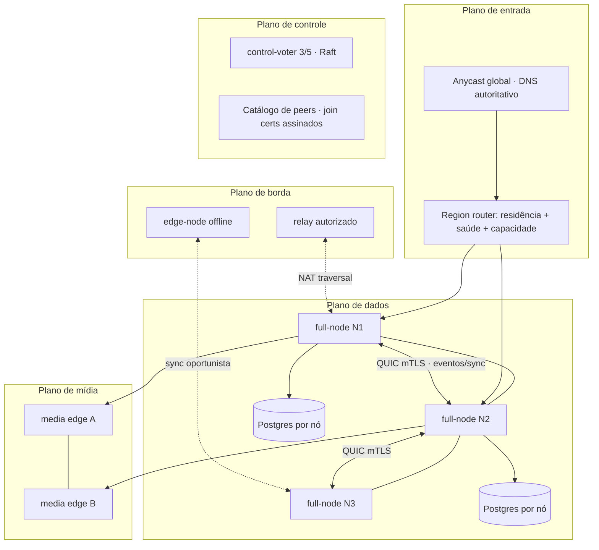

# Rede-alvo — desenho do CTO (proposta, não normativa)

> **Status:** **direção aprovada pelo usuário em 18/11/2026** (ADR-072) como alvo de arquitetura de rede. Cada item continua exigindo ADR própria antes de virar norma; este documento é o mapa, não a norma.
> **Pergunta que responde:** como eu desenharia a rede se pudesse escolher tudo do zero, dado o que o GodMesh precisa fazer.

## 1. O que "perfeita" significa aqui

"Perfeita" não é a rede mais elegante — é a que **falha do jeito certo** para este produto. Quatro requisitos dominam e entram em conflito entre si:

| Requisito | Consequência de projeto |
|---|---|
| SOS precisa funcionar quando tudo mais falha | reserva de capacidade, caminho independente, fila local, nada dependente de consenso |
| PTT precisa de latência baixa e contínua | afinidade de sessão a nó de mídia, migração de conexão, sem passar por banco |
| Localização é dado sensível | replicação escopada por finalidade, nunca "espelhar tudo" |
| Usuário global, base BR/CO | duas regiões reais, residência declarada, latência medida |

Toda escolha abaixo é tradeoff explícito contra um desses quatro.

## 2. Invariantes de rede (testáveis)

1. Nenhum pacote de mídia atravessa o event bus.
2. Nenhum nó recebe dado privado por padrão; recebe por escopo autorizado.
3. Ingresso de nó sempre tem assinatura de nó já autorizado.
4. Cliente nunca é relay permanente.
5. Toda decisão de rota é por serviço, não por "servidor está de pé".
6. Estado `unknown` nunca é promovido a sucesso por passagem de tempo.
7. Escrita sensível tem autoridade única com fencing; partição para, não duplica.
8. Endereço IP não é permissão; chave é.
9. Revogação é declarada por destino e por cópia, com epoch.
10. Orçamento de SOS é reservado e não é consumido por tráfego opcional.

## 3. Planos

**Cinco planos com fronteiras duras.** O erro clássico é juntar controle e dados no mesmo cluster: aí uma eleição de líder derruba PTT.

## 4. Topologia concreta

| Elemento | Desenho |
|---|---|
| Entrada global | anycast + DNS autoritativo com saúde real; roteia por **país de residência** primeiro, latência depois |
| Célula regional | 3 a 5 `full-node` atrás de um balanceador regional; mesma versão de software |
| Controle | 3 ou 5 `control-voter` em domínios de falha distintos; só governança passa por consenso |
| Mídia | `media edge` separado, com afinidade por sala e admissão; escala independente do HTTP |
| Borda | `edge-node` por região/operação isolada; fila offline própria |
| Relay | só autorizado, com quota, para nó atrás de NAT; nunca caminho padrão |

## 5. Transporte

- **QUIC com mTLS** entre nós; ALPN versionado; IPv6 preferencial com Happy Eyeballs.
- **Migração de conexão** do QUIC é o motivo principal: celular troca de rede no meio do PTT e não pode perder a sessão.
- **0-RTT só para tráfego idempotente e não sensível.** Para SOS, handshake completo — replay não vale 100 ms.
- **WebRTC** para voz no cliente web; RTP nunca dentro do barramento de eventos.
- TCP/TLS como fallback declarado, não como surpresa.

## 6. Roteamento de sessão

1. Cliente resolve região por residência → latência → saúde → capacidade.
2. Sessão de mídia fixa em um `media edge`; troca de edge só com renegociação explícita, não silenciosa.
3. Requisições de dados podem ir a qualquer nó da região; cursor é vinculado a `(tenant, stream, partição, epoch)`.
4. Admissão por classe: SOS reservado, PTT prioritário, sync e telemetria cedem.
5. Preempção só com prova de invalidação no controlador **e** no ponto de mídia.

## 7. Dados e consistência

- Autoridade por tenant/partição, com lease + epoch; nunca um banco global multi-writer.
- Outbox na transação do domínio; Inbox durável onde não há transação comum; ACK máximo `persisted_local`.
- Replicação: **eventos + snapshot escopado**, por classe e jurisdição. Conteúdo E2EE, áudio, posição e ASR não cruzam região sem autorização.
- Replay reconstrói projeção; nunca repete efeito externo irreversível.
- Conflito: `epoch` mais alto ganha em metadado; conteúdo de usuário segue a política do tenant, não "last write wins" cego.

## 8. Falha, por desenho

| Falha | Comportamento correto |
|---|---|
| Nó cai | peers marcam `unknown` após freshness; balanceador deixa de admitir novos; sessões existentes drenam |
| Região cai | roteamento global muda; classes não replicadas informam indisponibilidade — não fingem continuidade |
| Partição | nó isolado continua operação local autorizada; escrita sensível para; `stale/unknown` nega |
| Split brain | fencing no efetor (rádio, banco, mídia), não no coordenador |
| Banco lento | admission control e backpressure por classe; SOS não compete com telemetria |
| NAT | relay autorizado com quota; falha de relay é degradação declarada |

## 9. Segurança e privacidade na rede

- Cadeia: genesis configurado → aprovação assinada por nó autorizado → certificado verificável → revogação assinada com epoch.
- Nada de trust-on-first-use; nada de DNS ou relógio como autenticidade.
- E2EE de conteúdo (MLS) e de voz (SRTP) separado de mTLS de transporte: mTLS protege o enlace, não promete confidencialidade ponta a ponta.
- Toda perna que termina proteção (bridge, ASR, gravação) marca `confidentiality=terminated`.
- Localização: coarse por padrão, precisa só em SOS autorizado e auditado.

## 10. Observabilidade da rede

- Sinais por plano: entrada (admissão recusada, latência de rota), controle (idade do leader lease, quórum), dados (lag de replicação, profundidade de fila), mídia (jitter, perda, reconexão), borda (tempo offline, tamanho de fila).
- SLO por rota, não por nó. `unknown` é estado de primeira classe.
- Probes sintéticos por região e por classe (incluindo um SOS sintético periódico em ambiente de teste).

## 11. O que eu deliberadamente NÃO faria

| Anti-padrão | Por quê |
|---|---|
| Um cluster único global | latência, residência e blast radius |
| Consenso para tudo | eleição de líder derrubaria PTT |
| Gossip de dado privado | vaza topologia e conteúdo |
| Cliente como relay garantido | móvel suspende, navegador fecha |
| DNS como autenticidade | envenenamento vira ingresso |
| "Réplica de tudo" como padrão | custo e violação de privacidade |
| Retry infinito em mídia | amplifica congestionamento |

## 12. Custo honesto

Rede "perfeita" custa: duas regiões reais desde o início, mais superfície de observabilidade, testes de partição, e disciplina de não usar consenso onde não precisa. O que não custa é a ordem: identidade → ingresso assinado → transporte → sync escopado → mídia → borda.
